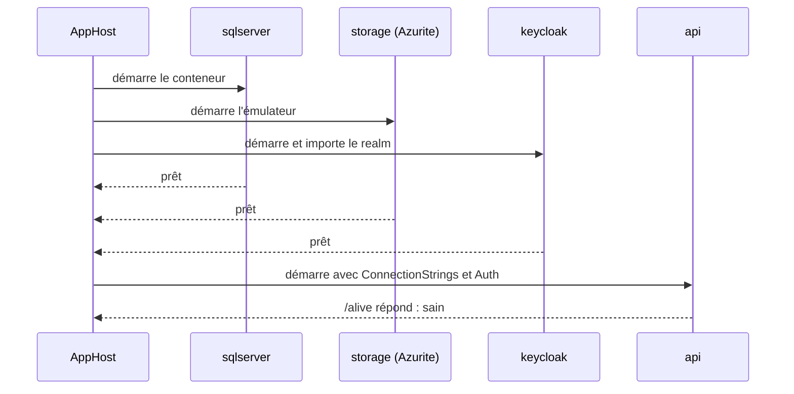

# AppHost

L'**AppHost** est le projet qui décrit, en C#, tout ce qu'Aspire doit démarrer. Cette page le lit ligne par ligne.

## Le concept simplement

Un AppHost est un programme console .NET ordinaire. Il crée un *builder* (`DistributedApplication.CreateBuilder`), y **déclare des ressources** (une base, un stockage, une API…), puis démarre l'ensemble avec `Build().Run()`. Chaque déclaration renvoie un objet que vous pouvez passer à la suivante : c'est ainsi que vous exprimez « l'API dépend de la base ».

Trois mots de vocabulaire :

| Terme | Sens |
|-------|------|
| **Ressource** | Un morceau du système : conteneur, projet .NET, paramètre, base de données. |
| **Référence** (`WithReference`) | « Cette application a besoin de cette ressource » : Aspire lui transmet sa chaîne de connexion. |
| **Attente** (`WaitFor`) | « Ne démarre pas cette application avant que cette ressource soit prête ». |

## Pourquoi c'est important

L'AppHost est la **source de vérité de l'environnement local**. Si un port, un mot de passe ou un ordre de démarrage doit changer, c'est ici. Le lire permet aussi de comprendre d'où viennent les chaînes de connexion de l'API, qui ne sont écrites dans aucun fichier de configuration du dépôt.

## Comment le template le fait

!!! info "Dans un projet généré"
    Les fichiers du dépôt sont la source du template. Dans un projet généré, `Web.Template.CQRS` est remplacé par le nom de votre projet (par exemple `Contoso.Orders.AppHost`). Le projet AppHost n'existe que si l'option Aspire (`EnableAspire`) est activée.

### Le projet et son SDK

```xml title="src/Web.Template.CQRS.AppHost/Web.Template.CQRS.AppHost.csproj"
--8<-- "src/Web.Template.CQRS.AppHost/Web.Template.CQRS.AppHost.csproj"
```

- `Sdk="Aspire.AppHost.Sdk/…"` : un SDK MSBuild spécial pour les AppHost. Il fournit l'outillage de build propre à Aspire (par exemple la génération d'une classe `Projects.<NomDuProjet>` pour les projets référencés ; le template n'en a pas besoin, car il désigne le projet de l'API par son chemin, voir plus bas).
- `OutputType` `Exe` : l'AppHost est un programme exécutable.
- Les trois `PackageReference` sont les **intégrations d'hébergement** : `Aspire.Hosting.SqlServer`, `Aspire.Hosting.Azure.Storage` et `Aspire.Hosting.Keycloak`. Elles apportent les méthodes `AddSqlServer`, `AddAzureStorage` et `AddKeycloak`. Leurs versions sont centralisées dans `Directory.Packages.props`.
- `UserSecretsId` : identifie le fichier de secrets de l'AppHost (voir [Paramètres et secrets](parametres-et-secrets.md)).

### Le point d'entrée

```csharp title="src/Web.Template.CQRS.AppHost/Program.cs"
--8<-- "src/Web.Template.CQRS.AppHost/Program.cs" start="using Aspire.Hosting;" end="CreateBuilder(args);"
```

`CreateBuilder` lit la configuration (arguments, variables d'environnement, User Secrets) et prépare l'enregistrement des ressources.

### SQL Server

```csharp title="src/Web.Template.CQRS.AppHost/Program.cs"
--8<-- "src/Web.Template.CQRS.AppHost/Program.cs" start="var sqlPassword" end="AddDatabase("
```

- `AddParameter("sql-password", secret: true)` déclare un **paramètre** nommé `sql-password`. `secret: true` signale qu'il ne doit pas apparaître en clair (dashboard, logs). Sa valeur est lue dans la configuration sous la clé `Parameters:sql-password` : ce sont les User Secrets.
- `AddSqlServer("sqlserver", password: sqlPassword)` démarre un **conteneur** SQL Server. `"sqlserver"` est le nom de la ressource (celui que vous voyez dans le dashboard). Le mot de passe est le paramètre déclaré juste avant.
- `WithDataVolume()` attache un **volume Docker** au conteneur : les fichiers de la base sont stockés dans ce volume, pas dans le conteneur.
- `WithLifetime(ContainerLifetime.Persistent)` demande à Aspire de **ne pas détruire** le conteneur à l'arrêt de l'AppHost. Le démarrage suivant est plus rapide et la base est conservée.
- `AddDatabase("projectdb")` déclare une **base logique** `projectdb` sur ce serveur. C'est elle que l'API utilise, et son nom (`projectdb`) devient le nom de la chaîne de connexion.

### Le stockage de blobs

```csharp title="src/Web.Template.CQRS.AppHost/Program.cs"
--8<-- "src/Web.Template.CQRS.AppHost/Program.cs" start="var blobs" end=".AddBlobs("
```

`AddAzureStorage("storage")` déclare un compte de stockage Azure. `RunAsEmulator()` indique « en local, ne contacte pas Azure : démarre l'émulateur **Azurite** dans un conteneur ». `AddBlobs("blobs")` expose le service Blob de ce compte sous le nom `blobs`. Voir [Émulateurs](emulateurs.md).

### Keycloak

```csharp title="src/Web.Template.CQRS.AppHost/Program.cs"
--8<-- "src/Web.Template.CQRS.AppHost/Program.cs" start="var keycloakAdminPassword" end="WithLifetime(ContainerLifetime.Persistent);"
```

- Un second paramètre secret porte le mot de passe de l'administrateur Keycloak.
- `AddKeycloak("keycloak", port: 8080, adminPassword: …)` démarre Keycloak et fixe son port sur l'hôte à **8080**. Un port fixe est nécessaire : l'API et les clients doivent connaître l'adresse du serveur d'identité à l'avance (`https://localhost:8080`), puisqu'elle figure dans les tokens comme **émetteur** (`iss`).
- `WithRealmImport("./Realms")` importe au démarrage les fichiers du dossier `Realms` : c'est ainsi que le realm `template`, ses clients et ses personas existent dès le premier lancement. L'import n'a lieu qu'au **premier démarrage d'un volume vide**.
- `WithDataVolume()` et `WithLifetime(ContainerLifetime.Persistent)` : mêmes rôles que pour SQL Server.

Pour le contenu du realm et la raison de ce choix, voir [Keycloak en local](../identite/keycloak-local.md).

### L'API

```csharp title="src/Web.Template.CQRS.AppHost/Program.cs"
--8<-- "src/Web.Template.CQRS.AppHost/Program.cs" start="var api" end="WithHttpHealthCheck("
```

- `AddProject("api", "../Web.Template.CQRS.Api/Web.Template.CQRS.Api.csproj")` déclare l'API comme un **projet .NET** (et non un conteneur), désigné par son chemin.
- `WithReference(projectDatabase)` et `WithReference(blobs)` **injectent les chaînes de connexion** dans l'API sous forme de variables d'environnement : `ConnectionStrings__projectdb` et `ConnectionStrings__blobs` (le double souligné `__` représente le `:` de la configuration .NET, soit `ConnectionStrings:projectdb`). L'API les lit sans rien savoir d'Aspire (voir plus bas).
- `WithReference(keycloak)` rend Keycloak connu de l'API (référence et dépendance déclarées dans le graphe de ressources).
- `WaitFor(sqlServer)`, `WaitFor(blobs)`, `WaitFor(keycloak)` : l'API ne démarre qu'une fois ces trois ressources prêtes. Sans cela, l'API tenterait de se connecter à une base qui n'a pas fini de démarrer.
- `WithEnvironment("Auth__Provider", "Keycloak")` (et `Auth__Authority`, `Auth__Audience`) définit à la main des variables d'environnement, ici la configuration d'authentification : l'API valide les tokens émis par le realm `template` pour l'audience `template-api`. Ces clés correspondent à la section `Auth` de la configuration (voir [Configuration](../reference/configuration.md)).
- `WithExternalHttpEndpoints()` rend les points d'accès HTTP de l'API accessibles depuis l'extérieur (votre navigateur, `curl`), et pas seulement depuis les autres ressources.
- `WithHttpHealthCheck("/alive")` demande à Aspire d'interroger `/alive` pour juger l'API saine. Cette route est fournie par `ServiceDefaults` (voir [Health checks](../fonctionnalites/health-checks.md)).

### Comment l'API lit ces chaînes

`AddInfrastructure` lit les deux clés `ConnectionStrings` que `WithReference` a remplies :

```csharp title="src/Web.Template.CQRS.Infrastructure/DependencyInjection.cs"
--8<-- "src/Web.Template.CQRS.Infrastructure/DependencyInjection.cs" start="var databaseConnectionString" end=".AddBlob(configuration);"
```

```csharp title="src/Web.Template.CQRS.Infrastructure/DependencyInjection.cs"
--8<-- "src/Web.Template.CQRS.Infrastructure/DependencyInjection.cs" start="var connectionString" end="AddBlobServiceClient(connectionString);"
```

`GetConnectionString("projectdb")` lit la clé `ConnectionStrings:projectdb`. Le code ne mentionne pas Aspire : en local, la valeur vient de l'AppHost ; une fois déployé, c'est à vous de la fournir (voir [Local et déployé](local-vs-deploye.md)). Pour le blob, la clé `blobs` est essayée en premier, puis `AzureBlobStorageConnectionString`.

### Le démarrage

```csharp title="src/Web.Template.CQRS.AppHost/Program.cs"
--8<-- "src/Web.Template.CQRS.AppHost/Program.cs" start="builder.Build()" end="builder.Build()"
```

`Build()` construit le graphe de ressources, `Run()` démarre tout et ne rend la main qu'à l'arrêt.



## À essayer

1. Dans `Program.cs`, retrouvez la ligne qui produit la variable `ConnectionStrings__projectdb`. Quel mot en détermine le nom `projectdb` ?
2. Supprimez (sans commit) `.WaitFor(keycloak)` et relancez : que montre le dashboard pour l'API ? Remettez la ligne ensuite.
3. Quelle est la différence entre `WithReference` et `WaitFor` ? Pourquoi le template utilise-t-il les deux ?
4. Pourquoi le port de Keycloak est-il fixé alors que celui de SQL Server ne l'est pas ?

## Pour aller plus loin

- [Documentation Aspire : modèle d'application](https://aspire.dev)
