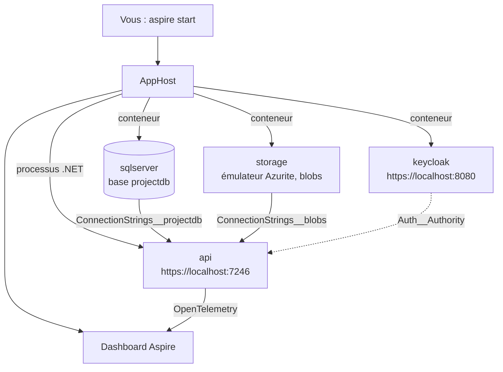

# Aspire

Cette section explique **Aspire**, l'outil qui orchestre l'application sur votre poste : quel problème il résout, comment le template l'utilise (l'AppHost, ligne par ligne), ce que sont les émulateurs, comment gérer les secrets, comment observer l'application, et ce qui change une fois déployé.

## Le concept simplement

### Le problème : lancer à la main

Pour faire tourner l'API du template, il faut plus que `dotnet run`. L'API a besoin :

- d'une **base SQL Server** (avec ses données qui doivent survivre d'un jour à l'autre) ;
- d'un **stockage de fichiers** compatible Azure Blob Storage ;
- d'un **serveur d'identité** (Keycloak) qui délivre les tokens ;
- de **mots de passe** pour tout cela, qui ne doivent pas se retrouver dans Git ;
- et de savoir, pour chacun, **où il écoute** : adresse, port, chaîne de connexion.

À la main, cela donne une page de commandes `docker run`, des chaînes de connexion à recopier dans des fichiers de configuration, un ordre de démarrage à respecter et des ports qui rentrent en conflit. Chaque nouveau développeur recommence ce parcours, et chacun finit avec une configuration légèrement différente.

### Ce qu'est Aspire

**Aspire** est un outil d'orchestration pour les applications composées de plusieurs morceaux (une API, une base, un stockage, un serveur d'identité). Vous décrivez en **C#** la liste des morceaux et leurs dépendances ; Aspire se charge de :

- démarrer les conteneurs et les projets .NET **dans le bon ordre** ;
- **injecter la configuration** (chaînes de connexion, URL) dans chaque application ;
- fournir un **dashboard** web qui affiche l'état, les logs, les traces et les métriques de tout ce qui tourne ;
- offrir un **CLI** (`aspire`) pour démarrer, arrêter et interroger l'ensemble.

L'analogie est celle d'un chef d'orchestre : il ne joue d'aucun instrument, mais il sait qui entre quand, et chacun reçoit sa partition.

### Ce qu'Aspire n'est pas

Aspire est d'abord un outil de **développement local**. Il ne remplace pas un hébergeur : en production, votre API tourne sur un service d'hébergement (App Service, Container Apps, Kubernetes…), avec de vraies ressources (Azure SQL, Azure Blob Storage, Entra ID). Le code de l'API reste identique, seule la **configuration** change. La page [Local et déployé](local-vs-deploye.md) donne la correspondance ressource par ressource.

## Pourquoi c'est important

- **Un démarrage en une commande** : `aspire start` suffit, sans notice d'installation de dix pages.
- **Le même environnement pour tous** : mêmes versions, mêmes ports, même realm Keycloak.
- **Aucune chaîne de connexion à copier** : Aspire les fabrique et les transmet à l'API.
- **De l'observabilité gratuite** : logs, traces et métriques sont visibles dès le premier lancement (voir [Observabilité](../fonctionnalites/observabilite.md)).

## Comment le template le fait

Le template contient deux projets Aspire, avec deux rôles distincts :

| Projet | Rôle | Qui l'exécute |
|--------|------|---------------|
| `Web.Template.CQRS.AppHost` | **Décrit** les ressources et lance l'ensemble. C'est le chef d'orchestre. | `aspire start` (ou `aspire run`) |
| `Web.Template.CQRS.ServiceDefaults` | Bibliothèque **référencée par l'API** : OpenTelemetry, health checks, résilience HTTP, service discovery. | l'API elle-même, au démarrage |

L'AppHost ne contient aucune logique métier : c'est un programme qui décrit une topologie. `ServiceDefaults` est la part de configuration que toute application d'un système Aspire partage ; l'API l'active en une ligne.

```csharp title="src/Web.Template.CQRS.Api/Program.cs"
--8<-- "src/Web.Template.CQRS.Api/Program.cs" start="builder.AddServiceDefaults();" end="builder.AddServiceDefaults();"
```

```csharp title="src/Web.Template.CQRS.ServiceDefaults/Extensions.cs"
--8<-- "src/Web.Template.CQRS.ServiceDefaults/Extensions.cs" start="public static TBuilder AddServiceDefaults" before="public static TBuilder ConfigureOpenTelemetry"
```

!!! info "Les lignes `#if` du dépôt"
    Le dépôt est la source du template : `Program.cs` entoure ces appels d'un `#if (EnableAspire)`. Dans un projet généré, seules les branches correspondant à vos options sont conservées ; sans l'option Aspire, les projets AppHost et ServiceDefaults n'existent pas.

### Les ressources du template



Chaque nœud est une **ressource** Aspire. Le détail de leur déclaration se trouve dans [AppHost](apphost.md).

## À essayer

1. Ouvrez `src/Web.Template.CQRS.AppHost/Program.cs` et comptez les ressources déclarées. Retrouvez-les dans le schéma ci-dessus.
2. Cherchez dans `src/Web.Template.CQRS.ServiceDefaults/Extensions.cs` la ligne qui active l'export vers Application Insights. Sous quelle condition s'exécute-t-elle ?
3. Dans ce template, l'AppHost sert uniquement au développement local. Qu'est-ce qui remplace chaque ressource une fois déployé ? (Réponse dans [Local et déployé](local-vs-deploye.md).)

## Pour aller plus loin

- [Documentation officielle d'Aspire](https://aspire.dev)
