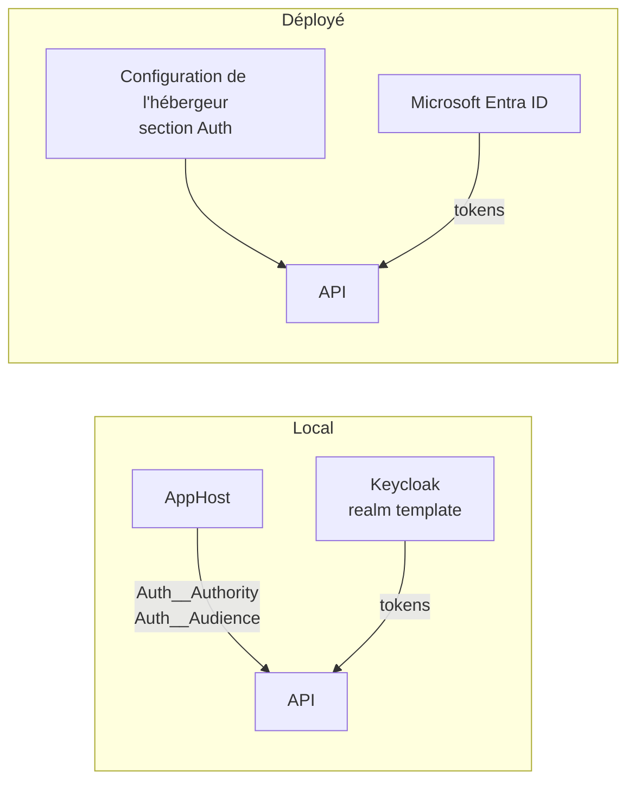

# Local et déployé

Cette page compare, ressource par ressource, ce que fait Aspire en local et ce que vous devez fournir une fois l'application déployée.

## Le concept simplement

En local, **Aspire fabrique la configuration** : il démarre les ressources, puis écrit pour l'API les chaînes de connexion et les adresses. Une fois déployée, l'API tourne sur un hébergeur sans AppHost : plus personne ne lui fournit ces valeurs. Il faut donc les lui donner **explicitement**, sous les mêmes noms de clés, mais avec les valeurs des vrais services.

Le code de l'API ne change pas : il lit `ConnectionStrings:projectdb`, `Auth:Authority`… sans savoir d'où ils viennent.

!!! info "Aspire et le déploiement"
    Le CLI Aspire propose des commandes de publication et de déploiement (`aspire publish`, `aspire deploy`, signalées comme préversion par le CLI). Le template ne les utilise pas et ne contient pas de script de déploiement : il décrit la **configuration à fournir**, pas la création des ressources Azure. Voir [Configurer un déploiement](../guides/configurer-un-deploiement.md).

## Pourquoi c'est important

Une application qui fonctionne en local et échoue au déploiement vient presque toujours d'une valeur de configuration absente ou erronée. Savoir quelle clé remplace quelle ressource réduit le diagnostic à une lecture de tableau.

## Comment le template le fait

### Correspondance ressource par ressource

| Ressource | En local (Aspire) | Une fois déployé | Configuration à fournir |
|-----------|-------------------|------------------|-------------------------|
| Base de données | conteneur SQL Server, base `projectdb` | Azure SQL (ou tout SQL Server accessible) | `ConnectionStrings:projectdb` (variable d'environnement `ConnectionStrings__projectdb`) |
| Fichiers | émulateur Azurite, service `blobs` | Azure Blob Storage | `ConnectionStrings:blobs` (ou, à défaut, `ConnectionStrings:AzureBlobStorageConnectionString`) ; nom du conteneur : `BlobSettings:ContainerName` (`uploads` par défaut) |
| Identité | Keycloak, realm `template` | Microsoft Entra ID | section `Auth` : `Provider` = `Entra`, `Instance`, `TenantId`, `ClientId`, `Audience`, `OpenApiClientId`, `OpenApiScope` ; `Authorization:Groups:Administrators` si les groupes sont activés |
| Télémétrie | dashboard Aspire (OpenTelemetry) | Application Insights | `APPLICATIONINSIGHTS_CONNECTION_STRING` |
| Secrets | User Secrets de l'AppHost | magasin de secrets de l'hébergeur (par exemple Azure Key Vault ou paramètres sécurisés de l'application) | les mêmes clés que ci-dessus, jamais dans le dépôt |
| CORS | `http://localhost:4200` (fichier de configuration de développement) | l'origine de votre front | `Cors:AllowedOrigins` |
| Health checks | `/alive` et `/health` exposés | **non exposés** hors développement | voir ci-dessous |

Le double souligné des variables d'environnement (`ConnectionStrings__projectdb`) équivaut au `:` des clés de configuration. Les valeurs vides de `appsettings.json` (par exemple `"projectdb": ""`) sont là pour rappeler qu'elles doivent être renseignées par l'environnement.

!!! warning "Les health checks ne sont pas exposés en production"
    `MapDefaultEndpoints()` ne mappe `/health` et `/alive` que dans les environnements `Development` et `Testing`. Si votre hébergeur a besoin d'une sonde HTTP, il faut adapter ce comportement en connaissance de cause (voir [Health checks](../fonctionnalites/health-checks.md)).

```csharp title="src/Web.Template.CQRS.ServiceDefaults/Extensions.cs"
--8<-- "src/Web.Template.CQRS.ServiceDefaults/Extensions.cs" start="if (app.Environment.IsDevelopment()" end="return app;"
```

### Télémétrie : du dashboard à Application Insights

Le même code d'instrumentation sert partout. Selon la configuration reçue, `ConfigureOpenTelemetry` choisit la destination :

```csharp title="src/Web.Template.CQRS.ServiceDefaults/Extensions.cs"
--8<-- "src/Web.Template.CQRS.ServiceDefaults/Extensions.cs" start="var hasOtlpEndpoint" before="return builder;"
```

- En local, Aspire définit `OTEL_EXPORTER_OTLP_ENDPOINT` : la télémétrie va au dashboard.
- Sur Azure, vous définissez `APPLICATIONINSIGHTS_CONNECTION_STRING` : elle va à Application Insights. Le détail (tables, requêtes KQL) est dans [Observabilité](../fonctionnalites/observabilite.md#en-production-application-insights).

### Identité : de Keycloak à Entra ID



En local, l'AppHost fixe `Auth__Provider=Keycloak`, l'autorité (`https://localhost:8080/realms/template`) et l'audience (`template-api`). Déployée, l'API passe en `Provider` = `Entra` et reçoit les identifiants de votre application Entra. La table complète des clés locales et déployées, avec la configuration d'Entra ID, se trouve dans [Configuration locale et déployée](../identite/local-vs-deploye.md).

## À essayer

1. Listez les clés de configuration que l'API lit pour la base et le stockage (`src/Web.Template.CQRS.Infrastructure/DependencyInjection.cs`). Lesquelles Aspire fournit-il en local ?
2. Vous déployez l'API et elle échoue au démarrage avec une erreur de connexion à la base. Quelle variable d'environnement vérifiez-vous en premier ?
3. Pourquoi `/alive` ne répond-il pas sur une API déployée en `Production` ? Où le code le décide-t-il ?
4. Où va la télémétrie de l'API si ni `OTEL_EXPORTER_OTLP_ENDPOINT` ni `APPLICATIONINSIGHTS_CONNECTION_STRING` n'est défini ?

## Pour aller plus loin

- [Configuration d'ASP.NET Core](https://learn.microsoft.com/aspnet/core/fundamentals/configuration/)
- [Application Insights avec OpenTelemetry](https://learn.microsoft.com/azure/azure-monitor/app/opentelemetry-enable)
