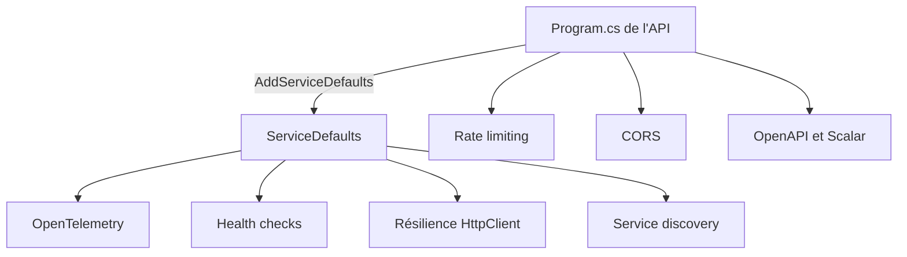

# Fonctionnalités

Cette section présente les fonctionnalités **transverses** du template : celles qui ne concernent pas un cas d'usage métier en particulier, mais toute l'API. Elles sont déjà configurées dans le projet généré ; chaque page explique ce que la fonctionnalité apporte, comment le code la met en place et comment la modifier.

## Vue d'ensemble

| Fonctionnalité | Rôle en une phrase | Où elle est configurée | Option qui l'active |
|----------------|--------------------|------------------------|---------------------|
| [Observabilité](observabilite.md) | voir ce que fait l'application : logs, traces, métriques | `ServiceDefaults/Extensions.cs` (`ConfigureOpenTelemetry`), `Api/Observability/RequestLoggingScopeMiddleware.cs` | le scope de logs est toujours présent ; OpenTelemetry arrive avec Aspire (`EnableAspire`) |
| [Health checks](health-checks.md) | permettre à un orchestrateur de savoir si l'application est vivante | `ServiceDefaults/Extensions.cs` (`AddDefaultHealthChecks`, `MapDefaultEndpoints`) | `EnableAspire` |
| [Rate limiting](rate-limiting.md) | limiter le nombre de requêtes par utilisateur | `Api/Common/RateLimiting/` | `EnableRateLimiting` |
| [Résilience et service discovery](resilience-et-service-discovery.md) | rendre les appels HTTP sortants robustes et trouver les autres services par leur nom | `ServiceDefaults/Extensions.cs` (`AddServiceDefaults`) | `EnableAspire` |
| [OpenAPI et Scalar](openapi-et-scalar.md) | décrire l'API et l'essayer depuis le navigateur | `Api/Configuration/OpenApiExtensions.cs`, `Api/Authentication/ScalarOAuth2.cs`, `Program.cs` | toujours présent, exposé en Development seulement |
| [CORS](cors.md) | autoriser un front-end d'une autre origine à appeler l'API | `Program.cs`, clé `Cors:AllowedOrigins` des `appsettings` | toujours présent |

Les noms d'options sont ceux du `dotnet new` : voir [Options du template](../reference/options-du-template.md) pour la liste complète et la façon de les choisir.

## Comment elles s'assemblent

Le projet `ServiceDefaults` regroupe la configuration partagée par tous les services (OpenTelemetry, health checks, résilience, découverte de services). L'API l'active en une ligne, `builder.AddServiceDefaults()`. Le reste (limitation de débit, CORS, OpenAPI) est configuré directement dans le projet `Api`.

!!! info "Les lignes `#if` du dépôt"
    Le code du dépôt est la source du template : il contient des directives comme `#if (EnableAspire)`. Dans un projet généré, seules les branches correspondant à vos options sont conservées. Si vous désactivez `EnableAspire`, les projets `AppHost` et `ServiceDefaults` n'existent pas, et avec eux l'export OpenTelemetry, les health checks et la résilience par défaut.

## Dans quel ordre les lire

1. Commencez par l'[Observabilité](observabilite.md) : c'est la plus riche, et elle sert à comprendre toutes les autres (un refus 429 ou une erreur 500 se retrouvent grâce au `traceId`).
2. Poursuivez avec les [Health checks](health-checks.md) et la [Résilience](resilience-et-service-discovery.md), qui partagent le même fichier.
3. Terminez par le [Rate limiting](rate-limiting.md), [OpenAPI et Scalar](openapi-et-scalar.md) et le [CORS](cors.md).
