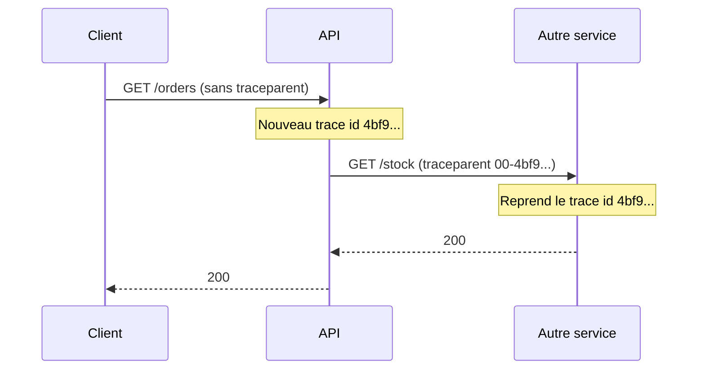
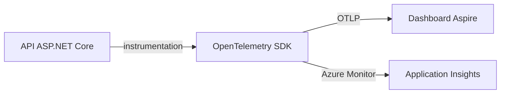
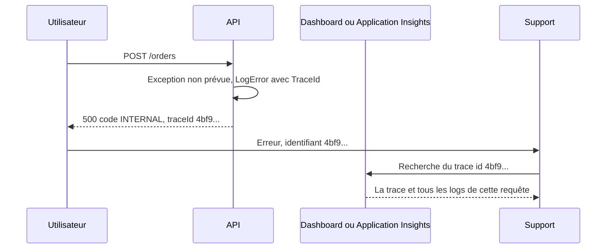

# Observabilité

Cette page est un cours complet sur l'observabilité : comprendre ce qui se passe dans une application en production sans y brancher un débogueur. Vous y verrez les concepts (logs, traces, métriques, identifiant de corrélation, OpenTelemetry), puis comment le template les met en oeuvre et comment s'en servir dans le dashboard Aspire et dans Application Insights.

## Le concept simplement

### Pourquoi « observer » une application

En développement, vous posez un point d'arrêt et vous regardez. En production, c'est impossible : des milliers de requêtes passent en parallèle, sur des serveurs que vous ne contrôlez pas, et le problème a eu lieu hier à 3 h du matin. Une application est dite **observable** quand elle émet assez d'informations pour que vous puissiez répondre, **après coup**, à des questions que vous n'aviez pas prévues.

Prenons l'analogie d'une voiture. Le **tableau de bord** vous donne des chiffres en continu : vitesse, température, niveau de carburant. Le **carnet d'entretien** raconte les événements un par un : « vidange faite le 3 mars, plaquettes changées le 12 juin ». Enfin, pour un colis envoyé par transporteur, le **suivi de colis** retrace le parcours complet : entrepôt, tri, camion, livreur, avec l'heure de chaque étape. Ces trois outils sont les trois **piliers** de l'observabilité.

| Pilier | Analogie | Question à laquelle il répond | Forme |
|--------|----------|-------------------------------|-------|
| **Métriques** | le tableau de bord | « Combien ? À quelle vitesse ? Est-ce que ça se dégrade ? » | des nombres agrégés dans le temps (requêtes par seconde, mémoire utilisée) |
| **Logs** | le carnet d'entretien | « Que s'est-il passé exactement à cet instant ? » | des événements horodatés, un par ligne |
| **Traces** | le suivi de colis | « Par où cette requête est-elle passée, et où a-t-elle perdu du temps ? » | un arbre d'étapes chronométrées pour une requête |

Aucun pilier ne suffit seul. La métrique vous dit que les erreurs 500 augmentent. La trace vous montre quelle étape est lente ou en échec. Le log vous donne le détail de l'exception. Le travail de l'observabilité consiste à **passer de l'un à l'autre** : c'est le rôle de l'identifiant de corrélation, vu plus bas.

### Logs structurés et logs texte

Un log **texte** est une phrase : `Utilisateur 42 a créé la commande 1337`. Pour retrouver toutes les commandes de l'utilisateur 42, il faut une recherche de texte fragile.

Un log **structuré** garde la phrase **et** ses données séparément. En .NET, on écrit un *modèle de message* avec des paramètres nommés, et non une chaîne déjà assemblée :

```csharp
// Structuré : UserId et OrderId deviennent des champs interrogeables
logger.LogInformation("User {UserId} created order {OrderId}", userId, orderId);

// À éviter : l'information est noyée dans le texte
logger.LogInformation($"User {userId} created order {orderId}");
```

Dans le premier cas, l'outil de logs stocke `UserId = 42` et `OrderId = 1337` comme des champs, et vous pouvez filtrer « tous les logs où `UserId` vaut 42 ». C'est ce qui rend possible la corrélation décrite plus bas.

### Trace, span et `Activity`

Une **trace** représente le parcours complet d'une requête. Elle est composée de **spans** : un span est une étape chronométrée (« traiter la requête HTTP », « exécuter la requête SQL », « appeler le service de paiement »). Les spans sont imbriqués : le span HTTP contient le span SQL. Chacun a un début, une durée, des **tags** (des paires clé-valeur, comme `http.response.status_code = 500`) et un statut (succès ou erreur).

En .NET, un span s'appelle une **`Activity`** (espace de noms `System.Diagnostics`). `Activity.Current` désigne l'étape en cours d'exécution pour la requête courante. OpenTelemetry (voir plus bas) se contente de collecter ces `Activity` et de les envoyer ailleurs.

Chaque trace porte un identifiant, le **trace id** : 32 caractères hexadécimaux, par exemple `4bf92f3577b34da6a3ce929d0e0e4736`. Chaque span a en plus son propre **span id** de 16 caractères.

## Pourquoi c'est important

- **Diagnostiquer un incident sans le reproduire** : l'utilisateur dit « ça a planté hier », vous remontez de la réponse d'erreur jusqu'à l'exception exacte.
- **Comprendre la lenteur** : une trace montre que 90 % du temps d'une requête est passé dans un appel SQL, pas dans votre code.
- **Voir les problèmes avant les utilisateurs** : les métriques permettent d'alerter sur un taux d'erreurs ou une latence anormale.
- **Suivre une requête à travers plusieurs services** : dès que votre API en appelle une autre, une seule requête utilisateur produit des logs dans deux applications. Sans identifiant commun, impossible de les relier.

## Le problème de la corrélation

Imaginez le journal de votre API pendant une heure chargée :

```text
10:02:11 INFO  Début du traitement
10:02:11 INFO  Début du traitement
10:02:11 INFO  Lecture de la commande 17
10:02:12 ERROR Échec de la lecture : timeout
10:02:12 INFO  Fin du traitement
```

Les requêtes s'exécutent en parallèle et leurs lignes s'entremêlent. **Quelle ligne appartient à quelle requête ?** Laquelle des deux a échoué ? Impossible à dire.

La solution est l'**identifiant de corrélation** (*correlation id*) : on attribue un identifiant unique à chaque requête dès son arrivée, et on l'ajoute à **chaque** ligne de log, à chaque span et à la réponse d'erreur. Il suffit alors de filtrer sur cet identifiant pour reconstituer l'histoire d'une seule requête :

```text
10:02:11 [a1b2...] INFO  Début du traitement
10:02:11 [c3d4...] INFO  Début du traitement
10:02:11 [c3d4...] INFO  Lecture de la commande 17
10:02:12 [c3d4...] ERROR Échec de la lecture : timeout
10:02:12 [a1b2...] INFO  Fin du traitement
```

Le template n'invente pas un identifiant maison. Il réutilise le **trace id** de la trace en cours : un seul identifiant relie les logs, la trace et la réponse d'erreur.

### L'identifiant de trace W3C et `traceparent`

Quand une requête traverse plusieurs services, chacun doit réutiliser **le même** trace id. Le standard **W3C Trace Context** définit pour cela un en-tête HTTP, `traceparent`, composé de quatre champs séparés par des tirets :

```text
traceparent: 00-4bf92f3577b34da6a3ce929d0e0e4736-00f067aa0ba902b7-01
```

| Champ | Exemple | Rôle |
|-------|---------|------|
| version | `00` | version du format |
| trace id | `4bf92f35...4736` (32 hex) | identifie toute la trace, identique dans tous les services |
| span id parent | `00f067aa0ba902b7` (16 hex) | le span de l'appelant, dont le nouveau span sera l'enfant |
| drapeaux | `01` | `01` signifie que la trace est échantillonnée (conservée) |

Le comportement est le suivant :

1. Si la requête entrante porte un `traceparent`, ASP.NET Core **reprend** le trace id reçu et crée un nouveau span enfant.
2. Sinon, il **génère** un nouveau trace id.
3. Quand l'API appelle un autre service avec `HttpClient`, l'instrumentation OpenTelemetry **ajoute** automatiquement l'en-tête `traceparent` à l'appel sortant.



Résultat : les logs et les spans des deux services partagent le même trace id `4bf9...`, et les outils d'observabilité reconstruisent la trace complète.

### `TraceId` ou `TraceIdentifier` ?

Deux notions se ressemblent dans le code du template, et il ne faut pas les confondre :

| | `Activity.Current.TraceId` | `HttpContext.TraceIdentifier` |
|---|---|---|
| Origine | standard W3C, géré par `System.Diagnostics` | propre à ASP.NET Core |
| Forme | 32 caractères hexadécimaux | texte propre au serveur (de la forme `0HN...:00000001`) |
| Traverse les services | oui, via `traceparent` | non, il ne vaut que pour la requête locale |
| Reconnu par les outils (Aspire, Application Insights) | oui | non |

Le template préfère toujours le premier et ne retombe sur le second que si aucune `Activity` n'existe (c'est le sens de l'expression `Activity.Current?.TraceId.ToString() ?? context.TraceIdentifier` que vous verrez dans le code). Les deux sont journalisés, sous les noms `TraceId` et `RequestId`.

## OpenTelemetry

**OpenTelemetry** (souvent abrégé OTel) est un standard ouvert pour produire et exporter logs, traces et métriques. Il sépare deux responsabilités :

- **Instrumenter** : l'application (ou une bibliothèque) émet de la télémétrie. ASP.NET Core, `HttpClient` et le runtime .NET s'y prêtent, il suffit d'activer leur instrumentation.
- **Exporter** : envoyer cette télémétrie vers un backend. Le protocole standard s'appelle **OTLP**. Changer de backend se fait en configuration, sans modifier le code applicatif.

C'est cet avantage qui compte : vous n'êtes lié à aucun fournisseur. Localement, la télémétrie part vers le dashboard Aspire (en OTLP) ; en production sur Azure, vers Application Insights (par l'exportateur Azure Monitor).



## Comment le template le fait

!!! info "Les lignes `#if` du dépôt"
    Dans le dépôt template, des fichiers contiennent des directives `#if (EnableAspire)`. Le projet `ServiceDefaults` n'existe dans un projet généré que si l'option Aspire est activée (voir [Options du template](../reference/options-du-template.md)). Seules les branches correspondant à vos options subsistent.

### `ConfigureOpenTelemetry`

Toute la configuration vit dans le projet `ServiceDefaults`, méthode `ConfigureOpenTelemetry`. Elle est appelée par `AddServiceDefaults()` depuis le `Program.cs` de l'API. La première moitié branche les logs, les métriques et les traces :

```csharp title="src/Web.Template.CQRS.ServiceDefaults/Extensions.cs"
--8<-- "src/Web.Template.CQRS.ServiceDefaults/Extensions.cs" start="builder.Logging.AddOpenTelemetry" before="var hasOtlpEndpoint"
```

Ce qu'il faut retenir :

- **Logs** : `IncludeFormattedMessage` envoie aussi le message déjà rempli, et `IncludeScopes` envoie les *scopes* de log (voir plus bas), donc `TraceId`, `RequestId` et `Endpoint`.
- **Métriques** : instrumentation d'ASP.NET Core (durée des requêtes), de `HttpClient` (appels sortants) et du runtime (mémoire, ramasse-miettes), plus un compteur nommé d'après l'application (`AddMeter`).
- **Traces** : instrumentation d'ASP.NET Core et de `HttpClient`. C'est elle qui lit et écrit l'en-tête `traceparent`.
- **Filtrage** : les requêtes vers `/health` et `/alive` sont **exclues** des traces. Un orchestrateur les appelle toutes les quelques secondes ; sans filtre, ces appels noieraient les vraies requêtes. Voir [Health checks](health-checks.md).

La seconde moitié choisit où envoyer la télémétrie, **selon la configuration** :

```csharp title="src/Web.Template.CQRS.ServiceDefaults/Extensions.cs"
--8<-- "src/Web.Template.CQRS.ServiceDefaults/Extensions.cs" start="var hasOtlpEndpoint" before="return builder;"
```

| Variable de configuration | Effet |
|---------------------------|-------|
| `OTEL_EXPORTER_OTLP_ENDPOINT` | active l'export **OTLP** vers cette adresse. Aspire la renseigne pour les projets qu'il lance, ce qui alimente son dashboard. |
| `APPLICATIONINSIGHTS_CONNECTION_STRING` | active l'export vers **Azure Monitor** (Application Insights). |

Sans l'une ni l'autre, l'application tourne normalement et n'exporte rien. Les deux peuvent aussi être actives en même temps.

### Le scope de logs : `RequestLoggingScopeMiddleware`

Un **scope** de log est un contexte attaché à toutes les lignes écrites tant qu'il est ouvert (`BeginScope` dans un bloc `using`). C'est le mécanisme qui ajoute le trace id à chaque log de la requête, sans que chaque développeur ait à y penser :

```csharp title="src/Web.Template.CQRS.Api/Observability/RequestLoggingScopeMiddleware.cs"
--8<-- "src/Web.Template.CQRS.Api/Observability/RequestLoggingScopeMiddleware.cs"
```

Le middleware fait trois choses pour chaque requête :

1. Il détermine le `traceId` (`Activity.Current`, sinon `TraceIdentifier`) et le nom de l'endpoint (`unmatched` si aucun endpoint ne correspond).
2. Il ajoute à la trace le tag **`app.endpoint`**, utile pour filtrer les spans par endpoint.
3. Il ouvre un scope avec `TraceId`, `RequestId` et `Endpoint` autour de `await next(context)` : tout ce qui est journalisé plus loin dans le pipeline (handlers, validation, accès aux données) hérite de ces trois champs.

Dans `Program.cs`, il est enregistré **après** l'authentification et **avant** le limiteur de débit et l'autorisation. Les refus de ces deux étapes sont donc eux aussi journalisés avec leur `TraceId`.

### Le `traceId` dans les erreurs

Chaque réponse Problem Details contient le champ `traceId`, rempli par `Program.cs` pour toutes les erreurs :

```csharp title="src/Web.Template.CQRS.Api/Program.cs"
--8<-- "src/Web.Template.CQRS.Api/Program.cs" start="builder.Services.AddProblemDetails(" before="builder.Services.AddCors("
```

Le format de ces réponses est expliqué dans [Erreurs et Problem Details](../architecture/erreurs-et-problem-details.md). Ce qui compte ici : ce champ est la **passerelle entre le client et vos outils**. L'utilisateur ne voit jamais l'exception, mais il peut vous transmettre un identifiant.



Le gestionnaire d'erreurs journalise l'exception complète avec ce même `traceId` : le détail reste côté serveur, le client ne reçoit que l'identifiant.

## Lire la télémétrie dans le dashboard Aspire

Quand vous lancez le projet avec Aspire (voir [Premier lancement](../demarrer/premier-lancement.md)), le dashboard est servi à l'adresse affichée au démarrage. La ressource de l'API s'appelle `api`. Trois pages vous intéressent :

- **Logs structurés** : un tableau de lignes de log, filtrable par ressource, gravité et texte. Ouvrez une ligne pour voir ses attributs, dont les champs du scope (`TraceId`, `RequestId`, `Endpoint`). Un lien mène à la trace correspondante.
- **Traces** : la liste des requêtes, avec leur durée et leur statut. Ouvrir une trace affiche les spans en cascade : la requête HTTP au sommet, puis ses appels sortants et ses accès aux données en dessous. Les traces en erreur sont signalées.
- **Métriques** : les compteurs et histogrammes de la ressource, par exemple la durée des requêtes HTTP.

Le geste à connaître est le **va-et-vient** entre logs et traces : depuis une trace, vous affichez les logs de cette trace ; depuis un log, vous suivez le lien vers sa trace.

### Interroger la télémétrie depuis le terminal

Le CLI Aspire expose les mêmes données, utile pour un script ou pour un assistant de code. L'application doit être lancée (voir [Dashboard et CLI](../aspire/dashboard-et-cli.md)) :

```bash
# Les logs structurés de l'API, les erreurs seulement
aspire otel logs api --severity Error

# Tous les logs d'un trace id donné
aspire otel logs api --trace-id 4bf92f3577b34da6a3ce929d0e0e4736

# Les traces de l'API qui ont échoué
aspire otel traces api --has-error

# Une trace précise
aspire otel traces api --trace-id 4bf92f3577b34da6a3ce929d0e0e4736
```

Les options `--format Json`, `--limit` (`-n`) et `--search` sont aussi disponibles. `aspire otel spans`, `aspire logs` (les sorties console des ressources) et `aspire describe` (l'état des ressources) complètent la boîte à outils.

## En production : Application Insights

Sur Azure, définissez `APPLICATIONINSIGHTS_CONNECTION_STRING` (par exemple dans la configuration de l'application hébergée) et la même télémétrie arrive dans **Application Insights**. Le trace id y porte le nom **`operation_Id`**. Dans l'onglet **Logs** de la ressource, le langage de requêtes est le **KQL** (*Kusto Query Language*) : on part d'une table et on enchaîne des filtres avec `|`.

Les tables utiles :

| Table | Contenu |
|-------|---------|
| `requests` | une ligne par requête HTTP reçue par l'API |
| `dependencies` | les appels sortants (HTTP, SQL, stockage) |
| `traces` | les logs applicatifs |
| `exceptions` | les exceptions journalisées |

Retrouver la requête d'un utilisateur à partir du `traceId` de son erreur :

```text
requests
| where operation_Id == "4bf92f3577b34da6a3ce929d0e0e4736"
```

Voir ensuite **tout** ce qui s'est passé pendant cette requête, dans l'ordre :

```text
union requests, dependencies, traces, exceptions
| where operation_Id == "4bf92f3577b34da6a3ce929d0e0e4736"
| order by timestamp asc
```

Trouver les requêtes lentes ou en échec de la dernière heure :

```text
requests
| where timestamp > ago(1h) and (success == false or duration > 2s)
| order by duration desc
| take 20
```

!!! tip "Le réflexe support"
    Face à un utilisateur qui signale une erreur : demandez le `traceId` de la réponse, collez-le dans la première requête ci-dessus, et vous avez la requête, ses appels sortants et ses logs. Sans ce champ, il faudrait deviner à partir d'une heure approximative.

## À essayer

Lancez le projet avec Aspire (voir [Premier lancement](../demarrer/premier-lancement.md)), puis :

1. Provoquez une 401 en appelant un endpoint protégé **sans** jeton, puis notez le champ `traceId` du corps de la réponse :
   ```bash
   curl -ik https://localhost:7246/me
   ```
2. Dans le dashboard Aspire, ouvrez **Traces**, ressource `api`, et retrouvez la requête `GET /me` à l'heure de votre appel. Quel est son statut ? Combien de spans contient-elle ?
3. Ouvrez la page **Logs structurés** et cherchez votre `traceId`. Quels champs du scope (`TraceId`, `RequestId`, `Endpoint`) voyez-vous ?
4. Faites le même chemin depuis le terminal : `aspire otel traces api --trace-id <votre traceId>` puis `aspire otel logs api --trace-id <votre traceId>`.
5. Récupérez un jeton valide (voir [Premier lancement](../demarrer/premier-lancement.md)), appelez `/me`, et comparez la trace d'une requête réussie avec celle de la 401.
6. Question : pourquoi les appels à `/alive` n'apparaissent-ils pas dans les traces ? Où le code l'explique-t-il ?

## Pour aller plus loin

- [OpenTelemetry, documentation officielle](https://opentelemetry.io/docs/)
- [W3C Trace Context](https://www.w3.org/TR/trace-context/)
- [Observabilité .NET avec OpenTelemetry (Microsoft Learn)](https://learn.microsoft.com/dotnet/core/diagnostics/observability-with-otel)
- [Application Insights avec OpenTelemetry (Microsoft Learn)](https://learn.microsoft.com/azure/azure-monitor/app/opentelemetry-enable)
