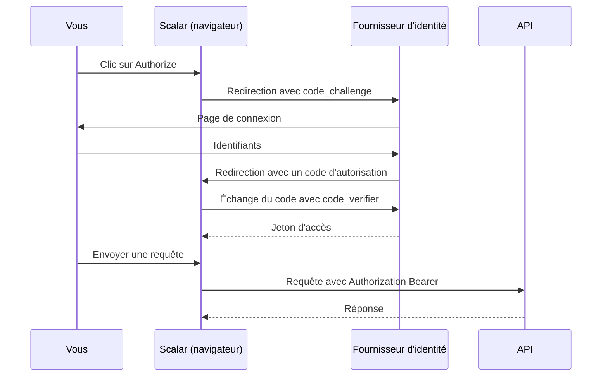

# OpenAPI et Scalar

Cette page explique comment le template décrit son API dans un document standard (OpenAPI) et comment il propose une interface (Scalar) pour l'explorer et l'appeler depuis le navigateur, en s'authentifiant par OAuth2.

## Le concept simplement

**OpenAPI** est un format standard (JSON) qui décrit une API HTTP : ses routes, les paramètres, les formes des corps de requête et de réponse, les codes d'erreur et la façon de s'authentifier. C'est le **contrat** de l'API, lisible par des machines.

**Scalar** est une interface web qui lit ce document et affiche une documentation interactive : vous voyez les endpoints, vous remplissez des paramètres, vous cliquez sur « Envoyer ». C'est le même rôle que Swagger UI.

## Pourquoi c'est important

- **Une documentation toujours à jour** : le document est généré depuis le code, il ne peut pas dériver.
- **Un contrat partagé** : une équipe front-end peut générer un client typé (TypeScript, C#) à partir du document.
- **Essayer sans outil externe** : tester un endpoint protégé sans écrire de `curl` ni copier un jeton à la main.
- **Un test de compréhension** : si un endpoint est difficile à décrire, il est souvent mal conçu.

## Comment le template le fait

### Le document `/openapi/v1.json`

Le document est produit par le support OpenAPI intégré à ASP.NET Core. `AddOpenApiExtensions` le configure avec deux **transformers** : des fonctions qui retouchent le document généré.

```csharp title="src/Web.Template.CQRS.Api/Configuration/OpenApiExtensions.cs"
--8<-- "src/Web.Template.CQRS.Api/Configuration/OpenApiExtensions.cs"
```

- Le **transformer d'opération** s'exécute pour chaque endpoint. Si l'endpoint n'est pas marqué `AllowAnonymous`, il lui ajoute une exigence de sécurité : « ce endpoint demande le schéma `OAuth2` ». C'est ce qui fait apparaître un cadenas dans Scalar et lui fait envoyer le jeton.
- Le **transformer de document** s'exécute une fois. Il fixe le titre, vide la liste des serveurs (pour que Scalar appelle l'adresse d'où il est servi) et déclare le schéma de sécurité **OAuth2 Authorization Code**, avec l'URL d'autorisation, l'URL du jeton et les scopes.

### Les URL selon le fournisseur d'identité

Les URL et le `ClientId` dépendent du fournisseur configuré (Keycloak en local, Entra ID en déploiement). `ScalarOAuth2` les calcule à partir de `AuthOptions` :

```csharp title="src/Web.Template.CQRS.Api/Authentication/ScalarOAuth2.cs"
--8<-- "src/Web.Template.CQRS.Api/Authentication/ScalarOAuth2.cs"
```

Pour Keycloak, le client est `template-scalar` et les scopes sont `openid`, `profile` et `email`. Pour Entra ID, le client et le scope viennent de `OpenApiClientId` et `OpenApiScope` dans la configuration (voir [Entra ID](../identite/entra-id.md) et [Keycloak en local](../identite/keycloak-local.md)).

### Scalar, seulement en Development

`Program.cs` expose le document et l'interface uniquement quand l'environnement est `Development` :

```csharp title="src/Web.Template.CQRS.Api/Program.cs"
--8<-- "src/Web.Template.CQRS.Api/Program.cs" start="if (app.Environment.IsDevelopment())" before="app.MapCurrentUserEndpoints();"
```

- `MapOpenApi()` publie le document sur **`/openapi/v1.json`** ; `MapScalarApiReference` publie l'interface (sous le préfixe `/scalar`, la page du document `v1` est `/scalar/v1`). Les deux sont `AllowAnonymous` : sinon l'interface ne pourrait pas se charger avant d'avoir un jeton.
- La condition `IsDevelopment()` évite de publier en production la carte complète de l'API et un client OAuth2 de développement. Pour documenter une API publique, retirez cette condition en connaissance de cause.
- `AddAuthorizationCodeFlow` configure le flux OAuth2 décrit ci-dessous.

### Le flux Authorization Code avec PKCE

Scalar tourne dans le navigateur : c'est un **client public**, qui ne peut pas garder de secret. Le flux adapté est **Authorization Code avec PKCE** (*Proof Key for Code Exchange*). Le principe de PKCE : Scalar invente un secret aléatoire à usage unique (`code_verifier`), n'envoie que son empreinte (`code_challenge`) au début, et révèle le secret à la fin. Une personne qui intercepterait le code d'autorisation ne pourrait pas l'échanger sans ce secret. `Pkce.Sha256` règle l'empreinte en SHA-256.



!!! tip "Pour essayer avec Keycloak"
    Utilisez les personas locaux : `admin@local.test` ou `user@local.test`, mot de passe `Passw0rd!`. Le premier a le rôle `Admin`, le second `User`. Voir [Keycloak en local](../identite/keycloak-local.md).

## À essayer

1. Lancez le projet avec Aspire et ouvrez `https://localhost:7246/openapi/v1.json`. Repérez la section `components.securitySchemes`.
2. Ouvrez `https://localhost:7246/scalar` (l'adresse utilisée dans [Premier lancement](../demarrer/premier-lancement.md), qui ouvre Scalar ; le document `v1` est servi sur `/scalar/v1`), cliquez sur **Authorize**, connectez-vous avec `user@local.test`, puis appelez `GET /me`.
3. Appelez `/admin/ping` avec `user@local.test` (403), puis avec `admin@local.test` (200), si l'option des politiques d'autorisation est activée.
4. Repérez dans le document JSON un endpoint avec une clé `security` et un autre sans. Lequel est `AllowAnonymous` ?
5. Question : que se passerait-il en production si `MapOpenApi()` n'était pas dans le bloc `IsDevelopment()` ?

## Pour aller plus loin

- [Générer des documents OpenAPI dans ASP.NET Core (Microsoft Learn)](https://learn.microsoft.com/aspnet/core/fundamentals/openapi/aspnetcore-openapi)
- [Scalar pour ASP.NET Core](https://github.com/scalar/scalar/tree/main/integrations/aspnetcore)
- [PKCE, RFC 7636](https://www.rfc-editor.org/rfc/rfc7636)
