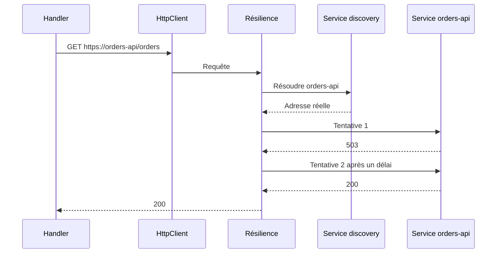

# Résilience et service discovery

Cette page présente deux mécanismes que le template active pour tous les appels HTTP **sortants** de l'application : la résilience (survivre aux pannes passagères d'un service appelé) et la découverte de services (appeler un service par son nom plutôt que par son adresse).

## Le concept simplement

### Résilience

Dans un système réparti, les pannes passagères sont normales : un service redémarre, un réseau perd un paquet, une base est surchargée pendant deux secondes. Une application fragile transmet ces erreurs à ses utilisateurs ; une application **résiliente** les absorbe quand c'est raisonnable. Trois outils y contribuent :

| Mécanisme | Principe | Analogie |
|-----------|----------|----------|
| **Retry** (nouvelle tentative) | rejouer l'appel après un échec passager, avec un délai croissant | rappeler quelqu'un dont la ligne était occupée |
| **Circuit breaker** (disjoncteur) | après trop d'échecs, cesser d'appeler le service quelque temps pour ne pas l'achever et ne pas faire attendre l'appelant | le disjoncteur électrique qui coupe avant que l'installation brûle |
| **Timeout** | abandonner un appel qui dure trop longtemps | raccrocher après dix sonneries |

Les retries ne conviennent qu'aux erreurs **passagères** (timeout, 503, 5xx). Rejouer une requête invalide (400) n'a aucun sens.

### Service discovery

Quand l'API en appelle une autre, quelle adresse utiliser ? Écrire `https://10.0.3.17:5001` dans le code est fragile : l'adresse change à chaque déploiement. La **découverte de services** (*service discovery*) permet d'écrire un **nom logique**, par exemple `https://orders-api`, que la plateforme (Aspire en local, un orchestrateur en production) traduit en adresse réelle au moment de l'appel.

## Pourquoi c'est important

- **Moins d'incidents visibles** : un retry bien réglé transforme une erreur de deux secondes en simple latence.
- **Protection en cascade** : sans disjoncteur, un service lent bloque ses appelants, qui bloquent les leurs, jusqu'à l'effondrement de tout le système.
- **Pas d'adresse en dur** : la même configuration marche en local, en test et en production.
- **Uniformité** : tous les `HttpClient` de l'application reçoivent les mêmes protections, sans que chaque développeur doive y penser.

## Comment le template le fait

!!! info "Les lignes `#if` du dépôt"
    Ces mécanismes sont dans le projet `ServiceDefaults`, présent dans un projet généré uniquement si l'option Aspire (`EnableAspire`) est activée.

`AddServiceDefaults`, appelée par `Program.cs`, regroupe toute la configuration partagée :

```csharp title="src/Web.Template.CQRS.ServiceDefaults/Extensions.cs"
--8<-- "src/Web.Template.CQRS.ServiceDefaults/Extensions.cs" start="public static TBuilder AddServiceDefaults" before="public static TBuilder ConfigureOpenTelemetry"
```

Les trois lignes qui nous intéressent :

- `builder.Services.AddServiceDiscovery()` enregistre le mécanisme de découverte ;
- `ConfigureHttpClientDefaults` applique des réglages à **tous** les `HttpClient` créés via `IHttpClientFactory` ;
- `AddStandardResilienceHandler()` y ajoute le gestionnaire de résilience standard (paquet `Microsoft.Extensions.Http.Resilience`, basé sur Polly) : limiteur de débit sortant, timeout global, **retries** avec délai exponentiel, **circuit breaker** et timeout par tentative. Les valeurs par défaut conviennent à un démarrage ; elles se règlent via les options du handler ;
- `http.AddServiceDiscovery()` permet à ces clients de résoudre les noms logiques.

### Quand cela s'applique-t-il ?

Uniquement aux clients HTTP créés par `IHttpClientFactory` (`AddHttpClient`, clients typés ou nommés) **après** `AddServiceDefaults`. Un `new HttpClient()` fabriqué à la main n'en profite pas : évitez-le. Cela ne concerne pas non plus les appels à SQL Server ou au stockage, qui ont leurs propres mécanismes de nouvelle tentative.



### Exemple : appeler un autre service

Le template ne contient pas d'appel vers un autre service ; voici le schéma à suivre pour en ajouter un. Dans l'`AppHost`, vous déclarez la dépendance avec `.WithReference(ordersApi)`, ce qui fournit l'adresse au projet appelant. Dans l'API, vous enregistrez un client typé avec le **nom logique** de la ressource :

```csharp
builder.Services.AddHttpClient<OrdersClient>(client =>
{
    // "orders-api" est le nom de la ressource dans l'AppHost
    client.BaseAddress = new Uri("https+http://orders-api");
});
```

Le préfixe `https+http://` demande à la découverte de préférer HTTPS et de se rabattre sur HTTP. Chaque appel de `OrdersClient` bénéficie alors, sans code supplémentaire, de la résolution du nom, des retries, du disjoncteur et des timeouts, et propage l'en-tête `traceparent` (voir [Observabilité](observabilite.md)).

!!! warning "Attention aux retries sur les écritures"
    Rejouer un `POST` qui a déjà été traité peut créer un doublon. Le gestionnaire standard rejoue par défaut les requêtes, quelle que soit la méthode HTTP : pour les opérations non idempotentes, rendez-les idempotentes (clé d'idempotence) ou réglez les options de retry du handler.

## À essayer

1. Ouvrez `Extensions.cs` : quels appels dans `AddServiceDefaults` concernent la résilience, lesquels la découverte de services ?
2. Dans l'`AppHost`, repérez comment l'API reçoit l'adresse de Keycloak (`WithReference`). Quel est le nom logique utilisé ?
3. Question : pourquoi un circuit breaker aide-t-il le service appelé autant que l'appelant ?
4. Question : un `new HttpClient()` écrit dans un handler bénéficie-t-il du retry ? Pourquoi ?

## Pour aller plus loin

- [Résilience HTTP dans .NET (Microsoft Learn)](https://learn.microsoft.com/dotnet/core/resilience/http-resilience)
- [Service discovery dans .NET (Microsoft Learn)](https://learn.microsoft.com/dotnet/core/extensions/service-discovery)
