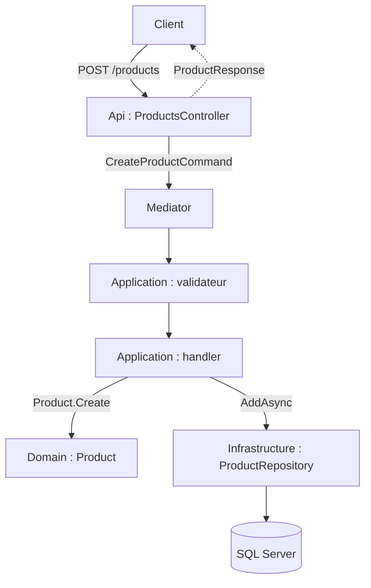

# Ajouter une feature

Ce tutoriel ajoute une feature complète à un projet généré : la gestion d'un **catalogue de produits**. À la fin, votre API sait créer un produit (`POST /products`, réservé aux administrateurs) et le relire (`GET /products/{id}`, pour tout utilisateur connecté), avec une table en base, une validation, des erreurs au format Problem Details et des tests. Chaque étape donne le code complet du fichier à créer ou la modification exacte, puis une commande pour **vérifier**.

Tout le code de ce tutoriel a été appliqué tel quel à un projet généré avec les commandes de l'étape 1 : la solution compile, les tests passent et la migration EF est produite.

## Le concept simplement

Dans ce template, une feature n'est pas un fichier : c'est une **tranche verticale** qui traverse les couches du projet, du domaine jusqu'à l'API. Chaque couche ajoute un ou deux fichiers, et chaque fichier a un seul rôle.



| Couche | Ce que vous ajoutez | Étape |
|--------|---------------------|-------|
| Domain | `ProductId`, `Product` | 2 |
| Application | `IProductRepository`, commande, query, validateurs, handlers, résultats | 3 et 5 |
| Infrastructure | `ProductConfiguration`, `ProductRepository`, `DbSet`, migration | 3 et 4 |
| Contracts | requête et réponse HTTP | 6 |
| Api | `ProductsController`, branchement dans `Program.cs` | 7 |
| Tests | unitaires et d'intégration | 8 |

Si un terme vous échappe (CQRS, handler, agrégat, Problem Details), le [glossaire](../glossaire.md) les définit, et la section [Architecture](../architecture/index.md) explique chaque couche.

## Pourquoi c'est important

Ajouter une feature est l'opération que vous ferez le plus souvent. En la déroulant une fois de bout en bout, vous voyez à quoi sert chaque convention du template : pourquoi le contrat HTTP est séparé du résultat métier, pourquoi la validation n'est jamais écrite dans l'endpoint, pourquoi les tests d'intégration n'ont besoin ni de SQL Server ni de Keycloak. Et vous repartez avec un modèle à recopier pour la feature suivante.

## Comment le template le fait

### Avant de commencer

Il vous faut le SDK .NET 10 et le template installé (voir [Prérequis](../demarrer/prerequis.md) et [Créer un projet](../demarrer/creer-un-projet.md)). Docker n'est nécessaire qu'à l'étape 9. Le tutoriel suppose les options par défaut, sauf le modèle d'autorisation que l'on fixe explicitement : en particulier `EnableRateLimiting` et `EnableTests` doivent rester activés (l'endpoint utilise les politiques de limitation de débit, et l'étape 8 ajoute des tests).

!!! info "Les noms de ce tutoriel"
    Le projet s'appelle `Contoso.Catalog`. Partout où vous voyez `Contoso.Catalog`, votre propre nom de projet joue le même rôle : les espaces de noms, les dossiers et les fichiers portent le nom que vous avez donné à `dotnet new`.

### Étape 1 : générer le projet

```bash
dotnet new templatewebcqrs --name Contoso.Catalog --AuthorizationModel AppRoles --output Contoso.Catalog
cd Contoso.Catalog
```

`--AuthorizationModel AppRoles` choisit le modèle où les droits viennent des rôles (`Admin`, `User`) : c'est le modèle par défaut, donné ici pour être explicite (voir [Modèles d'autorisation](../identite/modeles-d-autorisation.md)).

**Vérifier** : partez d'une base saine.

```bash
dotnet build Contoso.Catalog.slnx
dotnet test --solution Contoso.Catalog.slnx
```

La compilation doit se terminer par `0 Erreur(s)` et les tests par `échec : 0`. Les avertissements `NU1902` ou `NU1903` sur `System.Security.Cryptography.Pkcs` signalent une vulnérabilité connue d'un paquet transitif ; ils proviennent des versions des dépendances au moment de la génération, pas de ce tutoriel.

!!! tip "Versionnez dès maintenant"
    Faites `git init`, puis un premier commit. Ainsi `git status` vous montrera exactement les fichiers que chaque étape ajoute ou modifie.

### Étape 2 : le domaine

Le domaine contient les règles métier, sans aucune dépendance technique. Le template fournit trois briques dans `src/Contoso.Catalog.Domain/Common/Models/` : `ValueObject`, `Entity<TId>` et `AggregateRoot<TId>`.

- Un **objet valeur** (*value object*) n'a pas d'identité propre : deux objets valeur de même contenu sont égaux. `ValueObject` définit l'égalité à partir de la liste `GetEqualityComponents()`.
- Une **entité** possède un identifiant ; deux entités sont égales si leurs identifiants le sont.
- Une **racine d'agrégat** (*aggregate root*) est l'entité par laquelle on accède à un groupe d'objets cohérent. Les repositories (étape 3) ne manipulent que des racines.

Créez d'abord l'identifiant du produit. Envelopper un `Guid` dans un type dédié évite de confondre l'identifiant d'un produit avec celui d'un autre concept, et centralise la règle « un identifiant n'est jamais vide ».

```csharp title="src/Contoso.Catalog.Domain/Products/ProductId.cs"
using Contoso.Catalog.Domain.Common.Models;

namespace Contoso.Catalog.Domain.Products;

public sealed class ProductId : ValueObject
{
    public ProductId(Guid value)
    {
        if (value == Guid.Empty)
        {
            throw new ArgumentException("A product identifier cannot be empty.", nameof(value));
        }

        Value = value;
    }

    public Guid Value { get; }

    public static ProductId CreateNew() => new(Guid.NewGuid());

    public override IEnumerable<object> GetEqualityComponents()
    {
        yield return Value;
    }
}
```

Puis le produit lui-même. Les invariants (nom obligatoire, longueur maximale, prix positif ou nul) sont vérifiés dans la méthode de fabrication `Create` : il est impossible de construire un produit invalide, quel que soit l'appelant. Le constructeur est privé ; le constructeur sans paramètre est réservé à EF Core, qui en a besoin pour recréer l'objet depuis la base.

```csharp title="src/Contoso.Catalog.Domain/Products/Product.cs"
using Contoso.Catalog.Domain.Common.Models;

namespace Contoso.Catalog.Domain.Products;

public sealed class Product : AggregateRoot<ProductId>
{
    public const int NameMaxLength = 200;

    private Product(ProductId id, string name, decimal price)
        : base(id)
    {
        Name = name;
        Price = price;
    }

    // Constructeur sans paramètre réservé à EF Core.
    private Product()
    {
    }

    public string Name { get; private set; } = string.Empty;

    public decimal Price { get; private set; }

    public static Product Create(string name, decimal price)
    {
        if (string.IsNullOrWhiteSpace(name))
        {
            throw new ArgumentException("A product name is required.", nameof(name));
        }

        if (name.Length > NameMaxLength)
        {
            throw new ArgumentException($"A product name cannot exceed {NameMaxLength} characters.", nameof(name));
        }

        if (price < 0)
        {
            throw new ArgumentOutOfRangeException(nameof(price), "A product price cannot be negative.");
        }

        return new Product(ProductId.CreateNew(), name.Trim(), price);
    }
}
```

!!! note "Domaine et validation, deux filets différents"
    Le domaine **protège** ses invariants en levant une exception si on les viole. La validation de l'étape 5 **informe le client** avec un message précis (HTTP 400) avant d'arriver là. Un produit invalide ne devrait jamais atteindre le domaine ; s'il y arrive, c'est un bug que l'exception rend visible.

**Vérifier** :

```bash
dotnet build src/Contoso.Catalog.Domain
```

### Étape 3 : la persistance

Cette étape relie le domaine à la base, en trois fichiers et deux modifications.

**3.1. L'interface du repository, dans `Application`.** La couche Application définit *ce dont elle a besoin* ; l'Infrastructure fournit l'implémentation. `IRepository<T>` (déjà dans le template) propose `GetByIdAsync`, `GetAllAsync`, `AddAsync`, `UpdateAsync` et `DeleteAsync`. Une interface par agrégat permet d'y ajouter plus tard des requêtes spécifiques et de la remplacer par un faux dans les tests.

```csharp title="src/Contoso.Catalog.Application/Common/Interfaces/Persistence/IProductRepository.cs"
using Contoso.Catalog.Domain.Products;

namespace Contoso.Catalog.Application.Common.Interfaces.Persistence;

public interface IProductRepository : IRepository<Product>
{
}
```

**3.2. La configuration EF Core.** Elle décrit la table : nom, clé, longueurs, précision. Surtout, elle indique **comment convertir `ProductId` en `Guid`** (et inversement) pour la base : `HasConversion`. `ValueGeneratedNever` précise que l'identifiant est fourni par le code, pas généré par SQL Server.

```csharp title="src/Contoso.Catalog.Infrastructure/Persistence/Configurations/ProductConfiguration.cs"
using Microsoft.EntityFrameworkCore;
using Microsoft.EntityFrameworkCore.Metadata.Builders;
using Contoso.Catalog.Domain.Products;

namespace Contoso.Catalog.Infrastructure.Persistence.Configurations;

public sealed class ProductConfiguration : IEntityTypeConfiguration<Product>
{
    public void Configure(EntityTypeBuilder<Product> builder)
    {
        builder.ToTable("Products");

        builder.HasKey(product => product.Id);
        builder.Property(product => product.Id)
            .ValueGeneratedNever()
            .HasConversion(id => id.Value, value => new ProductId(value));

        builder.Property(product => product.Name)
            .IsRequired()
            .HasMaxLength(Product.NameMaxLength);

        builder.Property(product => product.Price)
            .HasPrecision(18, 2);
    }
}
```

Il n'y a rien d'autre à enregistrer : `ProjectDbContext` appelle `ApplyConfigurationsFromAssembly`, qui découvre toutes les classes `IEntityTypeConfiguration<T>` du projet.

**3.3. Le `DbSet`.** Dans `ProjectDbContext`, ajoutez la propriété `Products` et le `using` correspondant :

```csharp title="src/Contoso.Catalog.Infrastructure/Persistence/ProjectDbContext.cs"
using Microsoft.EntityFrameworkCore;
using Contoso.Catalog.Domain.Products;

namespace Contoso.Catalog.Infrastructure.Persistence;

public class ProjectDbContext(DbContextOptions<ProjectDbContext> options) : DbContext(options)
{
    public DbSet<Product> Products => Set<Product>();

    protected override void OnModelCreating(ModelBuilder modelBuilder)
    {
        modelBuilder
            .ApplyConfigurationsFromAssembly(typeof(ProjectDbContext).Assembly);
        base.OnModelCreating(modelBuilder);
    }
}
```

**3.4. Le repository.** `BaseRepository<TEntity, TContext>` implémente déjà les cinq opérations avec EF Core. Votre repository n'a qu'à en hériter et à déclarer l'interface :

```csharp title="src/Contoso.Catalog.Infrastructure/Persistence/Repositories/ProductRepository.cs"
using Contoso.Catalog.Application.Common.Interfaces.Persistence;
using Contoso.Catalog.Domain.Products;

namespace Contoso.Catalog.Infrastructure.Persistence.Repositories;

public sealed class ProductRepository(ProjectDbContext context)
    : BaseRepository<Product, ProjectDbContext>(context), IProductRepository
{
}
```

`GetByIdAsync(ValueObject id)` s'appuie sur `FindAsync` : comme `ProductId` est une clé convertie et que `ValueObject` compare par contenu, passer `new ProductId(guid)` retrouve bien la ligne.

**3.5. L'enregistrement.** Dans `src/Contoso.Catalog.Infrastructure/DependencyInjection.cs`, ajoutez les deux `using` manquants et la ligne d'enregistrement dans `AddInfrastructure`. Un repository dépend du `DbContext` (de durée de vie *scoped*) : il est donc enregistré en `AddScoped`.

```diff
+using Contoso.Catalog.Application.Common.Interfaces.Persistence;
 using Contoso.Catalog.Application.Common.Interfaces.Services;
 using Contoso.Catalog.Infrastructure.Persistence;
+using Contoso.Catalog.Infrastructure.Persistence.Repositories;
```

```csharp title="src/Contoso.Catalog.Infrastructure/DependencyInjection.cs (dans AddInfrastructure)"
services.AddScoped<IProductRepository, ProductRepository>();
```

Placez cette ligne juste avant `services.AddSingleton<IDateTimeProvider, DateTimeProvider>();`.

**Vérifier** :

```bash
dotnet build Contoso.Catalog.slnx
```

### Étape 4 : la migration EF Core

Une **migration** est un fichier C# qui décrit un changement de schéma (ici : créer la table `Products`). EF Core la génère en comparant votre modèle à l'état précédent, puis l'applique à la base.

**4.1. Installer l'outil `dotnet-ef`.** C'est un outil en ligne de commande, installé une fois pour toute la machine :

```bash
dotnet tool install --global dotnet-ef
```

Si l'outil est déjà installé, mettez-le à jour avec `dotnet tool update --global dotnet-ef` : un avertissement `The Entity Framework tools version ... is older than that of the runtime` signale une version trop ancienne.

**4.2. Donner à l'API le paquet de conception d'EF Core.** L'outil exécute l'application pour lire sa configuration : il lui faut le paquet `Microsoft.EntityFrameworkCore.Design` dans le **projet de démarrage** (ici `Api`). Le template ne l'ajoute qu'à `Infrastructure`, et sans lui la commande échoue :

```text
Your startup project 'Contoso.Catalog.Api' doesn't reference Microsoft.EntityFrameworkCore.Design. This package is required for the Entity Framework Core Tools to work. Ensure your startup project is correct, install the package, and try again.
```

Dans `src/Contoso.Catalog.Api/Contoso.Catalog.Api.csproj`, ajoutez, dans le premier `ItemGroup` de paquets, après `FluentValidation` :

```xml title="src/Contoso.Catalog.Api/Contoso.Catalog.Api.csproj (dans l'ItemGroup des PackageReference)"
<PackageReference Include="Microsoft.EntityFrameworkCore.Design">
    <PrivateAssets>all</PrivateAssets>
    <IncludeAssets>runtime; build; native; contentfiles; analyzers; buildtransitive</IncludeAssets>
</PackageReference>
```

La version vient du fichier central `Directory.Packages.props`, qui déclare déjà ce paquet. `PrivateAssets=all` empêche le paquet de se propager aux projets qui référencent l'API (comme le projet de tests).

**4.3. Créer la migration.** Depuis la racine du projet :

```bash
dotnet ef migrations add InitialCatalog --project src/Contoso.Catalog.Infrastructure --startup-project src/Contoso.Catalog.Api --output-dir Persistence/Migrations
```

- `--project` : le projet qui contient le `DbContext` et qui recevra les fichiers de migration (`Infrastructure`).
- `--startup-project` : le projet exécutable dont l'outil lit la configuration (`Api`).
- `--output-dir` : le dossier de destination dans le projet `Infrastructure`.

Le résultat se termine par `Done.` et crée trois fichiers dans `src/Contoso.Catalog.Infrastructure/Persistence/Migrations/` : `<horodatage>_InitialCatalog.cs` (la migration), `<horodatage>_InitialCatalog.Designer.cs` (métadonnées) et `ProjectDbContextModelSnapshot.cs` (l'image du modèle, comparée à la prochaine migration). Ouvrez la migration et relisez-la : relire une migration avant de l'appliquer est un réflexe à garder.

Le tutoriel suppose un projet généré avec Aspire (option par défaut), qui fournit le conteneur SQL Server local ; sans Aspire, vous devez configurer vous-même une chaîne de connexion. Attention aussi : si `ASPNETCORE_ENVIRONMENT=Development` est défini dans votre shell quand vous lancez `dotnet ef`, l'outil exécute `Program` au moment de la conception et le bloc `Migrate()` de l'étape 4.4 peut alors s'exécuter.

```csharp title="src/Contoso.Catalog.Infrastructure/Persistence/Migrations/<horodatage>_InitialCatalog.cs (méthode Up)"
protected override void Up(MigrationBuilder migrationBuilder)
{
    migrationBuilder.CreateTable(
        name: "Products",
        columns: table => new
        {
            Id = table.Column<Guid>(type: "uniqueidentifier", nullable: false),
            Name = table.Column<string>(type: "nvarchar(200)", maxLength: 200, nullable: false),
            Price = table.Column<decimal>(type: "decimal(18,2)", precision: 18, scale: 2, nullable: false)
        },
        constraints: table =>
        {
            table.PrimaryKey("PK_Products", x => x.Id);
        });
```

Pour voir le SQL que EF exécutera, sans toucher à une base :

```bash
dotnet ef migrations script --project src/Contoso.Catalog.Infrastructure --startup-project src/Contoso.Catalog.Api
```

Le script contient notamment :

```sql
CREATE TABLE [Products] (
    [Id] uniqueidentifier NOT NULL,
    [Name] nvarchar(200) NOT NULL,
    [Price] decimal(18,2) NOT NULL,
    CONSTRAINT [PK_Products] PRIMARY KEY ([Id])
);
```

**4.4. Appliquer la migration en local.** Il y a deux méthodes ; ce tutoriel choisit la première.

*Méthode 1 (choisie) : migrer au démarrage de l'API, en `Development` seulement.* La base locale est un conteneur SQL Server géré par Aspire, dont l'API attend la disponibilité (`WaitFor`). Il suffit donc que l'API applique les migrations en attente à son démarrage : aucune chaîne de connexion à copier, et un `aspire start` suffit après chaque nouvelle migration. Dans `Program.cs`, ajoutez d'abord deux `using` en tête de fichier, après `using Contoso.Catalog.Infrastructure;` :

```csharp title="src/Contoso.Catalog.Api/Program.cs (using)"
using Contoso.Catalog.Infrastructure.Persistence;
using Microsoft.EntityFrameworkCore;
```

puis ce bloc, après `app.MapFallback(...)` et avant `app.Run()` :

```csharp title="src/Contoso.Catalog.Api/Program.cs (avant app.Run())"
if (app.Environment.IsDevelopment())
{
    using var scope = app.Services.CreateScope();
    scope.ServiceProvider.GetRequiredService<ProjectDbContext>().Database.Migrate();
}
```

*Méthode 2 : appliquer à la main avec `dotnet ef database update`.* Il faut alors fournir la chaîne de connexion de la base locale avec l'option `--connection`. Vous la lisez dans le dashboard Aspire (ressource `api`, variables d'environnement, clé `ConnectionStrings__projectdb`). Cette méthode est utile pour viser une autre base que celle du conteneur.

!!! warning "Pas en production"
    Migrer automatiquement au démarrage convient au développement local, où vous êtes seul sur la base. En production, plusieurs instances de l'API peuvent démarrer en même temps et une migration ratée empêcherait l'API de démarrer. Générez plutôt un script (`dotnet ef migrations script --idempotent`) et appliquez-le dans votre déploiement (voir [Configurer un déploiement](configurer-un-deploiement.md)).

!!! note "Les tests ne migrent pas"
    L'environnement de test est `Testing`, pas `Development` : la condition n'est pas remplie, et les tests utilisent une base en mémoire (voir [Tests](../tests/index.md)). Autre conséquence : lancée **seule** (sans Aspire), l'API en `Development` échouerait maintenant au démarrage, car la chaîne de connexion `projectdb` est vide. Lancez-la par Aspire.

**Vérifier** :

```bash
dotnet build Contoso.Catalog.slnx
dotnet test --solution Contoso.Catalog.slnx
```

### Étape 5 : la couche Application

C'est ici que vit le cas d'usage. Chaque opération est un `record` (la commande ou la query) accompagné de son handler, rangés par feature : `Products/Commands/CreateProduct/` et `Products/Queries/GetProduct/`. Le pipeline de [CQRS et Mediator](../architecture/cqrs-et-mediator.md) fait le reste.

**5.1. Le résultat.** Un `*Result` est ce que le handler renvoie à l'API. Il est volontairement distinct de l'entité `Product` : l'API ne manipule jamais directement le domaine.

```csharp title="src/Contoso.Catalog.Application/Products/Common/ProductResult.cs"
namespace Contoso.Catalog.Application.Products.Common;

public sealed record ProductResult(Guid Id, string Name, decimal Price);
```

**5.2. La commande de création.** `ICommand<ProductResult>` indique qu'elle modifie l'état et renvoie un `ProductResult`.

```csharp title="src/Contoso.Catalog.Application/Products/Commands/CreateProduct/CreateProductCommand.cs"
using Mediator;
using Contoso.Catalog.Application.Products.Common;

namespace Contoso.Catalog.Application.Products.Commands.CreateProduct;

public sealed record CreateProductCommand(string Name, decimal Price) : ICommand<ProductResult>;
```

**5.3. Son validateur.** FluentValidation découvre automatiquement cette classe et le `ValidationBehavior` l'exécute avant le handler (voir [Validation](../architecture/validation.md)). Il réutilise la constante `Product.NameMaxLength` pour que la règle de validation et le domaine ne divergent pas.

```csharp title="src/Contoso.Catalog.Application/Products/Commands/CreateProduct/CreateProductCommandValidator.cs"
using FluentValidation;
using Contoso.Catalog.Domain.Products;

namespace Contoso.Catalog.Application.Products.Commands.CreateProduct;

public sealed class CreateProductCommandValidator : AbstractValidator<CreateProductCommand>
{
    public CreateProductCommandValidator()
    {
        RuleFor(command => command.Name)
            .NotEmpty()
            .MaximumLength(Product.NameMaxLength);

        RuleFor(command => command.Price)
            .GreaterThanOrEqualTo(0);
    }
}
```

**5.4. Son handler.** Il demande au domaine de construire le produit, le fait enregistrer par le repository, puis renvoie le résultat.

```csharp title="src/Contoso.Catalog.Application/Products/Commands/CreateProduct/CreateProductCommandHandler.cs"
using Mediator;
using Contoso.Catalog.Application.Common.Interfaces.Persistence;
using Contoso.Catalog.Application.Products.Common;
using Contoso.Catalog.Domain.Products;

namespace Contoso.Catalog.Application.Products.Commands.CreateProduct;

public sealed class CreateProductCommandHandler(IProductRepository products)
    : ICommandHandler<CreateProductCommand, ProductResult>
{
    public async ValueTask<ProductResult> Handle(
        CreateProductCommand command,
        CancellationToken cancellationToken)
    {
        var product = Product.Create(command.Name, command.Price);

        await products.AddAsync(product);

        return new ProductResult(product.Id.Value, product.Name, product.Price);
    }
}
```

**5.5. La query de lecture.** Le résultat est nullable : `null` signifie « produit introuvable », que l'API traduira en 404.

```csharp title="src/Contoso.Catalog.Application/Products/Queries/GetProduct/GetProductQuery.cs"
using Mediator;
using Contoso.Catalog.Application.Products.Common;

namespace Contoso.Catalog.Application.Products.Queries.GetProduct;

public sealed record GetProductQuery(Guid Id) : IQuery<ProductResult?>;
```

Un validateur rejette l'identifiant vide : sans lui, `new ProductId(Guid.Empty)` lèverait une exception du domaine, et le client recevrait une erreur 500 au lieu d'une 400 explicite.

```csharp title="src/Contoso.Catalog.Application/Products/Queries/GetProduct/GetProductQueryValidator.cs"
using FluentValidation;

namespace Contoso.Catalog.Application.Products.Queries.GetProduct;

public sealed class GetProductQueryValidator : AbstractValidator<GetProductQuery>
{
    public GetProductQueryValidator()
    {
        RuleFor(query => query.Id).NotEmpty();
    }
}
```

```csharp title="src/Contoso.Catalog.Application/Products/Queries/GetProduct/GetProductQueryHandler.cs"
using Mediator;
using Contoso.Catalog.Application.Common.Interfaces.Persistence;
using Contoso.Catalog.Application.Products.Common;
using Contoso.Catalog.Domain.Products;

namespace Contoso.Catalog.Application.Products.Queries.GetProduct;

public sealed class GetProductQueryHandler(IProductRepository products)
    : IQueryHandler<GetProductQuery, ProductResult?>
{
    public async ValueTask<ProductResult?> Handle(
        GetProductQuery query,
        CancellationToken cancellationToken)
    {
        var product = await products.GetByIdAsync(new ProductId(query.Id));

        return product is null
            ? null
            : new ProductResult(product.Id.Value, product.Name, product.Price);
    }
}
```

Rien n'est à enregistrer : `AddMediator` (via le générateur de code) trouve les handlers et `AddValidatorsFromAssembly` les validateurs.

**Vérifier** :

```bash
dotnet build Contoso.Catalog.slnx
```

### Étape 6 : les contrats

Le projet `Contracts` contient les formes **publiques** de l'API : ce que le client envoie et reçoit. Les séparer des résultats de l'Application permet de faire évoluer l'un sans casser l'autre.

```csharp title="src/Contoso.Catalog.Contracts/Products/CreateProductRequest.cs"
namespace Contoso.Catalog.Contracts.Products;

public sealed record CreateProductRequest(string Name, decimal Price);
```

```csharp title="src/Contoso.Catalog.Contracts/Products/ProductResponse.cs"
namespace Contoso.Catalog.Contracts.Products;

public sealed record ProductResponse(Guid Id, string Name, decimal Price);
```

### Étape 7 : l'API

Le template exprime ses endpoints en **minimal API** : une classe statique par ressource (suffixée `Controller` par convention, comme `AdminController`) avec une méthode d'extension `Map*Endpoints`. L'endpoint ne fait que traduire : requête HTTP vers commande, résultat vers réponse.

```csharp title="src/Contoso.Catalog.Api/Controllers/ProductsController.cs"
using Mediator;
using Microsoft.AspNetCore.RateLimiting;
using Contoso.Catalog.Api.Authorization;
using Contoso.Catalog.Api.Common.RateLimiting;
using Contoso.Catalog.Application.Products.Commands.CreateProduct;
using Contoso.Catalog.Application.Products.Queries.GetProduct;
using Contoso.Catalog.Contracts.Products;

namespace Contoso.Catalog.Api.Controllers;

public static class ProductsController
{
    public static IEndpointRouteBuilder MapProductEndpoints(this IEndpointRouteBuilder endpoints)
    {
        var createEndpoint = endpoints.MapPost("/products", async (
                CreateProductRequest request,
                IMediator mediator,
                CancellationToken cancellationToken) =>
            {
                var result = await mediator.Send(
                    new CreateProductCommand(request.Name, request.Price),
                    cancellationToken);

                return TypedResults.Created(
                    $"/products/{result.Id}",
                    new ProductResponse(result.Id, result.Name, result.Price));
            })
            .WithName("CreateProduct")
            .RequireAuthorization(Policies.RequireAdmin);

        createEndpoint.RequireRateLimiting(RateLimitingPolicies.Write);

        var getEndpoint = endpoints.MapGet("/products/{id:guid}", async (
                Guid id,
                IMediator mediator,
                CancellationToken cancellationToken) =>
            {
                var result = await mediator.Send(new GetProductQuery(id), cancellationToken);

                return result is null
                    ? Results.NotFound()
                    : Results.Ok(new ProductResponse(result.Id, result.Name, result.Price));
            })
            .WithName("GetProduct")
            .RequireAuthorization();

        getEndpoint.RequireRateLimiting(RateLimitingPolicies.Read);

        return endpoints;
    }
}
```

Points à retenir :

- **Autorisation** : `POST /products` exige `Policies.RequireAdmin`. `GET /products/{id}` appelle `RequireAuthorization()` sans policy : il suffit d'être connecté. Un endpoint sans rien serait de toute façon protégé par la politique par défaut (voir [Modèles d'autorisation](../identite/modeles-d-autorisation.md)).
- **Limitation de débit** : l'écriture utilise la politique `write` (120 requêtes par minute et par utilisateur), la lecture la politique `read` (600) ; voir [Rate limiting](../fonctionnalites/rate-limiting.md).
- **Réponses typées** : `TypedResults.Created(uri, corps)` produit le statut 201 avec l'en-tête `Location`. Pour la lecture, l'endpoint renvoie `Results.NotFound()` ou `Results.Ok(...)`, selon le résultat.
- **Contrainte de route** : `{id:guid}` n'accepte que des GUID ; toute autre valeur tombe sur la route de secours (404).
- **Erreurs** : aucune gestion d'erreur dans l'endpoint. La validation lève une exception que le gestionnaire global transforme en 400 Problem Details, et le 404 est transformé en Problem Details par `UseStatusCodePages` (voir [Erreurs et Problem Details](../architecture/erreurs-et-problem-details.md)).

Enfin, branchez les endpoints dans `Program.cs`, juste après `app.MapAdminEndpoints();`, et vérifiez que la ligne est bien placée **avant** `app.MapFallback(...)` :

```csharp title="src/Contoso.Catalog.Api/Program.cs (extrait)"
app.MapCurrentUserEndpoints();
app.MapAdminEndpoints();
app.MapProductEndpoints();
app.MapFallback(() => Results.NotFound()).AllowAnonymous();
```

**Vérifier** :

```bash
dotnet build Contoso.Catalog.slnx
```

### Étape 8 : les tests

On teste à deux niveaux (voir [Tests](../tests/index.md)).

**8.1. Tests unitaires du validateur.** Aucune dépendance : on instancie le validateur et on lit ses erreurs.

```csharp title="tests/Contoso.Catalog.Application.UnitTests/Products/CreateProductCommandValidatorTests.cs"
using Contoso.Catalog.Application.Products.Commands.CreateProduct;

namespace Contoso.Catalog.Application.UnitTests.Products;

public sealed class CreateProductCommandValidatorTests
{
    private readonly CreateProductCommandValidator _validator = new();

    [Fact]
    public void Validate_WithValidCommand_IsValid()
    {
        var result = _validator.Validate(new CreateProductCommand("Keyboard", 49.90m));

        Assert.True(result.IsValid);
    }

    [Theory]
    [InlineData("")]
    [InlineData("   ")]
    public void Validate_WithEmptyName_ReportsNameError(string name)
    {
        var result = _validator.Validate(new CreateProductCommand(name, 10m));

        var failure = Assert.Single(result.Errors);
        Assert.Equal(nameof(CreateProductCommand.Name), failure.PropertyName);
    }

    [Fact]
    public void Validate_WithNegativePrice_ReportsPriceError()
    {
        var result = _validator.Validate(new CreateProductCommand("Keyboard", -1m));

        var failure = Assert.Single(result.Errors);
        Assert.Equal(nameof(CreateProductCommand.Price), failure.PropertyName);
    }
}
```

**8.2. Un faux repository.** Pour tester les handlers sans base, on implémente `IProductRepository` avec une simple liste.

```csharp title="tests/Contoso.Catalog.Application.UnitTests/Fakes/FakeProductRepository.cs"
using System.Linq.Expressions;
using Contoso.Catalog.Application.Common.Interfaces.Persistence;
using Contoso.Catalog.Domain.Common.Models;
using Contoso.Catalog.Domain.Products;

namespace Contoso.Catalog.Application.UnitTests.Fakes;

public sealed class FakeProductRepository : IProductRepository
{
    public List<Product> Products { get; } = [];

    public Task<Product> AddAsync(Product entity)
    {
        Products.Add(entity);
        return Task.FromResult(entity);
    }

    public Task<Product?> GetByIdAsync(ValueObject id) =>
        Task.FromResult(Products.FirstOrDefault(product => product.Id.Equals(id)));

    public Task<IEnumerable<Product>> GetAllAsync(params Expression<Func<Product, object>>[] includes) =>
        Task.FromResult<IEnumerable<Product>>(Products);

    public Task<Product> UpdateAsync(Product entity) => Task.FromResult(entity);

    public Task<bool> DeleteAsync(ValueObject id) =>
        Task.FromResult(Products.RemoveAll(product => product.Id.Equals(id)) > 0);
}
```

**8.3. Tests unitaires des handlers.**

```csharp title="tests/Contoso.Catalog.Application.UnitTests/Products/CreateProductCommandHandlerTests.cs"
using Contoso.Catalog.Application.Products.Commands.CreateProduct;
using Contoso.Catalog.Application.UnitTests.Fakes;

namespace Contoso.Catalog.Application.UnitTests.Products;

public sealed class CreateProductCommandHandlerTests
{
    [Fact]
    public async Task Handle_StoresTheProductAndReturnsIt()
    {
        var repository = new FakeProductRepository();
        var handler = new CreateProductCommandHandler(repository);

        var result = await handler.Handle(
            new CreateProductCommand("Keyboard", 49.90m),
            TestContext.Current.CancellationToken);

        var stored = Assert.Single(repository.Products);
        Assert.Equal(stored.Id.Value, result.Id);
        Assert.Equal("Keyboard", result.Name);
        Assert.Equal(49.90m, result.Price);
    }
}
```

```csharp title="tests/Contoso.Catalog.Application.UnitTests/Products/GetProductQueryHandlerTests.cs"
using Contoso.Catalog.Application.Products.Queries.GetProduct;
using Contoso.Catalog.Application.UnitTests.Fakes;
using Contoso.Catalog.Domain.Products;

namespace Contoso.Catalog.Application.UnitTests.Products;

public sealed class GetProductQueryHandlerTests
{
    [Fact]
    public async Task Handle_WithKnownId_ReturnsTheProduct()
    {
        var repository = new FakeProductRepository();
        var product = Product.Create("Keyboard", 49.90m);
        await repository.AddAsync(product);
        var handler = new GetProductQueryHandler(repository);

        var result = await handler.Handle(
            new GetProductQuery(product.Id.Value),
            TestContext.Current.CancellationToken);

        Assert.NotNull(result);
        Assert.Equal("Keyboard", result.Name);
    }

    [Fact]
    public async Task Handle_WithUnknownId_ReturnsNull()
    {
        var handler = new GetProductQueryHandler(new FakeProductRepository());

        var result = await handler.Handle(
            new GetProductQuery(Guid.NewGuid()),
            TestContext.Current.CancellationToken);

        Assert.Null(result);
    }
}
```

**8.4. Tests d'intégration.** Ils passent par toute l'API : `ApiFactory` fournit une base en mémoire et `AsUser` fabrique l'identité (en-têtes `X-Test-User`, `X-Test-Roles`). Aucune configuration supplémentaire n'est nécessaire : `ProductRepository` utilise le `ProjectDbContext` que `ApiFactory` a déjà remplacé par EF InMemory.

```csharp title="tests/Contoso.Catalog.Api.IntegrationTests/Products/ProductEndpointTests.cs"
using System.Net;
using System.Net.Http.Json;
using System.Text.Json;
using Contoso.Catalog.Api.Authorization;
using Contoso.Catalog.Api.IntegrationTests.Infrastructure;
using Contoso.Catalog.Contracts.Products;

namespace Contoso.Catalog.Api.IntegrationTests.Products;

public sealed class ProductEndpointTests(ApiFactory factory) : IClassFixture<ApiFactory>
{
    [Fact]
    public async Task Create_AsAdmin_Returns201AndTheProductCanBeRead()
    {
        var cancellationToken = TestContext.Current.CancellationToken;
        var admin = factory.CreateClient().AsUser("admin-1", roles: [AppRoles.Admin]);

        var created = await admin.PostAsJsonAsync(
            "/products",
            new CreateProductRequest("Keyboard", 49.90m),
            cancellationToken);

        Assert.Equal(HttpStatusCode.Created, created.StatusCode);
        var product = await created.Content.ReadFromJsonAsync<ProductResponse>(cancellationToken);
        Assert.NotNull(product);
        Assert.Equal($"/products/{product.Id}", created.Headers.Location?.ToString());

        var reader = factory.CreateClient().AsUser("user-1", roles: [AppRoles.User]);
        var fetched = await reader.GetFromJsonAsync<ProductResponse>($"/products/{product.Id}", cancellationToken);

        Assert.Equal(product, fetched);
    }

    [Fact]
    public async Task Create_AsStandardUser_Returns403()
    {
        var user = factory.CreateClient().AsUser("user-1", roles: [AppRoles.User]);

        var response = await user.PostAsJsonAsync(
            "/products",
            new CreateProductRequest("Keyboard", 49.90m),
            TestContext.Current.CancellationToken);

        Assert.Equal(HttpStatusCode.Forbidden, response.StatusCode);
    }

    [Fact]
    public async Task Create_WithoutAuthentication_Returns401()
    {
        var response = await factory.CreateClient().PostAsJsonAsync(
            "/products",
            new CreateProductRequest("Keyboard", 49.90m),
            TestContext.Current.CancellationToken);

        Assert.Equal(HttpStatusCode.Unauthorized, response.StatusCode);
    }

    [Fact]
    public async Task Create_WithEmptyName_Returns400ProblemDetails()
    {
        var cancellationToken = TestContext.Current.CancellationToken;
        var admin = factory.CreateClient().AsUser("admin-1", roles: [AppRoles.Admin]);

        var response = await admin.PostAsJsonAsync(
            "/products",
            new CreateProductRequest("", 10m),
            cancellationToken);

        Assert.Equal(HttpStatusCode.BadRequest, response.StatusCode);
        Assert.Equal("application/problem+json", response.Content.Headers.ContentType?.MediaType);
        using var problem = JsonDocument.Parse(await response.Content.ReadAsStringAsync(cancellationToken));
        Assert.Equal("VALIDATION", problem.RootElement.GetProperty("code").GetString());
        Assert.True(problem.RootElement.GetProperty("errors").TryGetProperty("Name", out _));
    }

    [Fact]
    public async Task Get_WithUnknownId_Returns404()
    {
        var user = factory.CreateClient().AsUser("user-1", roles: [AppRoles.User]);

        var response = await user.GetAsync($"/products/{Guid.NewGuid()}", TestContext.Current.CancellationToken);

        Assert.Equal(HttpStatusCode.NotFound, response.StatusCode);
        Assert.Equal("application/problem+json", response.Content.Headers.ContentType?.MediaType);
    }

    [Fact]
    public async Task Get_WithEmptyGuid_Returns400()
    {
        var user = factory.CreateClient().AsUser("user-1", roles: [AppRoles.User]);

        var response = await user.GetAsync($"/products/{Guid.Empty}", TestContext.Current.CancellationToken);

        Assert.Equal(HttpStatusCode.BadRequest, response.StatusCode);
    }
}
```

Ces tests couvrent les cas attendus : 201 pour un administrateur (puis relecture du produit créé), 403 pour un utilisateur ordinaire, 401 sans authentification, 400 Problem Details sur un nom vide, 404 (lui aussi en Problem Details) sur un identifiant inconnu et 400 sur un identifiant vide.

**Vérifier** :

```bash
dotnet test --solution Contoso.Catalog.slnx
```

Le résumé doit indiquer `échec : 0`. Pour ne lancer que les tests de la feature : `dotnet test --solution Contoso.Catalog.slnx --filter-method "*Product*"`.

### Étape 9 : essayer en local avec les personas

Cette étape lance l'application complète : elle exige Docker et les secrets de l'AppHost (voir [Premier lancement](../demarrer/premier-lancement.md) pour les étapes détaillées). Résumé :

```bash
dotnet user-secrets set "Parameters:sql-password" "Choose-A-Strong-Local-Password!" --project src/Contoso.Catalog.AppHost/Contoso.Catalog.AppHost.csproj
dotnet user-secrets set "Parameters:keycloak-admin-password" "Choose-Another-Strong-Password!" --project src/Contoso.Catalog.AppHost/Contoso.Catalog.AppHost.csproj
aspire start --apphost src/Contoso.Catalog.AppHost/Contoso.Catalog.AppHost.csproj
```

Attendez que la ressource `api` soit `Running` dans le dashboard. Au démarrage, la migration de l'étape 4 crée la table `Products` (vous pouvez le constater dans les logs de la ressource `api`).

Obtenez un token pour chaque persona : `admin@local.test` (rôle `Admin`) et `user@local.test` (rôle `User`).

=== "PowerShell"

    ```powershell
    $admin = ./scripts/get-token.ps1 -Persona admin
    $user = ./scripts/get-token.ps1 -Persona user
    $body = '{"name":"Keyboard","price":49.90}'

    # 201 Created : un administrateur crée un produit
    Invoke-WebRequest -Method Post -Uri https://localhost:7246/products -Headers @{ Authorization = "Bearer $admin" } -ContentType 'application/json' -Body $body

    # 403 : un utilisateur ordinaire n'a pas le droit de créer (-SkipHttpErrorCheck exige PowerShell 7 ou plus)
    Invoke-WebRequest -Method Post -Uri https://localhost:7246/products -Headers @{ Authorization = "Bearer $user" } -ContentType 'application/json' -Body $body -SkipHttpErrorCheck
    ```

=== "Bash"

    ```bash
    admin=$(bash ./scripts/get-token.sh admin)
    user=$(bash ./scripts/get-token.sh user)

    # 201 Created : un administrateur crée un produit
    curl -i -X POST https://localhost:7246/products \
      -H "Authorization: Bearer $admin" -H "Content-Type: application/json" \
      -d '{"name":"Keyboard","price":49.90}'

    # 403 : un utilisateur ordinaire n'a pas le droit de créer
    curl -i -X POST https://localhost:7246/products \
      -H "Authorization: Bearer $user" -H "Content-Type: application/json" \
      -d '{"name":"Keyboard","price":49.90}'
    ```

La création renvoie `201 Created`, un en-tête `Location: /products/<id>` et un corps du type `{"id":"…","name":"Keyboard","price":49.90}`. Relisez le produit avec l'identifiant reçu, avec l'un ou l'autre persona : `GET https://localhost:7246/products/<id>` (en-tête `Authorization: Bearer <token>`) renvoie 200.

Vérifiez enfin les erreurs. Un nom vide avec le token de l'administrateur :

```bash
curl -i -X POST https://localhost:7246/products -H "Authorization: Bearer $admin" -H "Content-Type: application/json" -d '{"name":"","price":10}'
```

renvoie un `400` au format Problem Details, avec le code `VALIDATION` et l'erreur rattachée à `Name`. Un identifiant inconnu (`GET /products/<un autre GUID>`) renvoie un `404`. Vous pouvez aussi tester avec l'interface Scalar (`https://localhost:7246/scalar`, voir [OpenAPI et Scalar](../fonctionnalites/openapi-et-scalar.md)) ou en ajoutant ces requêtes à `Api.http`.

!!! warning "Utilisez le port HTTPS 7246"
    Le port HTTP `5257` redirige vers HTTPS et la redirection fait perdre l'en-tête `Authorization`.

Arrêtez l'application avec `aspire stop`. Les données de la table `Products` sont conservées dans le volume de SQL Server.

!!! warning "Un autre projet généré est déjà lancé ?"
    Les conteneurs SQL Server et Keycloak sont persistants : après `aspire stop`, le Keycloak d'un projet précédent (par exemple `Contoso.Orders`) garde le port 8080. Celui de `Contoso.Catalog` ne peut alors pas démarrer et l'API attend indéfiniment. Arrêtez l'ancien conteneur (`docker ps --filter name=keycloak`, puis `docker stop <conteneur>`) ou lancez `aspire stop --apphost <autre projet>.csproj --force`.

### Dépannage

| Symptôme | Cause probable | Remède |
|----------|----------------|--------|
| `doesn't reference Microsoft.EntityFrameworkCore.Design` | le projet de démarrage n'a pas le paquet | étape 4.2 |
| `Unable to create a 'DbContext'` ou erreur au chargement de l'application par `dotnet ef` | le projet de démarrage ne se construit pas | corrigez d'abord `dotnet build` |
| Les tests d'intégration échouent sur `Products` | la configuration EF est incorrecte (conversion de l'identifiant) | relisez l'étape 3.2 |
| 500 à l'appel de `POST /products` en local | la table n'existe pas : la migration n'a pas été appliquée | étape 4.4 ; relancez `aspire start` en `Development` |
| L'API reste en attente de Keycloak, ou le port 8080 est occupé | le Keycloak persistant d'un autre projet généré tourne encore | `docker ps --filter name=keycloak` puis `docker stop <conteneur>`, ou `aspire stop --apphost <autre projet>.csproj --force` |
| 403 pour l'administrateur | token du mauvais persona, ou rôle absent | décodez le token : le claim `roles` doit contenir `Admin` |

## À essayer

1. Ajoutez un champ `Description` (texte optionnel de 1 000 caractères au plus) à `Product` : modifiez le domaine, la configuration EF, la commande, le validateur, les contrats et les tests. Créez une migration `AddProductDescription` : `dotnet ef migrations add AddProductDescription ...` (mêmes options `--project`, `--startup-project`, `--output-dir`).
2. Ajoutez `GET /products` qui liste tous les produits (`GetAllAsync` existe déjà dans le repository) : query `ListProductsQuery`, résultat, réponse, endpoint, tests.
3. Ajoutez `DELETE /products/{id}`, réservé aux administrateurs, qui renvoie 204 (ou 404 si le produit n'existe pas). `DeleteAsync` existe déjà.
4. Ajoutez un test d'intégration qui prouve qu'un nom de 201 caractères est refusé avec une erreur 400. Quelle règle l'impose, et à quel endroit du code ?
5. Un nouveau rôle `Editor` doit pouvoir créer des produits sans être administrateur : suivez le guide [Rôles, groupes et personas](ajouter-role-groupe-persona.md).

## Pour aller plus loin

- [Migrations EF Core](https://learn.microsoft.com/ef/core/managing-schemas/migrations/)
- [Conversions de valeurs EF Core](https://learn.microsoft.com/ef/core/modeling/value-conversions)
- [Documentation de FluentValidation](https://docs.fluentvalidation.net/)
- [Minimal APIs dans ASP.NET Core](https://learn.microsoft.com/aspnet/core/fundamentals/minimal-apis)
