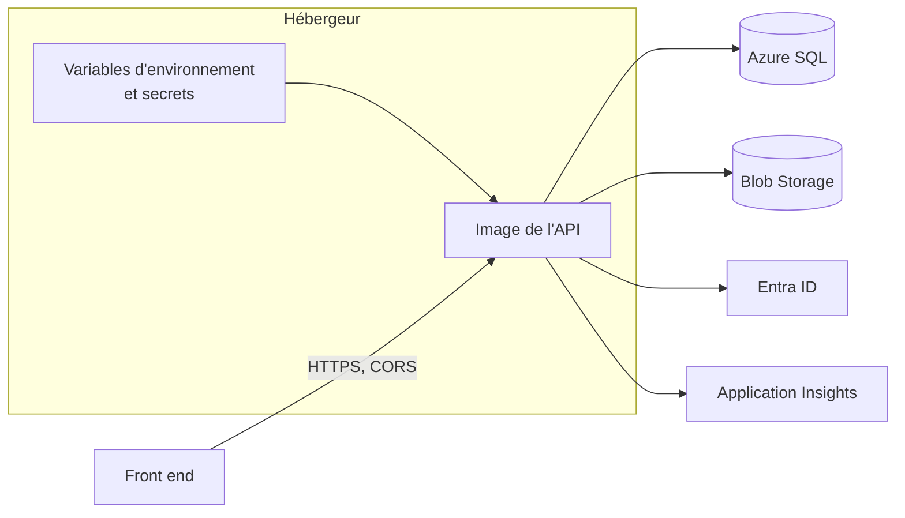

# Configurer un déploiement

Ce guide liste ce qu'il faut préparer pour passer un projet généré de votre poste à un hébergeur : les valeurs de configuration à fournir, la gestion des secrets, la télémétrie, CORS, HTTPS, les health checks et l'image Docker. Il décrit aussi, honnêtement, ce que le template **ne fait pas**.

## Le concept simplement

En local, l'AppHost Aspire démarre les services (SQL Server, stockage, Keycloak) et fabrique la configuration de l'API. Une fois déployée, l'API tourne sans AppHost : plus personne ne lui donne ses chaînes de connexion ni son fournisseur d'identité. Déployer, c'est donc **fournir la même configuration, avec les valeurs des vrais services**, et empaqueter l'API dans une image de conteneur ou la publier sur un hébergeur.

Le code ne change pas d'un environnement à l'autre ; seules les valeurs de configuration changent. La comparaison ressource par ressource est dans [Aspire : local et déployé](../aspire/local-vs-deploye.md) ; ce guide en est la liste de tâches.



## Pourquoi c'est important

Presque tous les échecs au premier déploiement viennent d'une valeur de configuration oubliée ou mal nommée. Une liste explicite évite de les chercher dans les logs. Et certains oublis ne sont pas des pannes mais des failles : un secret commité, un endpoint de santé exposé, un CORS trop large.

## Comment le template le fait

### Les valeurs à fournir

Le template lit sa configuration par les mécanismes habituels d'ASP.NET Core : fichiers `appsettings*.json`, puis variables d'environnement, ces dernières l'emportant. Une clé hiérarchique s'écrit avec un double souligné : `Auth:TenantId` devient `Auth__TenantId`.

| Clé | Rôle | Exemple de variable |
|-----|------|---------------------|
| `ConnectionStrings:projectdb` | base SQL Server | `ConnectionStrings__projectdb` |
| `ConnectionStrings:blobs` | Azure Blob Storage | `ConnectionStrings__blobs` |
| `BlobSettings:ContainerName` | conteneur de blobs (`uploads` par défaut) | `BlobSettings__ContainerName` |
| `Auth:Provider`, `Auth:Instance`, `Auth:TenantId`, `Auth:ClientId`, `Auth:Audience` | validation des tokens Entra | `Auth__TenantId`, `Auth__ClientId`… |
| `Auth:OpenApiClientId`, `Auth:OpenApiScope` | client Scalar (seulement si Scalar est utilisé) | `Auth__OpenApiClientId`… |
| `Authorization:Groups:Administrators` | GUID du groupe d'administrateurs (modèles avec groupes) | `Authorization__Groups__Administrators` |
| `Cors:AllowedOrigins` | origines du front-end | `Cors__AllowedOrigins__0` |
| `APPLICATIONINSIGHTS_CONNECTION_STRING` | télémétrie vers Azure | identique |

La liste complète, clé par clé, avec les valeurs locales, est dans [Référence : Configuration](../reference/configuration.md), et le détail de l'identité dans [Configuration locale et déployée](../identite/local-vs-deploye.md).

Deux comportements à connaître :

- **L'API refuse de démarrer si une clé obligatoire manque** : la validation de `Auth` et, avec groupes, de `Authorization:Groups:*`, est exécutée au démarrage. Un message d'erreur apparaît dans les logs ; c'est voulu.
- **L'environnement** : l'hébergeur doit lancer l'API avec `ASPNETCORE_ENVIRONMENT` différent de `Development` (c'est `Production` par défaut). En `Development`, Scalar est exposé et la validation HTTPS des métadonnées du fournisseur d'identité est désactivée.

### Les secrets

Un **secret** est une valeur dont la fuite est dangereuse : mot de passe de base, clé de compte de stockage, chaîne de connexion avec mot de passe. Règles :

- **Jamais dans le dépôt**, ni dans `appsettings.json`, ni dans une image. En local, ce sont les User Secrets de l'AppHost (voir [Paramètres et secrets](../aspire/parametres-et-secrets.md)).
- **Dans le magasin de secrets de l'hébergeur** : Azure Key Vault, ou les paramètres protégés de l'application (App Service, Container Apps) ou les variables protégées de votre pipeline.
- **Préférer l'identité managée** quand le service le permet : l'API se connecte à Azure SQL ou à Blob Storage sans mot de passe, avec l'identité de l'application. Le template lit une chaîne de connexion ; adapter le code à l'authentification par identité managée relève de votre projet.

Ne sont pas des secrets au sens strict : l'identifiant de tenant, l'identifiant de client, les GUID de groupes. Ils sont propres à un environnement et ne se commitent pas pour autant dans le dépôt.

### Application Insights

Définissez `APPLICATIONINSIGHTS_CONNECTION_STRING` sur l'hébergeur : le code de `ServiceDefaults` active alors l'export vers Application Insights (`UseAzureMonitor`), sans autre changement. Sans cette variable, rien n'est envoyé. Le détail, avec les requêtes KQL pour retrouver une requête à partir d'un `traceId`, est dans [Observabilité](../fonctionnalites/observabilite.md).

### CORS

Renseignez les origines de votre front-end : `Cors__AllowedOrigins__0=https://app.contoso.com`, `Cors__AllowedOrigins__1=…`. Une origine s'écrit avec protocole et sans barre finale. Liste vide : aucune origine navigateur n'est autorisée, ce qui est le comportement sûr par défaut. Voir [CORS](../fonctionnalites/cors.md).

### HTTPS

L'API appelle `UseHttpsRedirection()`. Sur un hébergeur managé (App Service, Container Apps…), c'est la plateforme qui termine le TLS et expose votre application en HTTPS ; le conteneur, lui, reçoit du HTTP simple sur son port interne. Le template ne configure ni les en-têtes `X-Forwarded-*` (`UseForwardedHeaders`) ni HSTS : si votre infrastructure en a besoin (par exemple pour que l'API connaisse le schéma d'origine derrière un proxy), c'est à ajouter à votre `Program.cs`. En tout cas :

- exposez l'API **uniquement en HTTPS** vers l'extérieur ;
- le fournisseur d'identité (`Auth:Authority` avec Keycloak, ou Entra) doit lui aussi être joint en HTTPS : la validation l'exige hors développement.

### Les health checks

`/health` et `/alive` ne sont mappés qu'en `Development` et `Testing` : en production, les sondes de l'hébergeur recevront un 404. C'est un choix de sécurité du template. Si votre plateforme a besoin d'une sonde HTTP, adaptez `MapDefaultEndpoints` en connaissance de cause, par exemple en les exposant sur un port interne. Voir [Health checks](../fonctionnalites/health-checks.md).

### L'image Docker

Le projet `Api` contient un `Dockerfile` en plusieurs étapes (*multi-stage*) : une image SDK compile et publie, une image ASP.NET plus légère exécute.

```dockerfile title="src/Web.Template.CQRS.Api/Dockerfile"
--8<-- "src/Web.Template.CQRS.Api/Dockerfile"
```

L'extrait ci-dessus est le Dockerfile de la **source du template** : `Web.Template.CQRS` y devient le nom de votre projet (par exemple `Contoso.Orders`) dans un projet généré.

Points à noter :

- le conteneur s'exécute avec un utilisateur non administrateur (`USER $APP_UID`) et écoute sur le port **8080** ;
- `COPY . .` copie tout le contexte de build : le contexte doit être **la racine de la solution**, parce que le projet `Api` référence les autres projets et que `Directory.Packages.props` est à la racine ;
- le `.dockerignore` à la racine exclut `bin/`, `obj/`, `.git/` et d'autres dossiers inutiles.

Construisez l'image depuis la racine du projet généré, en désignant le Dockerfile :

```bash
docker build -f src/Contoso.Orders.Api/Dockerfile -t contoso-orders-api:1.0.0 .
```

Un test local de l'image, avec la configuration minimale pour Entra :

```bash
docker run --rm -p 8080:8080 \
  -e Auth__TenantId=<tenant> -e Auth__ClientId=<client> \
  -e ConnectionStrings__projectdb="<chaîne de connexion>" \
  contoso-orders-api:1.0.0
```

Si votre modèle d'autorisation utilise des groupes (`Groups` ou `AppRolesAndGroups`), ajoutez `-e Authorization__Groups__Administrators=<object-id>` : sans cette valeur (un GUID), l'API refuse de démarrer.

Poussez ensuite l'image vers votre registre (par exemple Azure Container Registry) avec `docker tag` et `docker push`, puis configurez l'hébergeur pour qu'il exécute cette image avec les variables ci-dessus.

### Les migrations de base

L'API ne migre pas la base toute seule en production (le tutoriel [Ajouter une feature](ajouter-une-feature.md) ne l'ajoute qu'en `Development`). Générez un script SQL idempotent et appliquez-le dans votre déploiement, avant ou pendant la mise en ligne :

```bash
dotnet ef migrations script --idempotent --project src/Contoso.Orders.Infrastructure --startup-project src/Contoso.Orders.Api --output migrate.sql
```

Un script idempotent peut être rejoué sans erreur : il n'applique que les migrations manquantes.

### Ce que le template ne fournit pas

- **Aucune infrastructure as code** : pas de Bicep, de Terraform ni de pipeline de déploiement. Vous créez vous-même l'hébergeur, la base, le stockage, le Key Vault, Application Insights et l'inscription Entra, ou vous les décrivez dans votre propre dépôt d'infrastructure.
- **Aucun script de déploiement** : le CLI Aspire propose `aspire publish` et `aspire deploy` (signalés comme préversion), que le template n'utilise pas.
- **Pas de migrations versionnées livrées** : le dossier de migrations est créé par vous (voir le tutoriel).
- **Aucune configuration d'hébergeur** : mise à l'échelle, redémarrage, journaux d'infrastructure, domaine personnalisé et certificats sont de votre ressort.

## À essayer

1. Dressez la liste des variables d'environnement dont votre application aurait besoin dans un environnement de test, en partant du tableau ci-dessus. Lesquelles sont des secrets ?
2. Construisez l'image avec `docker build`, lancez-la **sans** aucune variable et lisez le message d'erreur de démarrage : quelle clé est réclamée ?
3. Générez le script `migrate.sql` de votre projet et ouvrez-le : repérez la ligne qui vérifie `__EFMigrationsHistory`.
4. Comparez, pour l'identité, la liste des étapes de passage en production dans [Configuration locale et déployée](../identite/local-vs-deploye.md) avec ce guide : qu'est-ce que chacun couvre ?

## Pour aller plus loin

- [Héberger et déployer ASP.NET Core](https://learn.microsoft.com/aspnet/core/host-and-deploy/)
- [Conteneuriser une application .NET](https://learn.microsoft.com/dotnet/core/docker/build-container)
- [Azure Key Vault](https://learn.microsoft.com/azure/key-vault/general/overview)
- [Application Insights avec OpenTelemetry](https://learn.microsoft.com/azure/azure-monitor/app/opentelemetry-enable)
