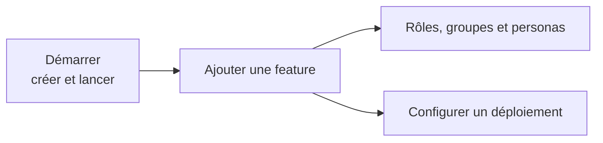

# Guides

Les guides sont des **procédures pas à pas** : ils partent d'un objectif concret (ajouter une fonctionnalité, donner un droit, préparer un déploiement) et vous conduisent jusqu'au résultat vérifié. Ils s'appuient sur les concepts expliqués dans les autres sections et y renvoient quand une notion mérite d'être approfondie.

## Les guides disponibles

| Guide | Objectif | Quand l'utiliser |
|-------|----------|------------------|
| [Ajouter une feature](ajouter-une-feature.md) | Construire de bout en bout une feature complète (« Product ») : domaine, persistance, migration, cas d'usage, API, tests | Dès que vous écrivez votre première fonctionnalité, ou pour retrouver l'ordre des fichiers à créer |
| [Rôles, groupes et personas](ajouter-role-groupe-persona.md) | Ajouter un rôle, un groupe de sécurité ou un utilisateur de test, en local et dans Entra | Quand un nouveau type d'utilisateur doit avoir des droits différents |
| [Configurer un déploiement](configurer-un-deploiement.md) | Lister la configuration, les secrets et l'image Docker nécessaires pour mettre l'API en ligne | Avant le premier déploiement, ou quand une valeur manque sur un nouvel environnement |

## Dans quel ordre les lire

1. Si ce n'est pas fait, créez et lancez un projet avec la section [Démarrer](../demarrer/index.md).
2. Déroulez le tutoriel [Ajouter une feature](ajouter-une-feature.md) : c'est le guide le plus utile pour comprendre comment les couches s'assemblent.
3. Dès qu'une feature a besoin de droits différents, passez à [Rôles, groupes et personas](ajouter-role-groupe-persona.md).
4. Avant de mettre en ligne, suivez [Configurer un déploiement](configurer-un-deploiement.md).

## Les guides ne remplacent pas les concepts

Chaque guide donne la marche à suivre, pas toute la théorie. Si une étape vous laisse perplexe, ouvrez la page de concept correspondante :

- [Architecture](../architecture/index.md) : couches, CQRS, validation, erreurs ;
- [Identité](../identite/index.md) : Entra ID, Keycloak, modèles d'autorisation ;
- [Aspire](../aspire/index.md) : AppHost, émulateurs, secrets ;
- [Tests](../tests/index.md) : tests unitaires et d'intégration ;
- [Référence](../reference/index.md) : options du template, configuration, endpoints.
