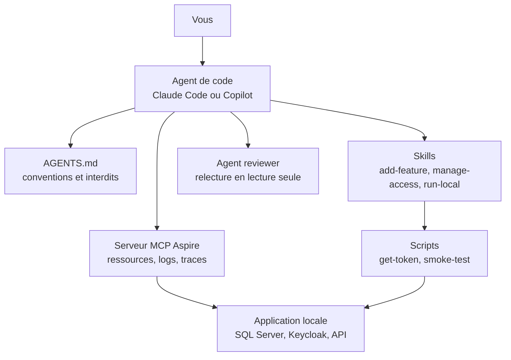

# Harnais agentique

Cette section explique comment travailler avec un **agent de code** (Claude Code ou GitHub Copilot) sur ce template et sur les projets qu'il génère : comment lui apprendre vos conventions, comment lui confier des tâches répétitives et comment lui permettre de voir votre application tourner.

## Le concept simplement

Un **agent de code** est un assistant IA qui ne se contente pas de répondre à des questions : il lit vos fichiers, lance des commandes (build, tests) et modifie le code, étape par étape, jusqu'à atteindre l'objectif que vous lui avez donné. Claude Code et GitHub Copilot (en mode agent) en sont deux exemples.

Un agent neuf ne connaît ni votre projet ni vos règles. Le **harnais** est l'ensemble des fichiers que vous versionnez dans le dépôt pour combler ce manque, comme on équipe un cheval d'un harnais pour canaliser sa force. Il se compose de cinq éléments :

| Élément | Ce que c'est | Analogie |
|---------|--------------|----------|
| `AGENTS.md` | un fichier de consignes à la racine : carte du code, conventions, commandes, interdits | le règlement intérieur affiché à l'entrée |
| **Skill** | une procédure écrite pour une tâche précise (`.claude/skills/<nom>/SKILL.md`), chargée par l'agent quand votre demande correspond à sa description | une fiche de procédure |
| **Agent** (ou sous-agent) | un assistant spécialisé avec ses propres consignes et ses propres outils, par exemple le relecteur `reviewer` | un collègue spécialiste que l'on sollicite |
| **MCP** (Model Context Protocol) | un standard qui permet à l'agent d'appeler des outils externes, ici le serveur MCP d'Aspire qui expose l'application en cours d'exécution | une prise standard qui branche un outil |
| **Scripts** | des commandes que l'agent (ou vous) lance : `get-token`, `smoke-test`, `new-project` | la boîte à outils |

## Pourquoi c'est important

- **Des résultats conformes** : l'agent applique vos conventions (couches, autorisation explicite, validation) au lieu d'en inventer.
- **Des tâches répétables** : « ajouter une feature » suit toujours les mêmes étapes, y compris les tests et la migration, que l'agent ou un humain l'exécute.
- **Des preuves, pas des promesses** : les skills exigent des critères de fin vérifiables (build vert, tests verts, smoke test réussi).
- **Des garde-fous** : chaque skill liste ce que l'agent ne doit jamais faire sans demander (supprimer des volumes, pousser sur un remote, écrire un secret).

## Comment le template le fait

### Claude Code et Copilot lisent les mêmes fichiers

Le template ne maintient pas deux jeux de consignes. `AGENTS.md` est le socle commun, et les skills vivent à un seul endroit.

| Élément | Claude Code | GitHub Copilot |
|---------|-------------|----------------|
| Consignes du dépôt | `CLAUDE.md`, qui importe `AGENTS.md` | `AGENTS.md` et `.github/copilot-instructions.md` |
| Skills | `.claude/skills/<nom>/SKILL.md` | lit aussi `.claude/skills/` ([VS Code](https://code.visualstudio.com/docs/copilot/customization/agent-skills), [Visual Studio](https://learn.microsoft.com/en-us/visualstudio/ide/copilot-agent-skills)) |
| Agents | `.claude/agents/<nom>.md` | `.github/agents/<nom>.agent.md` |
| Serveur MCP Aspire | `.mcp.json` | `.vscode/mcp.json` |

`CLAUDE.md` tient en quelques lignes : il importe `AGENTS.md` avec `@AGENTS.md` et ajoute deux préférences propres à Claude Code.

```markdown title="CLAUDE.md"
--8<-- "CLAUDE.md"
```

### La carte du harnais



### Ce qui vit où

Il y a deux harnais, un par situation.

- **Dans le dépôt du template** : le skill `init-project` et les scripts `eng/init/new-project.*` créent un projet client. Ils ne sont jamais copiés dans un projet généré. Voir [Initialiser un projet](initialiser-un-projet.md).
- **Dans chaque projet généré** : `AGENTS.md`, `CLAUDE.md`, `.github/copilot-instructions.md`, les skills de développement, l'agent `reviewer` et, avec Aspire, `run-local`, `.mcp.json`, `.vscode/mcp.json` et `scripts/smoke-test.*`. Sans Aspire, le skill `run-local`, les fichiers MCP et les scripts ne sont pas générés.

Le fichier `AGENTS.md` d'un projet généré est dérivé de `AGENTS.generated.md`. Voici sa section sur les skills et l'agent, telle que le template la contient avant génération :

```markdown title="AGENTS.generated.md"
--8<-- "AGENTS.generated.md" start="## Skills et agent" before="## Interdits"
```

!!! info "Les lignes `<!--#if -->`"
    Ces lignes sont des directives du moteur de template. Dans un projet généré, seules les branches qui correspondent aux options choisies sont conservées : sans Aspire, la mention de `run-local` disparaît.

Les pages suivantes détaillent chaque élément :

- [Initialiser un projet](initialiser-un-projet.md) : créer un projet client avec un agent, ou sans IA.
- [Skills de développement](skills-de-developpement.md) : `add-feature`, `manage-access`, `run-local`.
- [Agent de revue](agent-de-revue.md) : faire relire un changement.
- [MCP Aspire](mcp-aspire.md) : laisser l'agent observer l'application.
- [Personnaliser le harnais](personnaliser-le-harnais.md) : ajouter vos propres skills et agents.

## À essayer

1. Dans un projet généré, ouvrez `AGENTS.md` et repérez la section « Interdits » : lesquels concernent les secrets ?
2. Listez le contenu de `.claude/skills/` et de `.claude/agents/` : quels fichiers `SKILL.md` existent, et lequel est absent si le projet a été généré sans Aspire ?
3. Comparez `.claude/agents/reviewer.md` et `.github/agents/reviewer.agent.md` : quelle ligne du début diffère, et pourquoi ?

## Pour aller plus loin

- [Claude Code, les skills](https://code.claude.com/docs/en/skills)
- [Claude Code, les sous-agents](https://code.claude.com/docs/en/sub-agents)
- [GitHub Copilot, les instructions personnalisées](https://docs.github.com/en/copilot/customizing-copilot/adding-repository-custom-instructions-for-github-copilot)
- [Le standard AGENTS.md](https://agents.md/)
