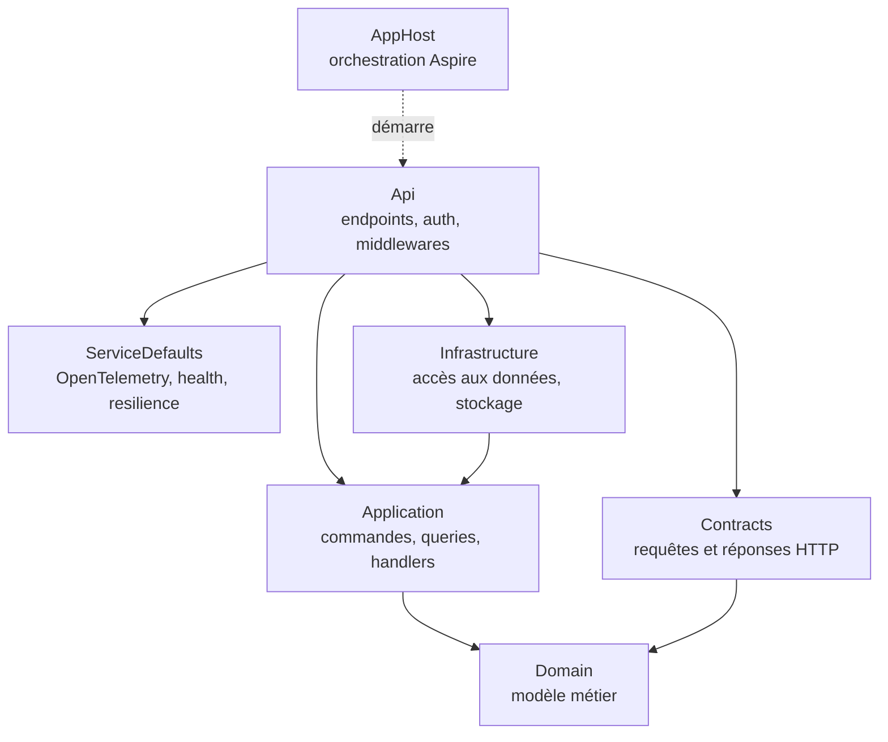

# Accueil

Ce template génère une API ASP.NET Core (.NET 10) organisée en CQRS : chaque action de l'application est soit une commande (qui modifie), soit une query (qui lit), traitée par un handler dédié. Il apporte en plus, prêts à l'emploi, des erreurs normalisées (Problem Details), l'observabilité OpenTelemetry, l'authentification Entra ID et une orchestration locale Aspire (SQL Server, Azurite, Keycloak). Vous créez un projet avec `dotnet new templatewebcqrs` et vous obtenez une base qui démarre en une commande.

Cette documentation est à la fois un guide d'utilisation et un support de cours. Elle s'adresse à des développeurs débutants ou juniors en .NET, à ceux qui découvrent CQRS, Aspire ou OAuth2, et aux personnes qui forment une équipe avec ce template. Chaque notion est expliquée depuis zéro, puis illustrée par le code réel du dépôt, puis mise en pratique dans un encadré « À essayer ».

## Trois parcours de lecture

### Je veux créer une API maintenant

1. [Prérequis](demarrer/prerequis.md) : installer ce qu'il faut sur votre poste.
2. [Créer un projet](demarrer/creer-un-projet.md) : choisir vos options et générer.
3. [Premier lancement](demarrer/premier-lancement.md) : démarrer, obtenir un token, appeler l'API.
4. [Ajouter une feature](guides/ajouter-une-feature.md) : écrire votre première commande ou query.

### Je débute et je veux comprendre

1. [Comprendre les templates](demarrer/qu-est-ce-qu-un-template.md) : ce que fait `dotnet new`.
2. [Architecture](architecture/index.md) : CQRS, Mediator, validation, erreurs.
3. [Fonctionnalités](fonctionnalites/index.md) : observabilité, health checks, rate limiting, OpenAPI.
4. [Aspire](aspire/index.md) : l'orchestration locale.
5. [Identité](identite/index.md) : OAuth2, Entra ID, Keycloak.

### Je forme une équipe

Voici un ordre de cours conseillé, avec une durée indicative par section (lecture et exercices « À essayer » compris).

| Étape | Section | Durée estimée | Objectif |
|-------|---------|---------------|----------|
| 1 | [Démarrer](demarrer/index.md) | 2 h | Générer le projet et l'appeler avec un token |
| 2 | [Architecture](architecture/index.md) | 3 h | Comprendre CQRS, Mediator, validation et erreurs |
| 3 | [Fonctionnalités](fonctionnalites/index.md) | 3 h | Savoir lire une trace, un health check, une limite de débit |
| 4 | [Aspire](aspire/index.md) | 2 h | Comprendre l'AppHost, les émulateurs et les secrets |
| 5 | [Identité](identite/index.md) | 4 h | Maîtriser tokens, rôles, groupes et personas |
| 6 | [Guides](guides/index.md) | 2 h | Ajouter une feature de bout en bout |

Faites réaliser les exercices « À essayer » en séance : ils sont conçus pour être exécutés sur un projet généré.

## La carte du template

Le dépôt est découpé en projets dont les dépendances vont toujours vers le centre (le Domain ne dépend de rien).

L'AppHost ne référence pas l'Api par dépendance de projet : il la démarre par son chemin de fichier `.csproj` (voir [AppHost](aspire/apphost.md)). Le détail des dossiers se trouve dans [Arborescence](reference/arborescence.md).

!!! info "La documentation existe aussi dans le wiki Azure DevOps"
    Le même contenu est généré sous forme de code wiki Azure DevOps (dossier `docs/wiki` du dépôt). Seule la mise en forme change ; le texte est identique. Le [Glossaire](glossaire.md) vous aide si un terme vous échappe.
