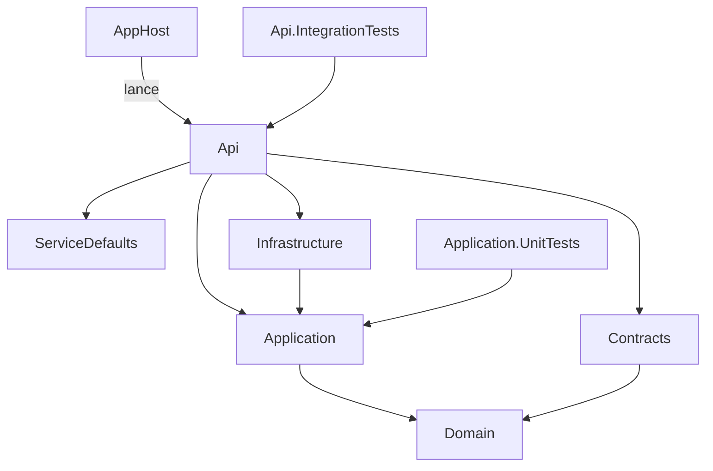

# Arborescence

Cette page présente l'arborescence d'un projet généré avec toutes les options activées, fichier par fichier, puis ce qui change selon les options. L'exemple est un projet `Contoso.Orders` généré avec `AuthorizationModel` = `AppRolesAndGroups` (le modèle le plus complet). Les rôles de chaque couche sont expliqués dans la section [Architecture](../architecture/index.md).

## Les projets et leurs dépendances



L'AppHost ne référence pas l'API comme une bibliothèque : il la lance comme un projet à orchestrer (voir [AppHost](../aspire/apphost.md)). `Domain` ne dépend de rien ; c'est la règle de dépendance de l'architecture en couches.

## L'arborescence commentée

```text
Contoso.Orders/
├── Contoso.Orders.slnx              solution (avec AppHost et ServiceDefaults si Aspire)
├── Directory.Packages.props         versions de tous les paquets NuGet (gestion centralisée)
├── global.json                      version du SDK .NET et lanceur de tests
├── README.md                        README du projet généré
├── .gitignore  .dockerignore
├── scripts/                         (Aspire) obtenir un jeton pour un persona local
│   ├── get-token.ps1
│   └── get-token.sh
├── src/
│   ├── Contoso.Orders.AppHost/                (Aspire) orchestration locale
│   │   ├── Program.cs                         SQL Server, Azurite, Keycloak, API
│   │   ├── Properties/launchSettings.json
│   │   └── Realms/template-realm.json         realm Keycloak importé au premier démarrage
│   ├── Contoso.Orders.ServiceDefaults/        (Aspire) OpenTelemetry, health checks, résilience
│   │   └── Extensions.cs
│   ├── Contoso.Orders.Api/                    couche présentation : HTTP
│   │   ├── Program.cs                         composition de l'application et pipeline
│   │   ├── DependencyInjection.cs
│   │   ├── appsettings.json  appsettings.Development.json
│   │   ├── Api.http                           requêtes de test (IDE)
│   │   ├── Dockerfile  README.md
│   │   ├── Properties/launchSettings.json
│   │   ├── Authentication/                    JWT Entra ID / Keycloak, utilisateur courant
│   │   ├── Authorization/                     policies, rôles, groupes
│   │   ├── Common/RateLimiting/               (EnableRateLimiting) politiques de débit
│   │   ├── Configuration/OpenApiExtensions.cs document OpenAPI et schéma OAuth2
│   │   ├── Controllers/                       endpoints : /me, /admin/ping
│   │   ├── Errors/ErrorHandling.cs            Problem Details
│   │   └── Observability/                     contexte de journalisation par requête
│   ├── Contoso.Orders.Application/            cas d'usage : commandes, queries, handlers
│   │   ├── Common/Behaviors/ValidationBehavior.cs
│   │   ├── Common/Interfaces/                 contrats vers l'infrastructure
│   │   ├── Admin/                             exemple : requête /admin/ping
│   │   └── Users/                             exemple : requête /me
│   ├── Contoso.Orders.Contracts/              requêtes et réponses HTTP
│   ├── Contoso.Orders.Domain/                 modèles du domaine (entités, agrégats, objets valeur)
│   └── Contoso.Orders.Infrastructure/         accès aux données et services externes
│       ├── Persistence/                       ProjectDbContext, repositories
│       └── Services/                          stockage de blobs, horloge
└── tests/                                     (EnableTests)
    ├── Contoso.Orders.Application.UnitTests/  tests de handlers et du ValidationBehavior
    └── Contoso.Orders.Api.IntegrationTests/   tests de l'API en mémoire
```

Le dossier `bin/` et `obj/` de chaque projet n'est pas listé : ils sont produits par la compilation.

## Ce qui change selon les options

| Option | Valeur | Effet sur l'arborescence |
|--------|--------|--------------------------|
| `EnableAspire` | `false` | disparaissent `scripts/`, `AppHost` et `ServiceDefaults` ; la solution ne les référence plus ; `Program.cs` n'appelle plus `AddServiceDefaults()` ni `MapDefaultEndpoints()` |
| `EnableRateLimiting` | `false` | disparaissent `Api/Common/RateLimiting/` et `IntegrationTests/RateLimiting/` ; les endpoints n'appellent plus `RequireRateLimiting` |
| `EnableTests` | `false` | disparaît `tests/` ; la solution ne les référence plus |
| `AuthorizationModel` | `Authenticated` | disparaissent `Authorization/Policies.cs`, `AppRoles.cs`, `GroupOptions.cs`, `Controllers/AdminController.cs`, `Application/Admin/`, `Contracts/Admin/` et les tests correspondants ; le realm ne contient ni rôles ni groupes |
| `AuthorizationModel` | `AppRoles` | disparaissent `GroupOptions.cs` et `IntegrationTests/Authorization/` ; le realm définit les rôles `Admin` et `User` |
| `AuthorizationModel` | `Groups` | disparaît `AppRoles.cs` ; le realm définit le groupe `Administrators` |
| `AuthorizationModel` | `AppRolesAndGroups` | rien ne disparaît ; le realm définit rôles et groupe |

Le détail des règles se trouve dans [Options du template](options-du-template.md).

## Ce qui n'existe que dans le dépôt du template

Ces éléments ne sont jamais générés (voir [Scripts et CI](scripts-et-ci.md)) :

```text
template-CQRS/
├── .template.config/template.json   définition du template (symboles et règles)
├── Directory.Build.props            définit tous les symboles pour compiler le dépôt
├── README.md                        README du dépôt ; README.generated.md devient celui du projet
├── Web.Template.CQRS.Core.slnx      solution sans Aspire, renommée si EnableAspire vaut false
├── src/.../RealmVariants/           variantes du realm Keycloak, une par modèle d'autorisation
├── docs/                            documentation : site/ (sources), wiki/ (généré), superpowers/ (notes)
├── eng/                             verify-template.sh, azure-pipelines/, docs/ (outillage)
├── mkdocs.yml                       configuration du site de documentation
└── .github/workflows/               template-ci.yml, docs.yml
```

## À essayer

1. Générez deux projets, l'un avec `--EnableAspire false`, l'autre avec les options par défaut, et comparez-les avec un outil de comparaison de dossiers.
2. Ouvrez `Contoso.Orders.slnx` dans votre IDE et vérifiez que le dossier `tests` y apparaît seulement si `EnableTests` était activé.
