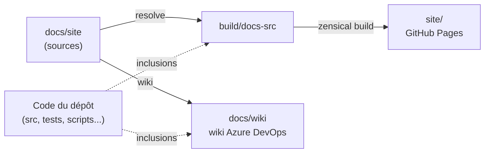
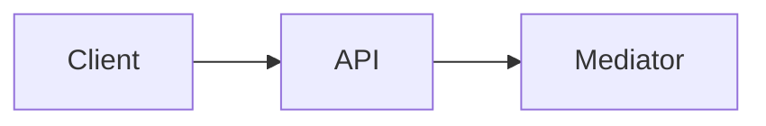

# Contribuer à la doc

Cette page explique comment cette documentation est fabriquée et comment la modifier : où vivent les sources, quelles commandes lancer, quelle syntaxe est autorisée (et pourquoi certaines sont interdites), comment inclure du code réel, et comment publier le wiki de code Azure DevOps. Pour contribuer au template lui-même (code, CI), voir la fin de [Scripts et CI](scripts-et-ci.md).

## Le concept simplement

La documentation est écrite **une seule fois**, en Markdown, dans `docs/site`. Un petit outil Python la transforme en deux publications :

- un **site** (Zensical, avec le thème Material), déployé sur GitHub Pages ;
- un **wiki de code Azure DevOps**, un dossier de fichiers Markdown (`docs/wiki`) que Azure DevOps affiche comme un wiki.

Les deux ne lisent pas le Markdown de la même façon : le site comprend des extensions (encadrés, onglets, icônes) que le wiki Azure DevOps ignore. L'outillage convertit donc ce qu'il sait convertir et **interdit le reste** : c'est la règle d'or de cette page.

## Pourquoi c'est important

- **Une seule source de vérité** : corriger une phrase dans `docs/site` corrige le site et le wiki.
- **Le code montré est le code réel** : les extraits sont inclus depuis les fichiers du dépôt, jamais copiés. Quand le code change, la doc change, et l'outil refuse une ancre qui ne trouve plus rien.
- **Une doc qui ne casse pas en silence** : la CI échoue si une règle de syntaxe est violée, si un lien interne est cassé ou si `docs/wiki` n'est pas à jour.

## Comment le template le fait

### L'organisation

| Chemin | Rôle | Modifiable à la main ? |
|--------|------|------------------------|
| `docs/site/` | sources Markdown de la doc | **oui** : c'est là qu'on écrit |
| `docs/site/assets/` | images (noms de fichier uniques) | oui |
| `mkdocs.yml` | configuration du site **et navigation** (`nav`) | oui |
| `eng/docs/` | l'outillage Python (`docs.py`, `docstool/`, tests) | oui, avec ses tests |
| `docs/wiki/` | wiki Azure DevOps **généré** | **non, jamais** |
| `build/docs-src/` | copie de `docs/site` avec les inclusions résolues | non (ignoré par git) |
| `site/` | site construit | non (ignoré par git) |
| `docs/superpowers/` | notes de conception, jamais publiées | hors doc publiée |



!!! warning "Ne modifiez jamais `docs/wiki` à la main"
    `docs/wiki` est régénéré intégralement (le dossier est supprimé puis recréé) à chaque `python eng/docs/docs.py wiki`. Toute modification manuelle sera perdue, et `check` signale une erreur si le contenu ne correspond pas à ce que produirait la génération. Un fichier `GENERATED.txt` le rappelle dans le dossier.

### Installer l'outillage

Il faut Python 3.12 ou plus récent (la CI utilise 3.13). Depuis la racine du dépôt :

```bash
python -m pip install -r eng/docs/requirements.txt
```

Le fichier installe Zensical, PyYAML et pytest. Les tests de l'outillage se lancent avec :

```bash
python -m pytest eng/docs/tests -q
```

### Les commandes

Toutes se lancent depuis la racine du dépôt avec `python eng/docs/docs.py <commande>`.

| Commande | Ce qu'elle fait | Écrit dans |
|----------|-----------------|------------|
| `resolve` | copie `docs/site` et remplace chaque inclusion par le code réel | `build/docs-src/` |
| `wiki` | régénère le wiki Azure DevOps | `docs/wiki/` |
| `build` | `resolve`, puis `wiki`, puis construit le site en mode strict (un lien cassé fait échouer) | `build/docs-src/`, `docs/wiki/`, `site/` |
| `serve` | `resolve`, puis lance le serveur de prévisualisation Zensical | `build/docs-src/` |
| `check` | vérifie la syntaxe, les inclusions, la navigation et la fraîcheur de `docs/wiki`, sans rien écrire | rien |

`serve` ne résout les inclusions qu'au démarrage : après une modification de `docs/site` ou du code inclus, arrêtez et relancez `serve` pour actualiser la prévisualisation. `check` affiche `docs check: OK` quand tout est correct, sinon une ligne par erreur (`page:ligne: message`) et un code de sortie non nul.

Le cycle de travail habituel :

```bash
python eng/docs/docs.py wiki
python eng/docs/docs.py check
python eng/docs/docs.py build
```

Puis commitez ensemble `docs/site` et `docs/wiki`.

### Écrire une page

Les pages de concept suivent toutes le même fil : `Le concept simplement`, `Pourquoi c'est important`, `Comment le template le fait`, `À essayer`, puis éventuellement `Pour aller plus loin`. Voici un squelette (le bloc est de type `text` : voir plus bas pourquoi).

````text
# Titre de la page

Une ou deux phrases : ce que la page explique et à qui elle sert.

## Le concept simplement

Explication depuis zéro, avec une analogie si possible.

## Pourquoi c'est important

- Ce que cela évite ou apporte.

## Comment le template le fait

```csharp title="src/Web.Template.CQRS.Api/Program.cs"
--8<-- "src/Web.Template.CQRS.Api/Program.cs" start="app.UseCors();" end="app.UseAuthorization();"
```

Commentaire de l'extrait, avec un [lien relatif](../architecture/validation.md).

## À essayer

1. Une manipulation que le lecteur peut faire sur un projet généré.

## Pour aller plus loin

- [Documentation officielle](https://learn.microsoft.com/)
````

Règles de rédaction : français, vouvoiement, public novice, noms de code en anglais, exemples de génération avec `Contoso.Orders`. Un extrait qui contient des directives du template (`#if (EnableAspire)`) s'accompagne d'un encadré `info` : dans un projet généré, seules les branches correspondant aux options sont conservées.

### Ajouter une page à la navigation

La navigation est la clé `nav` de `mkdocs.yml`, et elle sert aussi à construire le wiki. Une page présente dans `docs/site` mais absente de `nav` fait échouer `check`, et inversement.

```yaml title="mkdocs.yml"
--8<-- "mkdocs.yml" start="  - Tests:" end="      - tests/index.md"
```

Règles :

- Chaque entrée a un titre : `- Titre: chemin/page.md`.
- Une section commence par son `index.md`, **sans titre** : `- chemin/index.md` (le titre de la section est celui de la section).
- Les chemins sont relatifs à `docs/site`.
- **Pas de tiret dans les titres.** Dans le wiki Azure DevOps, un tiret du nom de fichier est codé `%2D` ; un titre comme « Pré-requis » donnerait un fichier `Pré%2Drequis.md`. Écrivez « Prérequis ». Les caractères `\ / : * ? " < > | # %` sont aussi retirés des noms.
- Deux pages d'un même dossier ne peuvent pas avoir le même nom de wiki.
- Un lien interne s'écrit en chemin relatif vers le fichier `.md` (`../identite/keycloak-local.md`) ; il doit viser une page de la navigation, sinon la génération du wiki échoue avec la page et le lien fautifs.
- Une image se place dans `docs/site/assets/` et se référence depuis cette arborescence ; deux images ne peuvent pas porter le même nom.

### La syntaxe autorisée

Tout ce qui suit fonctionne sur le site **et** dans le wiki (converti par l'outillage). Les exemples sont dans des blocs `text`, qui montrent la syntaxe sans l'exécuter.

#### Encadrés

Types autorisés : `note`, `info`, `tip`, `warning`, `danger`, `example`, `question`. Le corps est indenté de 4 espaces. `!!!` donne un encadré fixe, `???` un encadré repliable (`???+` : déplié par défaut). Le titre est facultatif. Un encadré se place au niveau racine de la page ou dans un autre encadré ou un onglet, **jamais dans une liste**.

```text
!!! tip "Astuce"
    Corps de l'encadré.

??? example "Repliable"
    Contenu visible après un clic.
```

Dans le wiki, un encadré devient une citation précédée d'une icône Unicode et de son titre.

#### Onglets

Le libellé est entre guillemets, le corps indenté de 4 espaces, avec le même placement que les encadrés.

````text
=== "PowerShell"
    ```powershell
    ./scripts/get-token.ps1 -Persona admin
    ```

=== "Bash"
    ```bash
    scripts/get-token.sh admin
    ```
````

Dans le wiki, chaque onglet devient un libellé en gras suivi de son contenu.

#### Blocs de code

Le seul attribut accepté est `title="..."`, placé après le langage. Dans le wiki, le titre devient une ligne « Fichier : ».

````text
```csharp title="src/Web.Template.CQRS.Api/Program.cs"
var builder = WebApplication.CreateBuilder(args);
```
````

#### Diagrammes mermaid

Un bloc de langage `mermaid` produit un diagramme sur le site. L'outillage le recopie dans le wiki, mais le mermaid du wiki Azure DevOps ne rend pas la plupart des balises HTML : n'écrivez pas de HTML dans les libellés. Par tolérance, la conversion pour le wiki remplace `<br/>`, `<br />` et `<br>` par une espace dans les blocs `mermaid` (le site, lui, garde les sauts de ligne).

````text

````

#### Tableaux, listes, liens

Tableaux Markdown, listes, gras, italique, code en ligne et liens relatifs sont libres.

### Inclure du code réel

Une **inclusion** remplace une ligne par le contenu d'un fichier du dépôt, ou d'un extrait de ce fichier délimité par des ancres de texte. Elle se place seule sur sa ligne, **dans un bloc de code**.

#### La grammaire

```text
--8<-- "chemin/depuis/la/racine"
--8<-- "chemin/depuis/la/racine" start="texte"
--8<-- "chemin/depuis/la/racine" start="texte" end="texte"
--8<-- "chemin/depuis/la/racine" start="texte" before="texte"
```

| Élément | Signification |
|---------|---------------|
| `"chemin"` | chemin du fichier depuis la racine du dépôt, avec des `/` |
| `start=` | première ligne de l'extrait : la **seule** ligne du fichier qui contient ce texte |
| `end=` | dernière ligne de l'extrait, **incluse** : la première ligne contenant ce texte, cherchée **à partir de la ligne de `start`** (celle-ci comprise) |
| `before=` | l'extrait s'arrête juste **avant** la première ligne contenant ce texte, cherchée **à partir de la ligne suivant `start`** : cette ligne est **exclue** |

Les règles complètes :

- Sans `start`, l'extrait commence à la première ligne du fichier ; sans `end` ni `before`, il va jusqu'à la fin du fichier. On utilise `end` ou `before`, jamais les deux. `end` et `before` peuvent s'employer sans `start` : la recherche part alors du début du fichier (`end` dès la première ligne, `before` dès la deuxième).
- Une valeur est entourée de guillemets doubles (`"texte"`) ou simples (`'texte'`). Elle n'est jamais vide et ne contient pas le guillemet qui l'entoure.
- **`start` doit être unique** : l'outil compare le texte à chaque ligne du fichier (comme un simple « contient »). Si le texte n'apparaît nulle part ou apparaît plusieurs fois, l'erreur donne les numéros de ligne concernés.
- La correspondance se fait sur un **morceau de ligne**, pas sur un mot entier ni sur la ligne entière. Les espaces du début comptent seulement si vous les écrivez dans l'ancre.
- L'**indentation commune** des lignes de l'extrait est retirée : un extrait pris au milieu d'une méthode s'affiche sans le décalage de la méthode.
- Les fins de ligne `\r\n` et un éventuel BOM sont ignorés.
- Si la directive est indentée (dans un encadré ou un onglet), chaque ligne de l'extrait reçoit la même indentation.

#### Guillemets simples pour le JSON

Quand l'ancre contient des guillemets doubles (typiquement dans du JSON), entourez-la de guillemets simples.

```text
--8<-- "src/Web.Template.CQRS.Api/appsettings.json" start='"Auth": {' before='"ConnectionStrings"'
```

#### `end` ou `before` ?

Utilisez `before` pour que l'extrait **s'arrête avant le membre suivant** : vous n'avez pas besoin d'ancrer sur la dernière ligne de l'élément. Utilisez `end` quand la dernière ligne souhaitée est reconnaissable.

```text
--8<-- "src/Web.Template.CQRS.ServiceDefaults/Extensions.cs" start="public static TBuilder AddDefaultHealthChecks" before="public static WebApplication MapDefaultEndpoints"
```

Un extrait doit commencer et se terminer sur des instructions complètes : jamais une demi-ligne ni un bloc ouvert sans sa fermeture.

#### Les pièges des ancres

!!! warning "Une ancre courte peut s'arrêter trop tôt"
    La recherche est une simple inclusion de texte, dans l'ordre du fichier. Avec `end="}"`, l'extrait s'arrête à la **première** ligne qui contient une accolade fermante après `start`, même si c'est celle d'un bloc imbriqué. Choisissez une ancre qui identifie sans ambiguïté la ligne voulue (`end="return builder;"`), ou utilisez `before` avec le début de l'élément suivant.

Autres pièges :

- `end` est cherché **à partir de la ligne de `start` elle-même** : si cette ligne contient aussi le texte de `end`, l'extrait ne contient que cette ligne.
- `before` n'est cherché qu'**à partir de la ligne suivante** : le texte de `before` peut donc figurer sur la ligne de `start`.
- Un `start` qui apparaît deux fois (par exemple `public static` ou le nom d'une méthode surchargée) est refusé : ajoutez des caractères pour le rendre unique (`public static TBuilder AddDefaultHealthChecks`).
- Après une modification du code inclus, relancez `check` : une ancre devenue introuvable ou ambiguë est signalée avec la page et la ligne.

Messages d'erreur courants :

| Message | Cause |
|---------|-------|
| `included file not found` | le chemin est faux ou le fichier a été déplacé |
| `start anchor "..." not found` | le texte de `start` n'existe plus dans le fichier |
| `start anchor "..." is ambiguous (lines ...)` | `start` apparaît plusieurs fois, lignes indiquées |
| `end anchor "..." not found after line ...` | `end` n'apparaît pas après `start` |
| `before anchor "..." not found after line ...` | `before` n'apparaît pas après `start` |
| `invalid include directive` | la ligne commence par `--8<--` mais ne respecte pas la grammaire |
| `includes must be inside a code block` | l'inclusion est hors d'un bloc de code |

#### Résultat

Voici une vraie inclusion et son résultat :

```text
--8<-- "src/Web.Template.CQRS.Api/Authentication/AuthOptions.cs" start="public AuthProvider Provider" end="public string? Authority"
```

```csharp title="src/Web.Template.CQRS.Api/Authentication/AuthOptions.cs"
--8<-- "src/Web.Template.CQRS.Api/Authentication/AuthOptions.cs" start="public AuthProvider Provider" end="public string? Authority"
```

#### Montrer la syntaxe sans l'exécuter

Une ligne qui commence par `--8<--` est toujours traitée comme une inclusion, même dans un bloc de code ordinaire. Pour **afficher** la syntaxe d'inclusion (comme sur cette page), placez-la dans un bloc de langage `text` (` ```text `) : l'outillage laisse alors ces lignes telles quelles, sans les résoudre ni les valider. N'utilisez pas `text` pour un extrait réel : la ligne ne serait pas remplacée par le code.

### Ce qui est interdit, et pourquoi

Le wiki de code Azure DevOps affiche du Markdown standard. Il ne comprend pas les extensions du thème Material. L'outillage sait convertir trois constructions (encadrés, onglets, titres de blocs de code) ; tout le reste doit rester du Markdown simple, sinon il s'afficherait en texte brut dans le wiki.

| Interdit | Exemple (non exécutable) | Pourquoi | Détecté par `check` |
|----------|--------------------------|----------|:-------------------:|
| Icônes par code | `:material-…:`, `:fontawesome-…:` | non rendues par le wiki | oui |
| Listes d'attributs | un élément suivi de `{ .class }` en fin de ligne | syntaxe d'extension absente du wiki | oui |
| Blocs `///` | blocs d'extension commençant par trois barres obliques | syntaxe d'extension absente du wiki | oui |
| HTML brut en bloc | une ligne commençant par `<div` | le rendu n'est pas garanti dans le wiki | oui |
| Attributs de bloc de code autres que `title` | numéros de ligne, surlignage | non convertis | oui |
| Types d'encadré non autorisés | `!!! abstract` | pas de conversion prévue | oui |
| Lien vers une page hors navigation | un lien vers une page orpheline | la génération du wiki échoue | oui (via `wiki` et `check`) |
| Annotations de code | marqueurs numérotés dans un commentaire de bloc | n'existent pas dans le wiki | non : à éviter |
| Encadré ou onglet dans une liste | liste puis encadré indenté | le Markdown simple du wiki ne le rend pas correctement | non : à éviter |
| Tiret dans un titre de navigation | `Pré-requis` | codé `%2D` dans les noms du wiki | non : à éviter |

Quand un besoin dépasse cette liste (un schéma, un tableau complexe), préférez un diagramme mermaid ou un tableau Markdown plutôt que d'ajouter une extension.

### Publier le wiki de code Azure DevOps

Le dossier `docs/wiki` suit le format d'un *code wiki* : une page par fichier, un fichier `.order` par dossier qui fixe l'ordre des pages, un dossier `.attachments` pour les images. Azure DevOps peut publier un dossier d'un dépôt comme wiki.

**Par l'interface** : dans votre projet Azure DevOps, ouvrez *Overview*, puis *Wiki*, puis *Publish code as wiki*. Choisissez :

- le dépôt qui contient le template ;
- la branche `main` ;
- le dossier `/docs/wiki` ;
- le nom du wiki, par exemple « Template Web CQRS ».

**Par la ligne de commande** (extension `azure-devops` d'Azure CLI) :

```bash
az devops wiki create --name "Template Web CQRS" --type codewiki --repository <Repo> --mapped-path /docs/wiki --version main
```

Remplacez `<Repo>` par le nom du dépôt Azure Repos.

Une fois publié, le wiki **suit `main` automatiquement** : chaque commit sur `main` qui modifie `docs/wiki` met le wiki à jour, sans pipeline de publication. C'est pourquoi `docs/wiki` est commité avec les sources et pourquoi `check` vérifie sa fraîcheur : le pipeline `eng/azure-pipelines/docs-ci.yml` (voir [Scripts et CI](scripts-et-ci.md)) échoue si l'on a oublié de régénérer.

### Zensical et le repli Material for MkDocs

Le site est construit avec **Zensical**, successeur de Material for MkDocs développé par la même équipe, qui lit directement le fichier `mkdocs.yml` (thème `material`, extensions Markdown de la famille Python-Markdown). Sa version est épinglée dans `eng/docs/requirements.txt`.

Zensical est jeune : si une régression vous bloque, le même `mkdocs.yml` reste écrit dans la syntaxe de Material for MkDocs. Le repli consiste à installer `mkdocs-material` à la place de Zensical, à lancer `python eng/docs/docs.py resolve`, puis `mkdocs build --strict` depuis la racine. Les commandes `wiki` et `check` n'utilisent pas Zensical et restent inchangées. Ce repli n'est pas automatisé par `docs.py` (seul `build` lance Zensical).

## À essayer

1. Ajoutez une page de test dans `docs/site/` et référencez-la dans `nav` de `mkdocs.yml` : lancez `check` et vérifiez qu'il réclame d'abord la régénération du wiki, puis lancez `wiki` et `check` à nouveau.
2. Dans une page de test, écrivez une inclusion avec `end="}"` sur une méthode contenant un bloc imbriqué : observez où l'extrait s'arrête, puis corrigez l'ancre.
3. Écrivez deux fois la même ancre `start` dans un fichier de test : lisez le message d'erreur et ses numéros de ligne.
4. Lancez `python eng/docs/docs.py serve`, ouvrez la page dans le navigateur, puis arrêtez le serveur, modifiez un texte, relancez `serve` et constatez le changement.

## Pour aller plus loin

- [Zensical](https://zensical.org/) : le générateur de site utilisé.
- [Publish a Git repository to a wiki](https://learn.microsoft.com/en-us/azure/devops/project/wiki/publish-repo-to-wiki) : la publication d'un wiki de code Azure DevOps.
