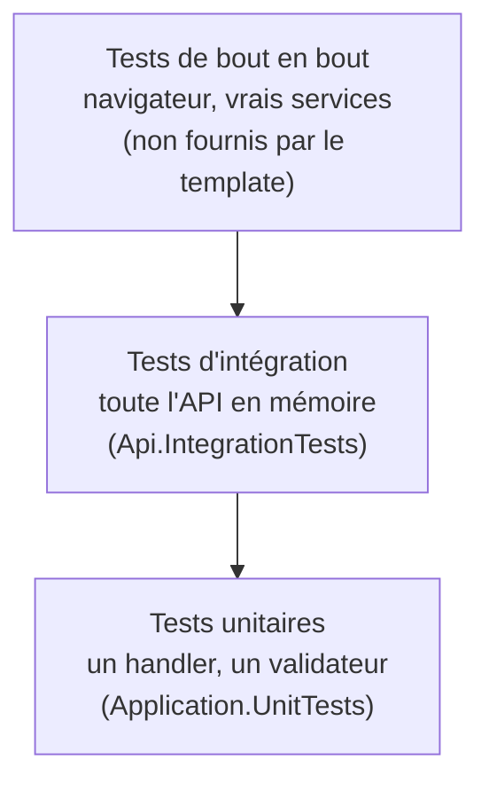
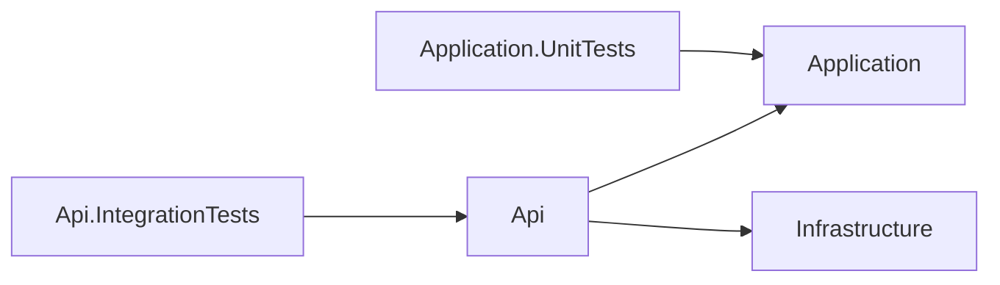

# Tests

Cette page explique comment le template teste son API : quels projets de tests il contient, comment on teste un handler seul, comment on teste toute l'API en mémoire avec un faux utilisateur, et comment on lance le tout. Elle sert aussi de point de départ pour écrire les tests de vos propres features.

## Le concept simplement

### La pyramide des tests

Un test automatisé est un petit programme qui appelle votre code et vérifie le résultat. On en écrit de plusieurs sortes, qu'on range classiquement en **pyramide** : beaucoup de tests rapides en bas, peu de tests lourds en haut.



| Niveau | Ce qu'il vérifie | Vitesse | Dans le template |
|--------|------------------|---------|------------------|
| Unitaire | une classe isolée : un handler, un validateur, un comportement | quelques millisecondes | `Application.UnitTests` |
| Intégration | plusieurs couches ensemble : routage HTTP, authentification, autorisation, validation, gestion d'erreurs | quelques centaines de millisecondes | `Api.IntegrationTests` |
| Bout en bout | l'application déployée avec ses vrais services | secondes ou minutes | non fourni |

### Doublure de test

Pour tester une classe seule, on remplace ses dépendances par des **doublures** (*test doubles*) : des objets simplifiés qui se comportent comme les vrais mais sans effet extérieur. Le template écrit ses doublures à la main, sans bibliothèque de simulation. Un **faux** (*fake*) est une doublure qui a une vraie logique minimale : par exemple un faux stockage de blobs qui répond « envoyé » sans contacter Azure.

### `WebApplicationFactory`

`WebApplicationFactory<Program>` est une classe de Microsoft qui démarre **toute votre API dans le processus de test**, sans port réseau : le client HTTP qu'elle fournit parle directement à l'application en mémoire. Vous gardez donc le vrai pipeline (routage, middlewares, validation, erreurs) tout en pouvant remplacer certains services par des doublures.

## Pourquoi c'est important

- **Un handler s'écrit et se teste sans HTTP ni base** : le test unitaire est le plus rapide et le plus précis pour localiser un bug.
- **Les règles de sécurité se vérifient** : un test d'intégration prouve qu'un utilisateur ordinaire reçoit 403 et qu'un appel anonyme reçoit 401. Sans test, ces règles régressent sans bruit.
- **Aucune infrastructure nécessaire** : pas de SQL Server, pas de Keycloak, pas de Docker pour lancer les tests. Ils tournent sur n'importe quelle machine, y compris l'intégration continue.
- **Un filet de sécurité pour le template lui-même** : quand vous modifiez du code généré, les tests existants vous disent ce que vous avez cassé.

## Comment le template le fait

### Les projets de tests

Un projet généré avec `EnableTests` (activé par défaut) contient deux projets dans `tests/`.

| Projet | Référence | Contenu |
|--------|-----------|---------|
| `*.Application.UnitTests` | `Application` | tests des handlers et du `ValidationBehavior`, faux `FakeCurrentUser` |
| `*.Api.IntegrationTests` | `Api` | tests des endpoints via `WebApplicationFactory`, authentification de test, bases en mémoire |



Le projet d'intégration référence `Api` et reçoit donc, par transitivité, `Application` et `Infrastructure` (voir [l'architecture](../architecture/index.md)). Le projet unitaire ne référence que `Application`, ce qui l'empêche d'utiliser du code d'infrastructure.

### xUnit v3 et Microsoft.Testing.Platform

Les tests utilisent **xUnit v3** (paquet `xunit.v3`). Avec xUnit v3, chaque projet de tests est un **exécutable** (`<OutputType>Exe</OutputType>`) qui embarque son propre lanceur. La commande `dotnet test` s'appuie, elle, sur **Microsoft.Testing.Platform**, le nouveau moteur de tests de Microsoft, à la place de l'ancien VSTest. C'est le fichier `global.json` à la racine qui le déclare :

```json title="global.json"
--8<-- "global.json"
```

La section `test.runner` indique à `dotnet test` d'utiliser Microsoft.Testing.Platform. Conséquence pratique : on désigne ce qu'on teste avec `--solution` ou `--project`, et non plus en passant simplement le chemin.

```xml title="tests/Web.Template.CQRS.Application.UnitTests/Web.Template.CQRS.Application.UnitTests.csproj"
--8<-- "tests/Web.Template.CQRS.Application.UnitTests/Web.Template.CQRS.Application.UnitTests.csproj" start="<PropertyGroup>" end="</ItemGroup>"
```

Le `<Using Include="Xunit" />` évite d'écrire `using Xunit;` dans chaque fichier. Dans les tests, le jeton d'annulation vient de `TestContext.Current.CancellationToken`, fourni par xUnit v3.

### Tester un handler

Un handler est une classe ordinaire. Le test crée une doublure de sa dépendance, appelle `Handle` directement et vérifie le résultat. Voici le test de `GetCurrentUserQueryHandler` : le faux `FakeCurrentUser` remplace l'accès aux claims HTTP.

```csharp title="tests/Web.Template.CQRS.Application.UnitTests/Users/GetCurrentUserQueryHandlerTests.cs"
--8<-- "tests/Web.Template.CQRS.Application.UnitTests/Users/GetCurrentUserQueryHandlerTests.cs" start="public sealed class GetCurrentUserQueryHandlerTests"
```

Le test suit le schéma **Arrange, Act, Assert** : préparer (`currentUser`, `handler`), agir (`Handle`), vérifier (`Assert`). Le nom `Handle_ReturnsCurrentUserIdentityRolesAndGroups` décrit l'action testée puis le résultat attendu : prenez cette habitude, il tient lieu de documentation.

```csharp title="tests/Web.Template.CQRS.Application.UnitTests/Fakes/FakeCurrentUser.cs"
--8<-- "tests/Web.Template.CQRS.Application.UnitTests/Fakes/FakeCurrentUser.cs" start="public sealed class FakeCurrentUser"
```

### Tester toute l'API : `ApiFactory`

Pour les tests d'intégration, `ApiFactory` dérive de `WebApplicationFactory<Program>` et configure l'application pour les tests. Trois choses y sont remplacées ou fixées.

```csharp title="tests/Web.Template.CQRS.Api.IntegrationTests/Infrastructure/ApiFactory.cs"
--8<-- "tests/Web.Template.CQRS.Api.IntegrationTests/Infrastructure/ApiFactory.cs" start="public sealed class ApiFactory"
```

!!! info "Directives de template"
    Ce fichier est un extrait de la **source du template** : les lignes `#if (UseGroups)` et `#endif` sont des directives traitées lors de la génération. Dans un projet généré, seules les branches correspondant à vos options sont conservées. Sans le modèle `Groups`, vous n'avez ni la constante `AdministratorsGroupId` ni la ligne `UseSetting("Authorization:Groups:Administrators", ...)`.

1. **L'environnement `Testing`** (`UseEnvironment("Testing")`). Il se distingue de `Development` : Scalar n'est pas exposé, mais les health checks restent disponibles (voir [Health checks](../fonctionnalites/health-checks.md)). Les réglages `Auth:*` sont fournis directement pour que la validation au démarrage de l'authentification réussisse sans Keycloak.
2. **L'authentification** : le schéma `Test` remplace le schéma JWT. Aucun vrai token n'est nécessaire (voir la section suivante).
3. **Les services externes** :
    - **SQL Server est remplacé par EF Core InMemory** : on retire les enregistrements de `ProjectDbContext` puis on le réenregistre avec `UseInMemoryDatabase`. Le test `DbContext_IsReplacedByInMemoryProvider` vérifie ce remplacement.
    - **Le stockage Azure est remplacé par un faux** : `FakeBlobService` implémente `IBlobService` et renvoie une URL fictive, sans réseau.

```csharp title="tests/Web.Template.CQRS.Api.IntegrationTests/Infrastructure/FakeBlobService.cs"
--8<-- "tests/Web.Template.CQRS.Api.IntegrationTests/Infrastructure/FakeBlobService.cs" start="public sealed class FakeBlobService"
```

!!! warning "InMemory n'est pas SQL Server"
    Le fournisseur en mémoire ne vérifie ni les contraintes relationnelles ni le SQL réel : un test qui passe ne garantit pas qu'une migration ou une requête fonctionne sur SQL Server. Il sert à tester la logique et le pipeline HTTP, pas la base. Autre conséquence : tous les tests d'une même `ApiFactory` partagent la même base en mémoire (nommée `api-integration-tests`) ; ne supposez donc pas qu'elle est vide.

Le fait que le client puisse démarrer `Program` vient de la dernière ligne de `Program.cs`, `public partial class Program { }` : sans elle, la classe générée par le compilateur serait inaccessible à `WebApplicationFactory<Program>`.

### Se faire passer pour un utilisateur : `TestAuthHandler`

En production, l'API valide un token JWT émis par Entra ID ou Keycloak. Les tests ne peuvent pas obtenir de vrai token. `TestAuthHandler` est donc un **schéma d'authentification de test** : il fabrique l'identité à partir d'en-têtes HTTP que le test envoie lui-même.

| En-tête | Rôle | Claim produit |
|---------|------|---------------|
| `X-Test-User` | identifiant de l'utilisateur ; **sans lui, l'appel est anonyme** | `oid`, `sub`, `name`, `email` |
| `X-Test-Roles` | rôles séparés par des virgules | un claim `roles` par rôle |
| `X-Test-Groups` | identifiants de groupes séparés par des virgules | un claim `groups` par groupe |

```csharp title="tests/Web.Template.CQRS.Api.IntegrationTests/Infrastructure/TestAuthHandler.cs"
--8<-- "tests/Web.Template.CQRS.Api.IntegrationTests/Infrastructure/TestAuthHandler.cs" start="public sealed class TestAuthHandler("
```

Sans `X-Test-User`, le handler renvoie `NoResult` : la requête est anonyme, et le serveur répond 401 sur un endpoint protégé. Les claims produits portent les mêmes noms que ceux d'un vrai token (`oid`, `roles`, `groups`), si bien que le code de production (`HttpCurrentUser`, les policies) les lit sans le savoir. Les en-têtes `roles` et `groups` seuls, sans `X-Test-User`, ne suffisent pas : un test le vérifie (`Me_WithRolesHeaderButNoUser_Returns401`).

Pour éviter d'écrire les en-têtes à la main, une méthode d'extension les pose :

```csharp title="tests/Web.Template.CQRS.Api.IntegrationTests/Infrastructure/TestUserExtensions.cs"
--8<-- "tests/Web.Template.CQRS.Api.IntegrationTests/Infrastructure/TestUserExtensions.cs" start="public static class TestUserExtensions"
```

### Un test d'intégration complet

Les tests de `CurrentUserEndpointTests` montrent les trois cas types : anonyme (401), connecté avec des rôles et des groupes (200 et contenu du corps), connecté sans rien (tableaux vides).

```csharp title="tests/Web.Template.CQRS.Api.IntegrationTests/Users/CurrentUserEndpointTests.cs"
--8<-- "tests/Web.Template.CQRS.Api.IntegrationTests/Users/CurrentUserEndpointTests.cs" start="public sealed class CurrentUserEndpointTests"
```

Remarquez `IClassFixture<ApiFactory>` : xUnit crée **une** `ApiFactory` par classe de tests et la fournit au constructeur. Démarrer l'application coûte cher ; la partager entre les tests d'une classe garde la suite rapide.

Pour l'autorisation, `AdminEndpointTests` suit le même modèle sur `/admin/ping` : `AsUser("standard-user", roles: [AppRoles.User])` attend 403, `AsUser("admin-by-role", roles: [AppRoles.Admin])` attend 200 et le message `pong`, et l'appel sans `AsUser` attend 401. Selon le modèle d'autorisation choisi à la génération, des tests sur les groupes s'ajoutent ou remplacent ceux sur les rôles (voir [Modèles d'autorisation](../identite/modeles-d-autorisation.md)).

D'autres tests d'intégration du template couvrent le [format des erreurs](../architecture/erreurs-et-problem-details.md) (`ErrorHandlingTests`), la [limitation de débit](../fonctionnalites/rate-limiting.md) (`RateLimitingTests`) et la validation de la configuration des groupes (`GroupOptionsValidationTests`).

### Lancer les tests

Depuis la racine du projet généré (remplacez `Contoso.Orders` par le nom de votre projet) :

```bash
# toute la solution
dotnet test --solution Contoso.Orders.slnx

# un seul projet de tests
dotnet test --project tests/Contoso.Orders.Application.UnitTests

# filtrer par nom de méthode (le caractère * remplace n'importe quel texte)
dotnet test --solution Contoso.Orders.slnx --filter-method "*Ping_AsStandardUser*"

# filtrer par nom de classe
dotnet test --solution Contoso.Orders.slnx --filter-class "*CurrentUserEndpointTests"
```

Les options `--filter-method`, `--filter-class`, `--filter-namespace` et `--filter-trait` sont celles de xUnit v3 sous Microsoft.Testing.Platform. Le résumé final indique le nombre de tests réussis, échoués et ignorés.

!!! tip "Dans votre IDE"
    Rider et Visual Studio découvrent aussi les tests xUnit v3 : un clic sur la flèche verte à côté d'un test le lance et permet de le déboguer pas à pas.

### Où ajouter les tests d'une nouvelle feature

| Ce que vous avez écrit | Où tester | Comment |
|------------------------|-----------|---------|
| Un validateur | `Application.UnitTests/<Feature>/` | instancier le validateur et appeler `Validate` |
| Un handler | `Application.UnitTests/<Feature>/` | créer un faux repository dans `Fakes/` |
| Un endpoint (statuts, autorisation, format d'erreur) | `Api.IntegrationTests/<Feature>/` | `ApiFactory` et `AsUser` |
| Une règle du domaine | un test dans `Application.UnitTests` ou un projet dédié | appeler directement l'agrégat |

Un tutoriel complet applique cette table : [Ajouter une feature](../guides/ajouter-une-feature.md) écrit les tests unitaires et d'intégration d'une feature « Product ».

## À essayer

1. Lancez `dotnet test --solution <votre-projet>.slnx` et relevez le nombre de tests de chaque projet.
2. Dans `AdminEndpointTests`, changez `AppRoles.User` en `AppRoles.Admin` dans le test `Ping_AsStandardUser_Returns403` (le nom ne correspond plus au contenu, c'est voulu) et relancez-le avec `--filter-method`. Pourquoi échoue-t-il ? Remettez ensuite la valeur d'origine.
3. Écrivez un test d'intégration qui appelle `/me` avec `AsUser("alice", roles: ["Admin"])` et vérifie que `Roles` contient `Admin`.
4. Pourquoi `Me_WithRolesHeaderButNoUser_Returns401` est-il utile ? Que se passerait-il si `TestAuthHandler` créait l'identité même sans `X-Test-User` ?
5. Dans `ApiFactory`, repérez l'endroit où l'on remplace la base de données : que se passerait-il si on le retirait et que la chaîne de connexion `projectdb` est vide ?

## Pour aller plus loin

- [xUnit.net v3](https://xunit.net/docs/getting-started/v3/getting-started)
- [Tests d'intégration dans ASP.NET Core](https://learn.microsoft.com/aspnet/core/test/integration-tests)
- [Microsoft.Testing.Platform et `dotnet test`](https://learn.microsoft.com/dotnet/core/testing/unit-testing-with-dotnet-test)
