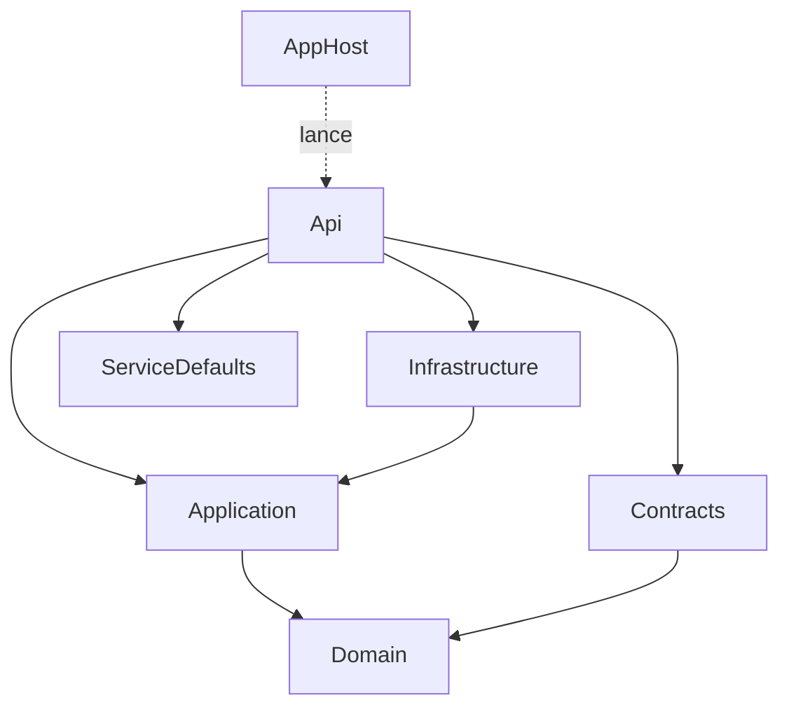

# Architecture

Cette section explique comment le code du template est organisé et pourquoi. Vous y apprendrez à lire la solution, à savoir dans quel projet placer un nouveau fichier, et à suivre une requête de bout en bout. Les trois autres pages approfondissent un sujet chacune : [CQRS et Mediator](/Architecture/CQRS-et-Mediator.md), [Validation](/Architecture/Validation.md) et [Erreurs et Problem Details](/Architecture/Erreurs-et-Problem-Details.md).

## Le concept simplement

Le template suit la **Clean Architecture** (« architecture propre »). L'idée tient en une règle : **les dépendances pointent vers l'intérieur**. Le code métier se trouve au centre, et il ne connaît ni la base de données, ni HTTP, ni Azure. Ce sont, au contraire, ces détails techniques qui connaissent le métier.

Pensez à une prise électrique : l'appareil (le métier) définit la forme de la fiche dont il a besoin, et c'est à la prise (la base de données, le stockage) de s'y adapter. En code, cette « forme de fiche » est une **interface** définie au centre, dans `Application`, et implémentée à l'extérieur, dans `Infrastructure` ou `Api`.

Les cercles de la Clean Architecture, du centre vers l'extérieur :

1. `Domain` : les objets métier et leurs règles. Ne dépend de rien.
2. `Application` : les cas d'usage (commandes, queries, validation) et les interfaces dont ils ont besoin. Dépend de `Domain`.
3. `Infrastructure` et `Api` : les détails techniques (EF Core, Azure Blob, HTTP, authentification). Dépendent d'`Application`.

## Pourquoi c'est important

- **Le métier reste testable** : sans base ni serveur web, un test unitaire d'un handler s'exécute en quelques millisecondes.
- **Les détails techniques sont remplaçables** : changer de base de données ou de fournisseur de stockage ne touche pas aux cas d'usage.
- **Chaque fichier a une place évidente** : quand un projet grossit, vous n'avez pas à vous demander où ranger du code.
- **Le compilateur fait respecter la règle** : si `Domain` ne référence aucun autre projet, il est impossible d'y écrire par erreur un `using` vers EF Core.

## Comment le template le fait

### Le rôle de chaque projet

| Projet | Rôle | Référence |
|--------|------|-----------|
| `Web.Template.CQRS.Domain` | Modèles de base du domaine : `Entity`, `AggregateRoot`, `ValueObject` | aucun projet |
| `Web.Template.CQRS.Application` | Commandes, queries, handlers, validateurs, interfaces (`ICurrentUser`, `IRepository`, `IBlobService`) | `Domain` |
| `Web.Template.CQRS.Contracts` | Les types échangés avec les clients de l'API (réponses JSON) | `Domain` |
| `Web.Template.CQRS.Infrastructure` | Implémentations techniques : EF Core, Azure Blob, horloge | `Application` |
| `Web.Template.CQRS.Api` | Point d'entrée HTTP : endpoints, authentification, autorisation, gestion d'erreurs | `Application`, `Infrastructure`, `Contracts`, `ServiceDefaults` |
| `Web.Template.CQRS.ServiceDefaults` | Configuration partagée : OpenTelemetry, health checks, résilience, découverte de services | paquets NuGet uniquement |
| `Web.Template.CQRS.AppHost` | Chef d'orchestre local d'Aspire (SQL Server, stockage, Keycloak, API) | déclare l'API dans son `Program.cs` |

Les projets `ServiceDefaults` et `AppHost` n'existent que si vous avez activé l'option Aspire (voir [Options du template](/Référence/Options-du-template.md)). L'`AppHost` ne référence pas l'API par une `ProjectReference` : il la déclare avec `AddProject("api", "../Web.Template.CQRS.Api/Web.Template.CQRS.Api.csproj")`.

### Le graphe des références

Ce diagramme reprend les `ProjectReference` des fichiers `.csproj`. Une flèche signifie « référence ».



Remarquez que `Application` ne référence pas `Infrastructure` : le sens est inverse. `Infrastructure` implémente les interfaces d'`Application`, et c'est l'`Api` qui, au démarrage, relie les deux.

> ℹ️ **Pourquoi l'Api référence l'Infrastructure**
>
> Le projet `Api` est la « racine de composition » : c'est le seul endroit qui connaît toutes les couches pour les assembler. Les handlers, eux, ne voient jamais `Infrastructure`.

### Où placer un nouveau fichier

| Je veux ajouter… | Projet | Dossier |
|------------------|--------|---------|
| Une query (lecture) | `Application` | `<Feature>/Queries/<NomQuery>/` |
| Une commande (écriture) | `Application` | `<Feature>/Commands/<NomCommande>/` |
| Un validateur | `Application` | à côté de la commande ou de la query |
| Le résultat renvoyé par un handler | `Application` | `<Feature>/Common/` |
| Une interface vers un service externe | `Application` | `Common/Interfaces/<Domaine>/` |
| Son implémentation (base, stockage, API tierce) | `Infrastructure` | `Services/` ou `Persistence/` |
| Un objet métier ou un value object | `Domain` | un dossier par concept |
| Le JSON renvoyé au client | `Contracts` | `<Feature>/` |
| Un endpoint HTTP | `Api` | `Controllers/` |
| Une règle d'autorisation | `Api` | `Authorization/` |
| Un middleware ou un réglage transverse HTTP | `Api` | `Common/` ou `Observability/` |

Le guide [Ajouter une feature](/Guides/Ajouter-une-feature.md) applique ce tableau pas à pas.

### Les modèles du domaine

Le projet `Domain` du template ne contient pas de règles métier, car elles dépendent de votre application. Il fournit les briques de base à étendre.

- **`Entity<TId>`** : un objet défini par son **identité**. Deux entités sont égales si leur `Id` est égal, même si leurs autres champs diffèrent (une commande reste « la commande 42 » quand son statut change).
- **`AggregateRoot<TId>`** : une entité qui sert de point d'entrée à un groupe d'objets cohérent. On ne modifie le groupe qu'en passant par elle.
- **`ValueObject`** : un objet défini par ses **valeurs**, sans identité. Deux adresses identiques sont interchangeables.

`ValueObject` est la plus instructive : vous y déclarez les composantes qui comptent pour l'égalité, et la classe de base en déduit `Equals`, `==` et `GetHashCode`.

**Fichier :** `src/Web.Template.CQRS.Domain/Common/Models/ValueObject.cs`

```csharp
namespace Web.Template.CQRS.Domain.Common.Models;

public abstract class ValueObject : IEquatable<ValueObject>
{
    public abstract IEnumerable<object> GetEqualityComponents();

    public bool Equals(ValueObject? other)
    {
        return Equals((object?)other);
    }

    public override bool Equals(object? obj)
    {
        if (obj is null || obj.GetType() != GetType())
        {
            return false;
        }

        var valueObject = (ValueObject) obj;

        return GetEqualityComponents().SequenceEqual(valueObject.GetEqualityComponents());
    }

    public static bool operator ==(ValueObject left, ValueObject right)
    {
        return Equals(left, right);
    }

    public static bool operator !=(ValueObject left, ValueObject right)
    {
        return !(left == right);
    }

    public override int GetHashCode()
    {
        return GetEqualityComponents()
            .Select(x => x?.GetHashCode() ?? 0)
            .Aggregate((x, y) => x ^ y);
    }
}
```

Pour créer le vôtre, héritez de `ValueObject` et listez les composantes dans `GetEqualityComponents` (pour un montant, par exemple, sa valeur et sa devise).

### Les dépôts : `IRepository` et `BaseRepository`

`IRepository<T>` est un exemple d'interface définie au centre. Elle décrit ce dont les cas d'usage ont besoin pour persister des objets, sans dire comment.

**Fichier :** `src/Web.Template.CQRS.Application/Common/Interfaces/Persistence/IRepository.cs`

```csharp
public interface IRepository<T>
{
    Task<T?> GetByIdAsync(ValueObject id);
    Task<IEnumerable<T>> GetAllAsync(params Expression<Func<T, object>>[] includes);
    Task<T> AddAsync(T entity);
    Task<T> UpdateAsync(T entity);
    Task<bool> DeleteAsync(ValueObject id);
}
```

`BaseRepository<TEntity, TContext>`, dans `Infrastructure`, en fournit une implémentation générique avec EF Core. Pour un nouvel agrégat, vous héritez de cette classe (déclarée `public abstract class BaseRepository<TEntity, TContext> : IRepository<TEntity>`) au lieu de tout réécrire. Voici, par exemple, l'ajout d'une entité.

**Fichier :** `src/Web.Template.CQRS.Infrastructure/Persistence/Repositories/BaseRepository.cs`

```csharp
public async Task<TEntity> AddAsync(TEntity entity)
{
    var res = Context.Set<TEntity>().Add(entity);
    await Context.SaveChangesAsync();
    return res.Entity;
}
```

Le `BaseRepository` ne contient que les opérations communes (ajout, mise à jour, suppression, lecture). Les requêtes propres à un agrégat se placent dans une classe fille. Le template ne fournit pas d'agrégat concret : le dépôt de base est un point de départ pour vos propres entités.

### L'injection de dépendances, couche par couche

Chaque couche expose une méthode d'extension qui enregistre ses propres services. `Program.cs` se contente de les appeler dans l'ordre.

**Fichier :** `src/Web.Template.CQRS.Api/Program.cs`

```csharp
builder.Services.AddEndpointsApiExplorer();
builder.Services.AddOpenApiExtensions(authOptions);
builder.Services.AddPresentation(builder.Configuration, builder.Environment);
builder.Services.AddApplication();
builder.Services.AddInfrastructure(builder.Configuration);
```

| Méthode | Projet | Ce qu'elle enregistre |
|---------|--------|-----------------------|
| `AddPresentation` | `Api` | authentification, autorisation, `HttpContextAccessor`, `ICurrentUser` |
| `AddApplication` | `Application` | Mediator, comportement de validation, validateurs (voir [CQRS et Mediator](/Architecture/CQRS-et-Mediator.md)) |
| `AddInfrastructure` | `Infrastructure` | `DbContext` SQL Server, clients Azure Blob, `IDateTimeProvider`, `IBlobService` |

C'est ici que la règle des dépendances se concrétise : `AddPresentation` enregistre `HttpCurrentUser` (qui lit les claims du token) comme implémentation de `ICurrentUser`, une interface qu'`Application` a définie sans rien savoir de HTTP.

> ℹ️ **Les lignes `#if` du dépôt**
>
> Dans le dépôt template, `Program.cs` contient des directives comme `#if (EnableAspire)` ou `#if (EnableRateLimiting)`, absentes de l'extrait ci-dessus mais présentes ailleurs dans le fichier. Dans un projet généré, seules les branches correspondant à vos options sont conservées.

## À essayer

1. Ouvrez `Web.Template.CQRS.Domain.csproj` : constatez qu'il ne contient aucune `ProjectReference`.
2. Ouvrez `Web.Template.CQRS.Application.csproj` : quelle seule référence de projet y trouvez-vous ? Vérifiez qu'`Infrastructure` n'y figure pas.
3. Dans `Application`, cherchez où `ICurrentUser` est défini, puis dans `Api` où il est implémenté. Pourquoi cette séparation ?
4. Avec le tableau, trouvez le projet de chacun de ces éléments : un validateur pour une commande `CreateOrder`, un client HTTP vers un service de paiement, la réponse JSON d'une commande.

## Pour aller plus loin

- [The Clean Architecture, par Robert C. Martin](https://blog.cleancoder.com/uncle-bob/2012/08/13/the-clean-architecture.html)
- [Architectures d'applications web courantes (Microsoft Learn)](https://learn.microsoft.com/dotnet/architecture/modern-web-apps-azure/common-web-application-architectures)
