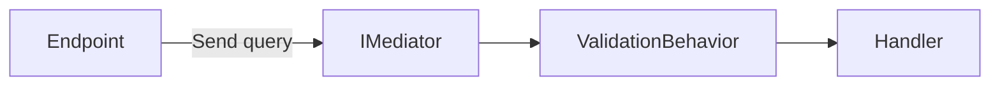
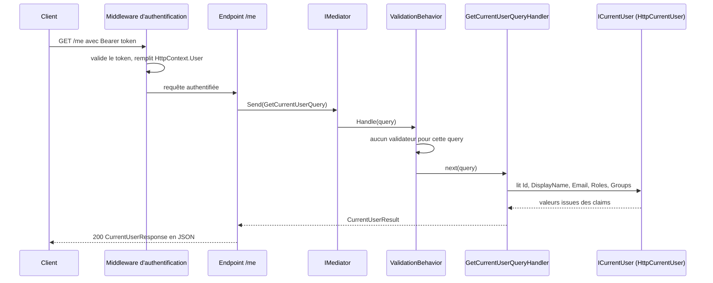

# CQRS et Mediator

Cette page explique comment une requête HTTP devient un appel de code métier, en suivant un exemple complet : `GET /me`. Si vous n'avez pas lu la page [Architecture](/Architecture.md), commencez par elle : elle présente les projets cités ici.

## Le concept simplement

### CQRS : séparer lire et écrire

**CQRS** signifie *Command Query Responsibility Segregation*, soit « séparation des responsabilités entre commandes et requêtes ». Le principe : chaque opération de votre application est soit une **query**, soit une **commande**.

| | Query | Commande |
|---|-------|----------|
| Rôle | lire des données | modifier l'état de l'application |
| Effet de bord | aucun | oui (base, fichier, message…) |
| Exemple | `GetCurrentUserQuery` | `CreateOrderCommand` |
| Interface (Mediator) | `IQuery<TResponse>` | `ICommand<TResponse>` |

Une opération est représentée par un petit objet (un `record` C#) qui contient ses paramètres. Une classe séparée, le **handler**, contient le code qui l'exécute.

### Mediator : un intermédiaire entre l'appelant et le handler

Le **pattern Mediator** place un intermédiaire entre celui qui demande une opération et celui qui l'exécute. L'endpoint ne connaît pas le handler : il remet la query à l'intermédiaire (`IMediator`), qui trouve le bon handler et l'appelle.



Cet intermédiaire permet aussi d'insérer du code commun avant chaque handler. On appelle cela un **pipeline behavior** : un maillon de chaîne qui s'exécute pour toutes les opérations, comme la validation (voir [Validation](/Architecture/Validation.md)).

### La bibliothèque Mediator

Le template utilise la bibliothèque **Mediator** (paquet `Mediator.Abstractions` et `Mediator.SourceGenerator`). Sa particularité : elle repose sur un **générateur de code**. À la compilation, elle écrit le code qui relie chaque query à son handler. Il n'y a donc pas de réflexion pour trouver les handlers à l'exécution, et le démarrage comme les appels restent rapides.

> 📝 **Ne pas confondre**
>
> Le nom `Mediator` désigne ici la bibliothèque (espace de noms `Mediator`, interfaces `IMediator`, `IQuery`, `ICommand`) et non le pattern en général.

## Pourquoi c'est important

- **Des endpoints minces** : un endpoint ne fait que traduire HTTP vers une query ou une commande, puis le résultat vers du JSON. La logique reste ailleurs.
- **Un cas d'usage par fichier** : une opération = un `record` + un handler. Vous retrouvez et testez chaque comportement sans lire le reste.
- **Des comportements transverses au bon endroit** : validation, journalisation ou transactions s'écrivent une fois, dans un pipeline, au lieu d'être recopiés dans chaque handler.
- **Des handlers testables** : un handler est une classe ordinaire dont les dépendances sont injectées. Un test unitaire n'a besoin ni de HTTP ni de base.

## Comment le template le fait

### Configuration

Tout se règle dans `AddApplication`. La durée de vie `Scoped` fait vivre les handlers le temps d'une requête HTTP. La ligne `PipelineBehaviors` branche `ValidationBehavior` devant chaque handler. Enfin, `AddValidatorsFromAssembly` enregistre tous les validateurs FluentValidation du projet.

**Fichier :** `src/Web.Template.CQRS.Application/DependencyInjection.cs`

```csharp
public static IServiceCollection AddApplication(this IServiceCollection services)
{
    services.AddMediator(options =>
    {
        options.ServiceLifetime = ServiceLifetime.Scoped;
        options.PipelineBehaviors = [typeof(ValidationBehavior<,>)];
    });

    services.AddValidatorsFromAssembly(typeof(DependencyInjection).Assembly);
    return services;
```

### Le parcours complet de `GET /me`

Un client authentifié appelle `GET /me`. Voici ce qui se passe, étape par étape.



**Étape 1 : le middleware d'authentification.** Avant d'atteindre l'endpoint, le token est validé et ses claims alimentent `HttpContext.User`. Le détail est dans la section [Identité](/Identité.md).

**Étape 2 : l'endpoint.** Il exige un utilisateur authentifié, envoie la query à `IMediator`, puis convertit le résultat en réponse JSON.

**Fichier :** `src/Web.Template.CQRS.Api/Controllers/CurrentUserController.cs`

```csharp
var currentUserEndpoint = endpoints.MapGet("/me", async (
        IMediator mediator,
        CancellationToken cancellationToken) =>
    {
        var currentUser = await mediator.Send(new GetCurrentUserQuery(), cancellationToken);
        return TypedResults.Ok(new CurrentUserResponse(
            currentUser.Id,
            currentUser.DisplayName,
            currentUser.Email,
            currentUser.Roles,
            currentUser.Groups));
    })
    .WithName("GetCurrentUser")
    .RequireAuthorization();
```

Le mot « Controller » du nom de fichier est historique : le template utilise des **minimal APIs**, pas des contrôleurs MVC. Un fichier `*Controller.cs` regroupe simplement les endpoints d'une feature.

**Étape 3 : la query.** C'est un `record` sans paramètre, qui déclare le type de résultat attendu.

**Fichier :** `src/Web.Template.CQRS.Application/Users/Queries/GetCurrentUser/GetCurrentUserQuery.cs`

```csharp
public sealed record GetCurrentUserQuery : IQuery<CurrentUserResult>;
```

**Étape 4 : le pipeline.** `IMediator.Send` passe d'abord par `ValidationBehavior`. Comme aucun validateur n'existe pour cette query, il laisse passer. La page [Validation](/Architecture/Validation.md) détaille ce qui se passe quand il en existe un.

**Étape 5 : le handler.** Il reçoit `ICurrentUser` par injection de dépendances et construit le résultat.

**Fichier :** `src/Web.Template.CQRS.Application/Users/Queries/GetCurrentUser/GetCurrentUserQueryHandler.cs`

```csharp
public sealed class GetCurrentUserQueryHandler(ICurrentUser currentUser)
    : IQueryHandler<GetCurrentUserQuery, CurrentUserResult>
{
    public ValueTask<CurrentUserResult> Handle(
        GetCurrentUserQuery query,
        CancellationToken cancellationToken)
    {
        var result = new CurrentUserResult(
            currentUser.Id,
            currentUser.DisplayName,
            currentUser.Email,
            currentUser.Roles,
            currentUser.Groups);

        return ValueTask.FromResult(result);
    }
}
```

Le handler ne sait pas d'où viennent les données de l'utilisateur. Il dépend de l'interface `ICurrentUser`, définie dans `Application` :

**Fichier :** `src/Web.Template.CQRS.Application/Common/Interfaces/Authentication/ICurrentUser.cs`

```csharp
public interface ICurrentUser
{
    string? Id { get; }

    string? DisplayName { get; }

    string? Email { get; }

    IReadOnlyList<string> Roles { get; }

    IReadOnlyList<string> Groups { get; }
}
```

**Étape 6 : l'implémentation HTTP.** Dans le projet `Api`, `HttpCurrentUser` lit les claims du token dans `HttpContext.User`. C'est cette classe qui connaît HTTP, pas le handler.

**Fichier :** `src/Web.Template.CQRS.Api/Authentication/HttpCurrentUser.cs`

```csharp
public sealed class HttpCurrentUser(IHttpContextAccessor httpContextAccessor) : ICurrentUser
{
    private ClaimsPrincipal? Principal => httpContextAccessor.HttpContext?.User;

    public string? Id => Principal?.FindFirst(ClaimNames.ObjectId)?.Value
        ?? Principal?.FindFirst(ClaimNames.Subject)?.Value
        ?? Principal?.FindFirst(ClaimTypes.NameIdentifier)?.Value;

    public string? DisplayName => Principal?.FindFirst(ClaimNames.Name)?.Value
        ?? Principal?.Identity?.Name;

    public string? Email => Principal?.FindFirst(ClaimNames.Email)?.Value
        ?? Principal?.FindFirst("preferred_username")?.Value
        ?? Principal?.FindFirst("upn")?.Value;

    public IReadOnlyList<string> Roles => ClaimValues(ClaimNames.Roles);

    public IReadOnlyList<string> Groups => ClaimValues(ClaimNames.Groups);

    private string[] ClaimValues(string claimType) =>
        Principal?.FindAll(claimType).Select(claim => claim.Value).ToArray() ?? [];
}
```

**Étape 7 : le résultat puis la réponse.** Le handler renvoie un `CurrentUserResult` (type d'`Application`), et l'endpoint le convertit en `CurrentUserResponse` (type de `Contracts`), sérialisé en JSON.

**Fichier :** `src/Web.Template.CQRS.Application/Users/Common/CurrentUserResult.cs`

```csharp
public sealed record CurrentUserResult(
    string? Id,
    string? DisplayName,
    string? Email,
    IReadOnlyList<string> Roles,
    IReadOnlyList<string> Groups);
```

**Fichier :** `src/Web.Template.CQRS.Contracts/Authentication/CurrentUserResponse.cs`

```csharp
public sealed record CurrentUserResponse(
    string? Id,
    string? DisplayName,
    string? Email,
    IReadOnlyList<string> Roles,
    IReadOnlyList<string> Groups);
```

### Pourquoi séparer `Result` et `Response`

Ces deux types ont aujourd'hui les mêmes champs, ce qui peut sembler redondant. Ils ont pourtant deux rôles distincts :

- Le **`Result`** appartient à l'application : c'est ce que le cas d'usage produit. Il évolue avec le métier.
- La **`Response`** appartient au contrat public : c'est ce que les clients de l'API reçoivent. Elle ne doit changer que volontairement, car un client déployé en dépend.

Avec deux types, vous pouvez enrichir le résultat interne sans modifier le JSON public, ou l'inverse. Le projet `Contracts` peut aussi être partagé avec un client .NET sans embarquer le code de l'application.

### Second exemple : `PingAdmin`

`GET /admin/ping` suit exactement le même chemin, avec une différence au niveau de l'endpoint : il exige la politique `RequireAdmin` (voir [Modèles d'autorisation](/Identité/Modèles-d'autorisation.md)).

**Fichier :** `src/Web.Template.CQRS.Api/Controllers/AdminController.cs`

```csharp
var pingEndpoint = endpoints.MapGet("/admin/ping", async (
        IMediator mediator,
        CancellationToken cancellationToken) =>
    {
        var result = await mediator.Send(new PingAdminQuery(), cancellationToken);
        return TypedResults.Ok(new PingAdminResponse(result.Message, result.UserId));
    })
    .WithName("PingAdmin")
    .RequireAuthorization(Policies.RequireAdmin);
```

Son handler renvoie `pong` et l'identifiant de l'utilisateur appelant :

**Fichier :** `src/Web.Template.CQRS.Application/Admin/Queries/PingAdmin/PingAdminQueryHandler.cs`

```csharp
public sealed class PingAdminQueryHandler(ICurrentUser currentUser)
    : IQueryHandler<PingAdminQuery, PingAdminResult>
{
    public ValueTask<PingAdminResult> Handle(
        PingAdminQuery query,
        CancellationToken cancellationToken)
    {
        return ValueTask.FromResult(new PingAdminResult("pong", currentUser.Id));
    }
}
```

> ℹ️ **Les lignes `#if` du dépôt**
>
> Les fichiers d'endpoints du dépôt contiennent des directives `#if (EnableRateLimiting)` pour appliquer une politique de limitation de débit. Elles sont absentes des extraits ci-dessus. Dans un projet généré, seules les branches correspondant à vos options sont conservées (voir [Rate limiting](/Fonctionnalités/Rate-limiting.md)).

## À essayer

1. Obtenez un token (voir [Premier lancement](/Démarrer/Premier-lancement.md)) puis appelez `GET /me`. Retrouvez chaque champ de la réponse dans `CurrentUserResponse`.
2. Dans `GetCurrentUserQueryHandler`, ajoutez temporairement un point d'arrêt, relancez, appelez `/me` et observez la pile d'appels : où voyez-vous `ValidationBehavior` ?
3. Écrivez sur papier la query `GetOrderQuery(Guid OrderId)` qui renvoie un `GetOrderResult`. Dans quels projets placeriez-vous la query, son handler, le résultat et la réponse JSON ? (Aidez-vous du tableau de la page [Architecture](/Architecture.md).)
4. Quelle différence de signature voyez-vous entre une `IQuery<T>` et une `ICommand<T>` dans le code du template ? Le guide [Ajouter une feature](/Guides/Ajouter-une-feature.md) vous fait créer les deux.

## Pour aller plus loin

- [Dépôt de la bibliothèque Mediator](https://github.com/martinothamar/Mediator)
- [Le pattern CQRS (Microsoft Learn)](https://learn.microsoft.com/azure/architecture/patterns/cqrs)
