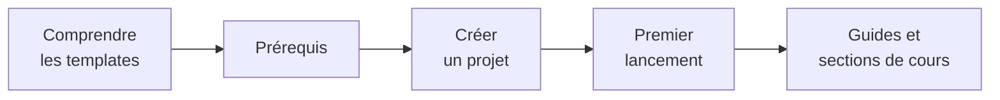

# Démarrer

Cette section vous mène de « je n'ai rien installé » à « mon API tourne et répond à un appel authentifié ». Comptez environ deux heures, lectures et exercices compris.

| Ordre | Page | Ce que vous y trouvez |
|-------|------|------------------------|
| 1 | [Comprendre les templates](/Démarrer/Comprendre-les-templates.md) | Ce qu'est `dotnet new`, comment un template renomme et adapte le code |
| 2 | [Prérequis](/Démarrer/Prérequis.md) | Les outils à installer, avec une commande de vérification pour chacun |
| 3 | [Créer un projet](/Démarrer/Créer-un-projet.md) | Installer le template, choisir les options, générer |
| 4 | [Premier lancement](/Démarrer/Premier-lancement.md) | Démarrer avec Aspire, obtenir un token, appeler l'API |

Si vous êtes pressé, lisez les pages 2 à 4 dans l'ordre et revenez à la page 1 plus tard. Si vous voulez comprendre ce que vous faites, commencez par la page 1 : elle explique pourquoi le code du dépôt contient des lignes `#if (EnableAspire)` qui n'existent plus dans un projet généré.

À la fin de la section, poursuivez avec [Ajouter une feature](/Guides/Ajouter-une-feature.md) ou avec le cours [Architecture](/Architecture.md).
