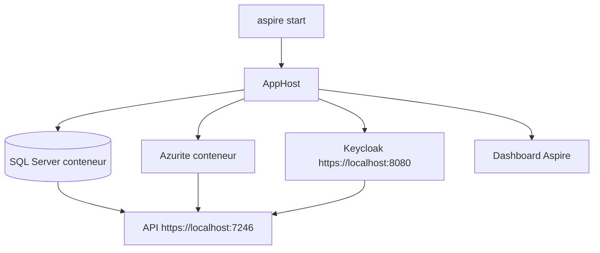

# Premier lancement

Ce tutoriel suit un chemin unique, de la configuration des secrets jusqu'à l'arrêt de l'application. Il suppose un projet généré avec les options par défaut (Aspire, modèle `AppRoles`) et les [Prérequis](/Démarrer/Prérequis.md) satisfaits. Les URL et les noms de projet ci-dessous sont ceux du dépôt template ; dans un projet généré, `Web.Template.CQRS` est remplacé par votre nom (par exemple `Contoso.Orders`).

## Le concept simplement

Lancer l'application ne veut pas dire « démarrer l'API ». Avec Aspire, une seule commande démarre un petit ensemble cohérent : une base SQL Server, un émulateur de stockage Azure, un serveur d'identité Keycloak, puis l'API qui les utilise. Vous obtenez ensuite un token auprès de Keycloak, comme une application réelle le ferait auprès d'Entra ID, et vous le présentez à l'API.

## Pourquoi c'est important

Ce parcours vérifie d'un coup que tout est en place : conteneurs, certificat, authentification, autorisation. Si l'appel à `/me` fonctionne et que `/admin/ping` renvoie 200 pour l'administrateur et 403 pour l'utilisateur simple, votre environnement est prêt.

## Comment le template le fait

### Étape 1 : renseigner les secrets de l'AppHost

L'AppHost déclare deux paramètres secrets : le mot de passe de SQL Server et celui de l'administrateur Keycloak. Ils ne sont écrits nulle part dans le code.

**Fichier :** `src/Web.Template.CQRS.AppHost/Program.cs`

```csharp
var sqlPassword = builder.AddParameter("sql-password", secret: true);
var sqlServer = builder
    .AddSqlServer("sqlserver", password: sqlPassword)
    .WithDataVolume()
    .WithLifetime(ContainerLifetime.Persistent);
var projectDatabase = sqlServer.AddDatabase("projectdb");

var blobs = builder
    .AddAzureStorage("storage")
    .RunAsEmulator()
    .AddBlobs("blobs");

var keycloakAdminPassword = builder.AddParameter("keycloak-admin-password", secret: true);
var keycloak = builder
    .AddKeycloak("keycloak", port: 8080, adminPassword: keycloakAdminPassword)
    .WithRealmImport("./Realms")
    .WithDataVolume()
    .WithLifetime(ContainerLifetime.Persistent);
```

Fournissez-les avec les user-secrets .NET (stockés hors du dépôt, dans votre profil utilisateur) :

```bash
dotnet user-secrets set "Parameters:sql-password" "Choose-A-Strong-Local-Password!" --project src/Web.Template.CQRS.AppHost/Web.Template.CQRS.AppHost.csproj
dotnet user-secrets set "Parameters:keycloak-admin-password" "Choose-Another-Strong-Password!" --project src/Web.Template.CQRS.AppHost/Web.Template.CQRS.AppHost.csproj
```

Choisissez des mots de passe qui respectent la politique de SQL Server (longueur, majuscules, chiffres). Pour comprendre ces paramètres, voir [Paramètres et secrets](/Aspire/Paramètres-et-secrets.md).

### Étape 2 : démarrer avec Aspire

```bash
aspire start --apphost src/Web.Template.CQRS.AppHost/Web.Template.CQRS.AppHost.csproj
```

Docker doit être lancé. Le premier démarrage télécharge les images des conteneurs, ce qui peut prendre quelques minutes.

### Étape 3 : ce qui démarre



L'API attend que SQL Server, le stockage et Keycloak soient prêts (`WaitFor`) avant de démarrer. Le realm `template` de Keycloak est importé uniquement au tout premier démarrage du volume de données.

### Étape 4 : ouvrir le dashboard

`aspire start` affiche l'URL du dashboard Aspire dans son résultat. Ouvrez-la : vous y voyez les ressources (`sqlserver`, `projectdb`, `storage`, `blobs`, `keycloak` et `api`), leur état, leurs logs et leurs traces. Attendez que l'API soit à l'état `Running` (ou `Healthy`).

### Étape 5 : obtenir un token

Le script interroge Keycloak avec le client `template-cli` et un persona (`admin` devient `admin@local.test`, mot de passe `Passw0rd!`) et affiche l'access token.

**PowerShell**


```powershell
$token = ./scripts/get-token.ps1 -Persona admin
```

**Bash**


```bash
token=$(bash ./scripts/get-token.sh admin)
```

### Étape 6 : appeler `/me`

**PowerShell**


```powershell
curl.exe -H "Authorization: Bearer $token" https://localhost:7246/me
```

**Bash**


```bash
curl -H "Authorization: Bearer $token" https://localhost:7246/me
```

Vous pouvez aussi utiliser le fichier `Api.http` de l'API (dans Rider ou Visual Studio) : collez le token dans la variable `@AccessToken`, puis exécutez la requête « Current user ».

La réponse reprend les champs de `CurrentUserResponse` : identifiant, nom affiché, e-mail, rôles et groupes lus dans le token. Pour `admin@local.test` avec le modèle `AppRoles`, la liste `roles` contient `Admin` (le realm donne le rôle `Admin` à ce persona et `User` à l'autre).

```json
{
  "id": "…",
  "displayName": "…",
  "email": "admin@local.test",
  "roles": [ "Admin" ],
  "groups": []
}
```

### Étape 7 : tester une route réservée

`GET /admin/ping` exige la policy `RequireAdmin`. Appelez-la avec le token de `admin` : réponse 200. Obtenez ensuite un token pour `user` (`-Persona user` ou `get-token.sh user`) et refaites l'appel : réponse 403.

| Persona | `GET /me` | `GET /admin/ping` |
|---------|-----------|-------------------|
| `admin@local.test` | 200 | 200 |
| `user@local.test` | 200 | 403 |
| sans token | 401 | 401 |

> ℹ️ **Avec le modèle Authenticated**
>
> La route `/admin/ping` n'existe pas dans un projet généré avec `--AuthorizationModel Authenticated`.

### Étape 8 : explorer avec Scalar

Ouvrez `https://localhost:7246/scalar`. Scalar est l'interface qui liste les endpoints et permet de les appeler. Utilisez le bouton d'authentification, choisissez le flux OAuth2 avec le client `template-scalar` et connectez-vous avec un persona : Scalar récupère le token à votre place (flux Authorization Code avec PKCE, voir [OpenAPI et Scalar](/Fonctionnalités/OpenAPI-et-Scalar.md)).

### Étape 9 : arrêter

```bash
aspire stop
```

Les conteneurs SQL Server et Keycloak sont déclarés avec une durée de vie persistante (`ContainerLifetime.Persistent`) et un volume de données : vos données survivent à l'arrêt.

> ⚠️ **Utilisez le port HTTPS 7246**
>
> Le port HTTP `5257` redirige vers HTTPS, et la redirection fait perdre l'en-tête `Authorization`. Appelez toujours `https://localhost:7246`.

> 💡 **Dépannage**
>
> - Port 8080 occupé : Keycloak est fixé sur ce port. Si vous avez déjà lancé un autre projet généré, son conteneur Keycloak (durée de vie persistante) tourne encore même après `aspire stop`, et votre API attend indéfiniment Keycloak. Listez-le avec `docker ps --filter name=keycloak`, puis `docker stop <conteneur>`, ou lancez `aspire stop --apphost <autre projet>.csproj --force` (voir [Émulateurs et conteneurs](/Aspire/Émulateurs.md)). Sinon, arrêtez le processus qui utilise le port, puis relancez.
> - Erreur de certificat avec `curl` ou `get-token` : relancez `dotnet dev-certs https --trust` (voir [Prérequis](/Démarrer/Prérequis.md)).
> - Persona inconnu ou modification du realm sans effet : le realm n'est importé qu'au premier démarrage du volume Keycloak. Pour le réimporter, suivez la procédure de réinitialisation de [Émulateurs](/Aspire/Émulateurs.md#reinitialiser-les-donnees) (`aspire stop … --force --volumes`, contrôle des volumes restants, `aspire start`) : elle remet aussi à zéro les données de SQL Server.

## À essayer

1. Déroulez les étapes 1 à 7. Quel code HTTP obtenez-vous pour `user@local.test` sur `/admin/ping` ?
2. Collez votre token sur [jwt.ms](https://jwt.ms) ou décodez-le localement, et retrouvez les claims `roles`, `aud` et `iss`. Que contient `aud` ?
3. Dans le dashboard, ouvrez la trace de votre appel à `/me` et repérez le `traceId`. Aux niveaux de log par défaut, un `/me` réussi ou une 401 n'écrit aucune ligne de log : regardez la trace (ses spans) plutôt que les logs. Pour voir des logs corrélés, relancez l'API avec `Logging__LogLevel__Microsoft.AspNetCore=Information`.
4. Appelez `/me` sans en-tête `Authorization` et lisez la réponse.

> 📝 **Ne collez que des tokens locaux**
>
> Ne collez sur un site externe (jwt.ms) que des tokens du Keycloak local. Ne collez jamais un token Entra ID ou de production : il donne accès à de vraies ressources.

Pour continuer, écrivez votre première feature avec [Ajouter une feature](/Guides/Ajouter-une-feature.md).

## Pour aller plus loin

- [Secrets utilisateur ASP.NET Core](https://learn.microsoft.com/aspnet/core/security/app-secrets)
