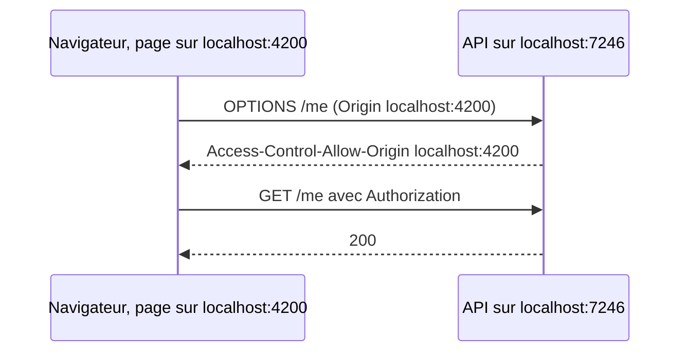

# CORS

CORS est l'une des premières erreurs mystérieuses que rencontre un développeur web. Cette page explique ce que c'est, pourquoi la restriction existe et comment le template la configure.

## Le concept simplement

Un navigateur applique la **same-origin policy** (politique de même origine) : une page web chargée depuis une origine ne peut lire les réponses d'une autre origine que si celle-ci l'autorise. Une **origine** est le triplet protocole, nom d'hôte et port : `http://localhost:4200` et `https://localhost:7246` sont deux origines différentes.

Cette règle protège l'utilisateur : sans elle, une page malveillante ouverte dans un onglet pourrait appeler en arrière-plan votre banque, avec vos cookies, et lire la réponse.

**CORS** (*Cross-Origin Resource Sharing*) est le mécanisme qui permet à un serveur de lever cette restriction pour des origines précises, par des en-têtes HTTP. Quand un front-end sur `http://localhost:4200` appelle l'API :

1. pour certaines requêtes (méthode `PUT`/`DELETE`, en-tête `Authorization`, JSON), le navigateur envoie d'abord une requête de **préflight** : `OPTIONS`, avec l'origine et ce qu'il compte faire ;
2. le serveur répond avec `Access-Control-Allow-Origin` et ses variantes ;
3. si l'origine est autorisée, le navigateur envoie la vraie requête, sinon il la bloque et affiche l'erreur dans la console.



> 📝 **CORS ne concerne que les navigateurs**
>
> `curl`, Postman, un autre serveur ou une application mobile ne sont pas soumis à CORS : ils n'appliquent pas la same-origin policy. CORS n'est donc **pas** un mécanisme de sécurité contre les appels non désirés ; il protège les utilisateurs de navigateurs. L'authentification reste ce qui protège vraiment l'API.

## Pourquoi c'est important

- **Un front-end séparé** (Angular, React) servi depuis un autre port ou domaine ne fonctionne pas sans CORS.
- **Une liste blanche** évite d'autoriser toutes les origines, ce qui rendrait la restriction du navigateur sans effet.
- **Savoir le diagnostiquer** : une erreur CORS apparaît dans la console du navigateur, mais la cause est côté serveur.

## Comment le template le fait

Le `Program.cs` enregistre une politique par défaut qui lit la liste des origines autorisées dans la configuration :

**Fichier :** `src/Web.Template.CQRS.Api/Program.cs`

```csharp
builder.Services.AddCors(options =>
{
    options.AddDefaultPolicy(policy =>
    {
        var allowedOrigins = builder.Configuration
            .GetSection("Cors:AllowedOrigins")
            .Get<string[]>() ?? [];

        policy.AllowAnyHeader().AllowAnyMethod();
        if (allowedOrigins.Length > 0)
        {
            policy.WithOrigins(allowedOrigins);
        }
    });
});
```

- La liste vient de la clé **`Cors:AllowedOrigins`** (un tableau de chaînes).
- `AllowAnyHeader()` et `AllowAnyMethod()` acceptent tous les en-têtes et méthodes.
- Si la liste est non vide, `WithOrigins` restreint aux origines listées. **Si elle est vide, aucune origine n'est autorisée explicitement** : seuls les appels de même origine et hors navigateur passent. C'est le comportement sûr par défaut.
- `app.UseCors()` active la politique dans le pipeline, avant l'authentification : le préflight `OPTIONS`, qui ne porte pas de jeton, doit être traité avant d'être refusé.

### Valeurs locales et en production

| Fichier | Valeur | Pourquoi |
|---------|--------|----------|
| `appsettings.Development.json` | `["http://localhost:4200"]` | l'adresse habituelle d'un front-end Angular en local |
| `appsettings.json` | `[]` | rien d'autorisé par défaut en production |

En déploiement, ajoutez l'origine de votre front-end réel. Les clés de configuration se surchargent par variable d'environnement, avec `__` (double souligné) pour les niveaux et l'indice pour les éléments d'un tableau :

```text
Cors__AllowedOrigins__0=https://app.contoso.com
Cors__AllowedOrigins__1=https://admin.contoso.com
```

Une origine s'écrit **sans barre finale** et avec son protocole et son port éventuel : `https://app.contoso.com`, pas `https://app.contoso.com/`.

## À essayer

1. Dans un terminal, simulez un préflight :
   ```bash
   curl -ik -X OPTIONS https://localhost:7246/me -H "Origin: http://localhost:4200" -H "Access-Control-Request-Method: GET"
   ```
   Quel en-tête `Access-Control-Allow-Origin` revient ?
2. Refaites l'appel avec `-H "Origin: http://evil.example"`. Que change-t-on dans la réponse ?
3. Ajoutez l'origine de votre front-end dans `appsettings.Development.json` et vérifiez qu'elle est acceptée.
4. Question : pourquoi une erreur CORS n'apparaît-elle jamais quand vous testez l'API avec `curl` ?

## Pour aller plus loin

- [Activer CORS dans ASP.NET Core (Microsoft Learn)](https://learn.microsoft.com/aspnet/core/security/cors)
- [CORS sur MDN](https://developer.mozilla.org/docs/Web/HTTP/Guides/CORS)
