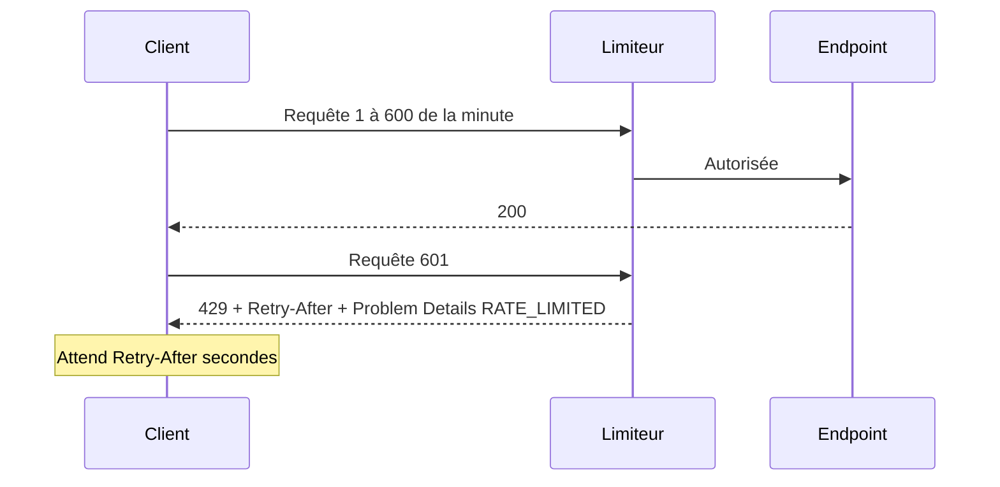

# Rate limiting

Le *rate limiting* (limitation de débit) plafonne le nombre de requêtes qu'un client peut envoyer sur une période donnée. Cette page explique pourquoi, présente les algorithmes courants, puis détaille le choix du template et la façon de l'appliquer à un endpoint.

## Le concept simplement

Un guichet de poste traite un client à la fois. Si une seule personne dépose cent colis à la suite, tous les autres attendent. Un panneau « 5 colis maximum par passage » rend le service équitable : c'est une limite de débit.

Pour une API, la règle prend la forme « au plus N requêtes par minute et par client ». Au-delà, le serveur répond immédiatement **429 Too Many Requests** au lieu de traiter la requête, et indique en combien de temps réessayer (en-tête `Retry-After`).

### Les algorithmes

| Algorithme | Principe | Avantage | Limite |
|------------|----------|----------|--------|
| **Fenêtre fixe** | un compteur par tranche de temps (par exemple chaque minute), remis à zéro à la fin | simple, peu coûteux | à la jonction de deux fenêtres, un client peut doubler son débit (N requêtes à 12:00:59, N autres à 12:01:00) |
| **Fenêtre glissante** | la fenêtre est découpée en segments qui se décalent avec le temps | lisse l'effet de bord de la fenêtre fixe | un peu plus complexe |
| **Token bucket** (seau de jetons) | un seau se remplit de jetons à vitesse constante ; chaque requête en consomme un | autorise de courtes rafales tout en limitant le débit moyen | à calibrer (taille du seau et vitesse de remplissage) |
| **Concurrence** | limite le nombre de requêtes **simultanées**, pas leur nombre par minute | protège les ressources lentes | ne limite pas la fréquence |

ASP.NET Core propose ces quatre limiteurs dans `System.Threading.RateLimiting`.

## Pourquoi c'est important

- **Protéger la disponibilité** : un client bogué qui boucle, ou un script malveillant, ne doit pas saturer l'API pour tous les autres.
- **Contenir les coûts** : certains endpoints sont coûteux (génération, publication, appels à des services payants).
- **Répartir équitablement** : chaque utilisateur a sa propre limite, l'abus de l'un n'affecte pas les autres.
- **Freiner les attaques** : essais de mots de passe, énumération de ressources.

## Comment le template le fait

> ℹ️ **Les lignes `#if` du dépôt**
>
> Le dossier `Common/RateLimiting` n'est conservé dans un projet généré que si l'option `EnableRateLimiting` est activée (activée par défaut). Dans `Program.cs`, les appels `AddRateLimiting()` et `UseRateLimiter()` sont entourés de `#if (EnableRateLimiting)`.

### Les politiques

Quatre **politiques** nommées sont définies. Elles s'appellent par des constantes, pour éviter les fautes de frappe dans les chaînes :

**Fichier :** `src/Web.Template.CQRS.Api/Common/RateLimiting/RateLimitingPolicies.cs`

```csharp
namespace Web.Template.CQRS.Api.Common.RateLimiting;

public static class RateLimitingPolicies
{
    public const string Read = "read";
    public const string Write = "write";
    public const string Generate = "generate";
    public const string Publish = "publish";
}
```

Leur configuration se trouve dans `RateLimiting.cs`. Lisez-le en trois temps : l'enregistrement des politiques (début de `AddRateLimiting`), le rejet (`OnRejected`) puis le calcul de la partition (`CreatePartition`).

**Fichier :** `src/Web.Template.CQRS.Api/Common/RateLimiting/RateLimiting.cs`

```csharp
using System.Diagnostics;
using System.Globalization;
using System.Threading.RateLimiting;
using Microsoft.AspNetCore.RateLimiting;

namespace Web.Template.CQRS.Api.Common.RateLimiting;

public static class RateLimiting
{
    public static IServiceCollection AddRateLimiting(this IServiceCollection services)
    {
        services.AddRateLimiter(options =>
        {
            options.AddPolicy(RateLimitingPolicies.Read, context => CreatePartition(context, 600));
            options.AddPolicy(RateLimitingPolicies.Write, context => CreatePartition(context, 120));
            options.AddPolicy(RateLimitingPolicies.Generate, context => CreatePartition(context, 10));
            options.AddPolicy(RateLimitingPolicies.Publish, context => CreatePartition(context, 5));

            options.OnRejected = async (rejection, cancellationToken) =>
            {
                var context = rejection.HttpContext;
                context.Response.StatusCode = StatusCodes.Status429TooManyRequests;

                if (rejection.Lease.TryGetMetadata(MetadataName.RetryAfter, out var retryAfter))
                {
                    context.Response.Headers.RetryAfter = Math.Ceiling(retryAfter.TotalSeconds)
                        .ToString(CultureInfo.InvariantCulture);
                }

                await Results.Problem(
                    statusCode: StatusCodes.Status429TooManyRequests,
                    title: "Too many requests.",
                    extensions: new Dictionary<string, object?>
                    {
                        ["code"] = "RATE_LIMITED",
                        ["traceId"] = Activity.Current?.TraceId.ToString() ?? context.TraceIdentifier
                    }).ExecuteAsync(context);
            };
        });

        return services;
    }

    private static RateLimitPartition<string> CreatePartition(HttpContext context, int permitLimit)
    {
        var subject = context.User.FindFirst("oid")?.Value
            ?? context.User.FindFirst("sub")?.Value;
        var partitionKey = !string.IsNullOrWhiteSpace(subject)
            ? $"subject:{subject}"
            : $"ip:{context.Connection.RemoteIpAddress?.ToString() ?? "unknown"}";

        return RateLimitPartition.GetFixedWindowLimiter(
            partitionKey,
            _ => new FixedWindowRateLimiterOptions
            {
                AutoReplenishment = true,
                PermitLimit = permitLimit,
                QueueLimit = 0,
                Window = TimeSpan.FromMinutes(1)
            });
    }
}
```

### Les quotas

| Politique | Requêtes par minute et par partition | Usage prévu |
|-----------|--------------------------------------|-------------|
| `read` | 600 | lectures (`GET`) |
| `write` | 120 | créations et modifications |
| `generate` | 10 | opérations coûteuses de génération |
| `publish` | 5 | publications |

Seule la politique `read` est appliquée dans le code actuel (aux endpoints `/me` et `/admin/ping`). `write`, `generate` et `publish` sont prêtes pour vos futurs endpoints. Ces valeurs sont des points de départ : ajustez-les selon votre trafic réel.

### Le choix du template : fenêtre fixe, par utilisateur

`CreatePartition` crée, pour chaque requête, un **limiteur à fenêtre fixe** d'une minute, sans file d'attente (`QueueLimit = 0`) : au-delà du quota, la requête est rejetée tout de suite. La fenêtre fixe est le choix le plus simple à comprendre et à tester ; son défaut de bord (rafale à la jonction de deux fenêtres) est acceptable pour protéger une API contre les abus.

La **partition** détermine *qui* partage un même compteur :

1. si le jeton contient un identifiant d'utilisateur, `oid` (Entra ID) ou à défaut `sub` : `subject:<identifiant>` ;
2. sinon, l'adresse IP de l'appelant : `ip:<adresse>`.

Chaque utilisateur authentifié a donc son propre quota, indépendant des autres. Les requêtes anonymes sont regroupées par adresse IP. Cela fonctionne parce que le limiteur est placé **après** l'authentification dans le pipeline (`UseAuthentication`, puis `UseRateLimiter`) : sinon `context.User` serait vide.

### La réponse 429

Quand une requête est refusée, `OnRejected` fabrique la réponse :



- le statut `429` ;
- l'en-tête **`Retry-After`**, en secondes (arrondi à l'entier supérieur), quand le limiteur connaît la durée d'attente ;
- un corps **Problem Details** avec le code `RATE_LIMITED` et le `traceId`, comme les autres erreurs (voir [Erreurs et Problem Details](/Architecture/Erreurs-et-Problem-Details.md)).

Un client bien écrit lit `Retry-After`, attend, puis réessaie.

### Appliquer une politique à un endpoint

Une politique ne s'applique que là où vous l'indiquez, avec `RequireRateLimiting`. Exemple tiré de l'endpoint `/me` :

**Fichier :** `src/Web.Template.CQRS.Api/Controllers/CurrentUserController.cs`

```csharp
currentUserEndpoint.RequireRateLimiting(RateLimitingPolicies.Read);
```

Pour un nouvel endpoint d'écriture, vous écririez de la même manière `endpoint.RequireRateLimiting(RateLimitingPolicies.Write)`. Un endpoint sans cet appel n'est pas limité, ce qui est le cas des endpoints de santé.

### Les limites de ce choix

> ⚠️ **Un limiteur en mémoire, par instance**
>
> Les compteurs vivent dans la mémoire du processus. Si vous déployez trois instances de l'API, chacune compte de son côté : un client peut obtenir jusqu'à trois fois le quota. Il n'y a pas de stockage distribué. Pour une limite globale exacte, placez la limitation devant l'API (Azure API Management, Front Door, passerelle) ou utilisez un compteur partagé (Redis, par exemple). Derrière un proxy, vérifiez aussi que l'adresse IP vue par l'API est bien celle du client (en-têtes `X-Forwarded-For`), sinon tous les anonymes partageraient une partition.

### Le test

Le comportement est vérifié par un test d'intégration qui consomme tout le quota de la politique `read`, puis contrôle la réponse suivante :

**Fichier :** `tests/Web.Template.CQRS.Api.IntegrationTests/RateLimiting/RateLimitingTests.cs`

```csharp
public async Task ReadPolicy_WhenQuotaExceeded_Returns429ProblemDetails()
{
    var client = factory.CreateClient().AsUser("rate-limited-user");
    var cancellationToken = TestContext.Current.CancellationToken;

    for (var request = 0; request < ReadPermitLimit; request++)
    {
        var accepted = await client.GetAsync("/me", cancellationToken);
        Assert.Equal(HttpStatusCode.OK, accepted.StatusCode);
    }

    var rejected = await client.GetAsync("/me", cancellationToken);

    Assert.Equal(HttpStatusCode.TooManyRequests, rejected.StatusCode);
    Assert.True(rejected.Headers.Contains("Retry-After"));
    using var problem = JsonDocument.Parse(await rejected.Content.ReadAsStringAsync(cancellationToken));
    Assert.Equal("RATE_LIMITED", problem.RootElement.GetProperty("code").GetString());
    Assert.False(string.IsNullOrWhiteSpace(problem.RootElement.GetProperty("traceId").GetString()));
```

Le test vérifie le statut 429, la présence de `Retry-After`, le code `RATE_LIMITED` et un `traceId` non vide. La constante `ReadPermitLimit` du test doit rester alignée avec les 600 requêtes de la politique : si vous changez le quota, mettez le test à jour.

## À essayer

1. Lisez `CreatePartition` : que se passe-t-il pour une requête anonyme ? Pour deux utilisateurs différents ?
2. Ajoutez la politique `write` à un endpoint de votre choix et vérifiez qu'elle est bien appliquée.
3. Lancez `dotnet test tests/Web.Template.CQRS.Api.IntegrationTests --filter RateLimitingTests`.
4. Abaissez temporairement le quota `read` à 3, relancez le projet et appelez `/me` quatre fois de suite avec un jeton valide. Quel en-tête permet de savoir quand réessayer ? Remettez 600 ensuite.
5. Question : pourquoi le middleware de limitation est-il placé après `UseAuthentication` dans `Program.cs` ?

## Pour aller plus loin

- [Middleware de limitation de débit dans ASP.NET Core (Microsoft Learn)](https://learn.microsoft.com/aspnet/core/performance/rate-limit)
- [RFC 6585, section 4 : le statut 429](https://www.rfc-editor.org/rfc/rfc6585#section-4)
