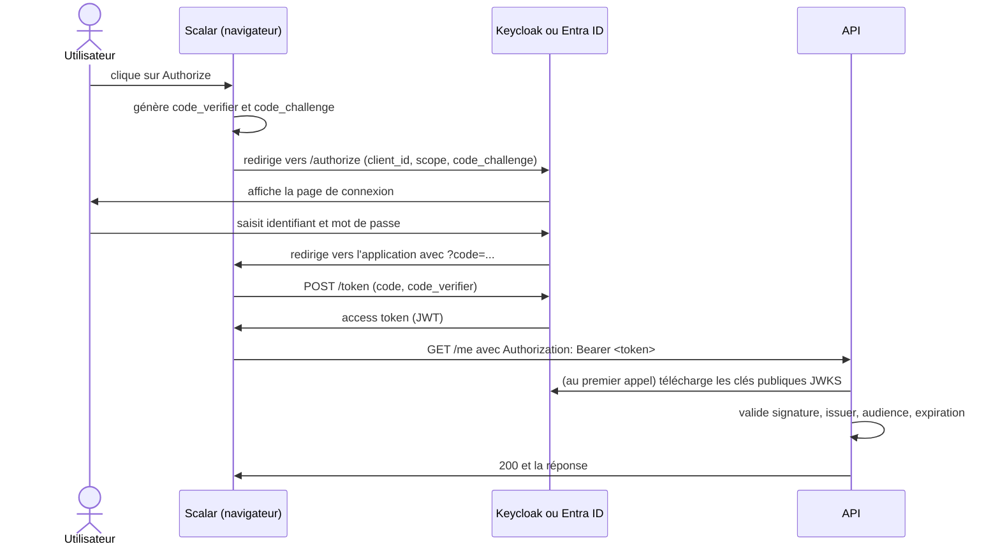
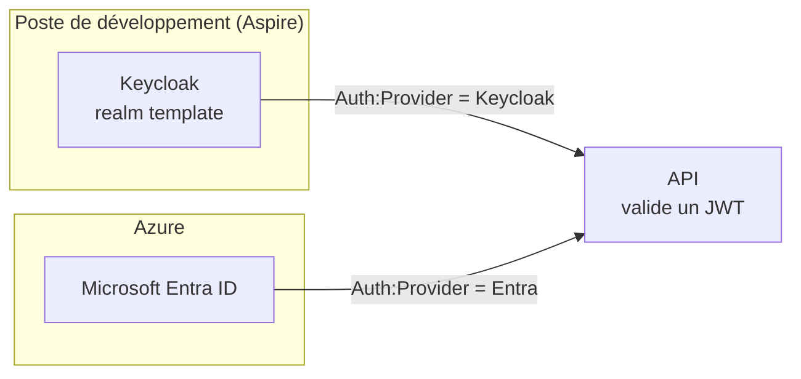

# Identité

Cette section explique comment l'API sait **qui** appelle et **ce qu'il a le droit de faire**. Cette première page est un cours : elle pose le vocabulaire (OAuth2, OpenID Connect, JWT) dont les autres pages ont besoin. Si vous connaissez déjà ces notions, passez directement à [Keycloak en local](/Identité/Keycloak-en-local.md) ou à [Entra ID](/Identité/Entra-ID.md).

| Page | Vous y trouvez |
|------|----------------|
| Cette page | Le cours : authentification, OAuth2, OpenID Connect, JWT, validation par l'API |
| [Entra ID](/Identité/Entra-ID.md) | Ce qu'il faut créer et configurer dans Microsoft Entra ID pour la production |
| [Keycloak en local](/Identité/Keycloak-en-local.md) | La référence complète du serveur d'identité local et du realm importé |
| [Modèles d'autorisation](/Identité/Modèles-d'autorisation.md) | Les quatre modèles, les policies, la protection d'un endpoint, les tests |
| [Configuration locale et déployée](/Identité/Configuration-locale-et-déployée.md) | Le tableau clé par clé de ce qui change entre votre poste et Azure |

## Le concept simplement

### Authentification et autorisation

Deux questions distinctes, souvent confondues :

- **Authentification** : *qui êtes-vous ?* On vérifie une identité (comme montrer sa carte d'identité à l'entrée d'un bâtiment).
- **Autorisation** : *qu'avez-vous le droit de faire ?* Une fois identifié, on regarde les droits (le badge ouvre la salle serveur, ou pas).

Une requête sans identité reçoit **401 Unauthorized** (« je ne sais pas qui vous êtes »). Une requête identifiée mais sans le droit nécessaire reçoit **403 Forbidden** (« je sais qui vous êtes, la réponse est non »). Le template applique cette distinction partout.

### Pourquoi ne pas gérer les mots de passe soi-même

Stocker des mots de passe, gérer l'oubli, le MFA, le verrouillage, les audits : c'est un métier à part, et chaque erreur est grave. On confie donc l'identité à un **fournisseur d'identité** (en anglais *identity provider*, IdP) : en production **Microsoft Entra ID**, en local **Keycloak**. L'API ne voit jamais le mot de passe : elle reçoit seulement une **preuve** émise par le fournisseur, un *token*.

### OAuth 2.0 : déléguer l'accès

**OAuth 2.0** est un standard qui décrit comment une application obtient un *access token* pour appeler une API **au nom d'un utilisateur**, sans connaître son mot de passe. Il définit quatre rôles :

| Rôle OAuth2 | Qui c'est dans le template |
|-------------|----------------------------|
| **Resource owner** (propriétaire des données) | L'utilisateur, par exemple Alice |
| **Client** (l'application qui veut accéder à l'API) | Scalar (la documentation interactive de l'API), plus tard votre frontend |
| **Authorization server** (celui qui authentifie et délivre les tokens) | Keycloak en local, Entra ID en production |
| **Resource server** (l'API protégée) | `Web.Template.CQRS.Api` |

OAuth2 parle d'**autorisation déléguée** : il ne dit pas, à lui seul, qui est l'utilisateur.

### OpenID Connect : savoir qui est l'utilisateur

**OpenID Connect** (OIDC) est une fine couche posée **au-dessus** d'OAuth2 qui ajoute l'identité : le fournisseur renvoie en plus un *ID token* (qui décrit l'utilisateur) et expose des adresses standard (*discovery document*, `/.well-known/openid-configuration`) qui permettent à l'API de découvrir automatiquement l'URL des clés de signature. Entra ID et Keycloak parlent tous les deux OIDC : c'est ce qui rend Keycloak capable de remplacer Entra en local.

### Le flux Authorization Code avec PKCE

Pour une application interactive (un navigateur), le flux recommandé est **Authorization Code avec PKCE** (prononcez « pixie »). Le client ne reçoit jamais directement de token dans l'URL : il reçoit un **code** à usage unique, qu'il échange contre les tokens. **PKCE** protège cet échange : le client invente un secret aléatoire (*code verifier*), envoie son empreinte (*code challenge*) au départ, puis prouve à l'échange qu'il détient le secret d'origine. Un code volé en route devient inutilisable. C'est pour cela que le client Scalar est configuré avec `pkce.code.challenge.method: S256` (voir [Keycloak en local](/Identité/Keycloak-en-local.md)).



À retenir : l'**API ne parle jamais à l'utilisateur** et ne reçoit jamais son mot de passe. Elle reçoit un token dans l'en-tête `Authorization: Bearer <token>` (« porteur » : quiconque détient le token a les droits qu'il décrit, d'où l'importance de ne pas le divulguer).

> ℹ️ **Et le client template-cli ?**
>
> En local, le script `get-token` obtient un token avec un autre flux, le *password grant* (identifiant et mot de passe envoyés directement au serveur). Il est pratique pour les scripts et les tests, mais déconseillé en production et supprimé d'OAuth 2.1 : c'est pourquoi le client qui l'utilise n'existe que dans le realm local. Voir [Keycloak en local](/Identité/Keycloak-en-local.md).

### Anatomie d'un JWT

Le token que l'API reçoit est un **JWT** (*JSON Web Token*, prononcez « jot ») : trois morceaux encodés en Base64URL et séparés par des points.

```text
eyJhbGciOi...   .   eyJpc3MiOi...   .   SflKxwRJSM...
   header              payload            signature
```

- **Header** : l'algorithme de signature (`alg`, par exemple RS256) et l'identifiant de la clé utilisée (`kid`).
- **Payload** : les **claims**, des affirmations sur l'utilisateur et sur le token.
- **Signature** : calculée par le fournisseur avec sa **clé privée**. Toute modification du header ou du payload invalide la signature.

> ⚠️ **Un JWT est signé, pas chiffré**
>
> N'importe qui peut lire le payload (il suffit de décoder le Base64). La signature garantit seulement qu'il n'a pas été modifié. Ne mettez jamais de secret dans un claim, et ne collez jamais un token **de production** dans un site de décodage en ligne.

Voici le payload décodé d'un token obtenu pour `admin@local.test` avec le realm du template, **abrégé** (un vrai token porte aussi `typ`, `scope`, `sid`, `realm_access`, `preferred_username`, `given_name`…). Les valeurs `iat`, `exp` et `oid` sont des exemples : elles changent à chaque token et chaque installation :

```json
{
  "exp": 1760443500,
  "iat": 1760443200,
  "iss": "https://localhost:8080/realms/template",
  "aud": "template-api",
  "sub": "3f5b1c1e-6a52-4c0e-9d1b-7d2d6f0a9b10",
  "azp": "template-cli",
  "oid": "3f5b1c1e-6a52-4c0e-9d1b-7d2d6f0a9b10",
  "roles": ["Admin"],
  "groups": ["6f1c2a4e-0d3b-4c1e-9a57-2b8f0e6d4c11"],
  "name": "Alice Admin",
  "email": "admin@local.test"
}
```

Les claims que vous croiserez dans ce projet :

| Claim | Signification | Utilisé par le template |
|-------|---------------|-------------------------|
| `iss` | *Issuer* : qui a émis le token (l'URL du fournisseur) | Validé par l'API |
| `aud` | *Audience* : à quelle API le token est destiné | Validé par l'API |
| `exp`, `iat` | Date d'expiration et d'émission (secondes depuis 1970) | `exp` validé par l'API |
| `sub` | *Subject* : identifiant de l'utilisateur, stable **pour une application** | Repli pour l'identifiant courant |
| `oid` | *Object ID* : identifiant de l'utilisateur dans l'annuaire Entra, identique pour toutes les applications | Identifiant courant (`ICurrentUser.Id`) |
| `name`, `email` | Nom affiché et adresse | `DisplayName`, `Email` |
| `roles` | Les **app roles** attribués (par exemple `Admin`) | Policy `RequireAdmin` selon le modèle |
| `groups` | Les identifiants (GUID) des groupes de sécurité | Policy `RequireAdmin` selon le modèle |
| `scp` | Les *scopes* délégués accordés au token (propre à Entra pour les tokens utilisateur) | Non utilisé pour l'autorisation |

### Ce que l'API vérifie sur chaque requête

Quand une requête arrive avec un token, le middleware d'authentification JWT de l'API contrôle, dans l'ordre suivant :

1. **La signature**, avec la clé publique du fournisseur. Les clés publiques sont publiées dans un document **JWKS** (*JSON Web Key Set*) dont l'URL figure dans le document de découverte OIDC. L'API les télécharge et les met en cache : le fournisseur n'est pas appelé à chaque requête.
2. **L'issuer** (`iss`) : le token vient bien du fournisseur attendu.
3. **L'audience** (`aud`) : le token est destiné à **cette** API et pas à une autre. Sans ce contrôle, un token obtenu pour une autre application pourrait être rejoué ici.
4. **L'expiration** (`exp`) : un token vit peu de temps (quelques minutes à une heure ou plus selon le fournisseur et sa configuration).

Si l'un de ces contrôles échoue, la réponse est **401**. Si les quatre passent, l'identité est établie et le code d'autorisation prend le relais (policies, rôles, groupes).

### Scopes, app roles et groupes

Trois mécanismes décrivent des droits, avec des usages différents :

| Mécanisme | Ce que c'est | Qui l'attribue | Claim | Exemple |
|-----------|--------------|----------------|-------|---------|
| **Scope** | Permission accordée à une **application cliente** pour agir au nom de l'utilisateur | L'utilisateur ou un administrateur donne son *consentement* | `scp` (Entra) | `access_as_user` : Scalar peut appeler l'API pour moi |
| **App role** | Rôle **défini par l'API** et attribué à un utilisateur (ou une application) | Un administrateur, dans *Enterprise applications* | `roles` | `Admin` : peut appeler `/admin/ping` |
| **Groupe** | Ensemble d'utilisateurs géré dans l'annuaire, indépendant de l'API | L'administration de l'annuaire | `groups` (GUID) | « Administrateurs » : tous ses membres |

Règle pratique : un **scope** répond à « cette application a-t-elle le droit d'appeler l'API ? », un **app role** ou un **groupe** répond à « cet utilisateur a-t-il le droit de faire cela ? ». Le template choisit entre rôles, groupes, les deux ou aucun au moment de la génération : voir [Modèles d'autorisation](/Identité/Modèles-d'autorisation.md).

## Pourquoi c'est important

- Une API mal configurée sur l'**audience** ou l'**issuer** accepte des tokens qui ne lui sont pas destinés : c'est une faille de sécurité classique.
- Confondre 401 et 403 fait perdre des heures de diagnostic : le premier se corrige côté authentification (token absent, expiré, mauvais issuer), le second côté droits (rôle ou groupe manquant).
- Comprendre ce qu'est un token évite deux erreurs fréquentes : croire qu'il est secret en lecture (il ne l'est pas) et croire qu'il est modifiable côté client (il ne l'est pas, grâce à la signature).

## Comment le template le fait

### Entra ID est la cible, Keycloak est un émulateur

L'application est conçue pour **Microsoft Entra ID** : c'est lui qui authentifie les utilisateurs une fois déployée. Mais Entra n'est pas utilisable sur un poste isolé (il faut un tenant, des droits d'administration, du réseau, et on ne veut pas de comptes réels pour développer). Le template embarque donc **Keycloak** dans l'environnement local géré par Aspire, configuré pour émettre des tokens **qui ressemblent à ceux d'Entra** : mêmes noms de claims (`oid`, `roles`, `groups`, `name`, `email`), mêmes valeurs de rôles, groupe identifié par un GUID.

Conséquence essentielle : **le code de l'API ne change pas** entre local et production. Seule la configuration `Auth:*` change. Keycloak n'est jamais déployé et n'est jamais une cible : c'est un décor de développement.



### Un seul choix à l'exécution : le fournisseur

Le code de l'API lit `Auth:Provider` (`Entra` par défaut, `Keycloak` en local) et enregistre le validateur correspondant. Le détail ligne à ligne est dans [Entra ID](/Identité/Entra-ID.md) pour la production et [Keycloak en local](/Identité/Keycloak-en-local.md) pour le local ; la différence de configuration est résumée dans [Configuration locale et déployée](/Identité/Configuration-locale-et-déployée.md).

## À essayer

Avec l'AppHost lancé (voir [Premier lancement](/Démarrer/Premier-lancement.md)) :

1. Obtenez un token : `./scripts/get-token.ps1 -Persona admin` (PowerShell) ou `scripts/get-token.sh admin` (Bash).
2. Collez-le dans [jwt.ms](https://jwt.ms) (**uniquement** un token local, jamais un token de production).
3. Retrouvez `iss`, `aud`, `exp`, `oid`, `roles` et `groups` dans le tableau ci-dessus.
4. Obtenez ensuite le token de `user` : quels claims manquent ? Pourquoi `/admin/ping` répondra-t-il 403 ?

## Pour aller plus loin

- [OAuth 2.0 (RFC 6749)](https://datatracker.ietf.org/doc/html/rfc6749) et [PKCE (RFC 7636)](https://datatracker.ietf.org/doc/html/rfc7636)
- [OpenID Connect Core](https://openid.net/specs/openid-connect-core-1_0.html)
- [JSON Web Token (RFC 7519)](https://datatracker.ietf.org/doc/html/rfc7519)
- [Plateforme d'identités Microsoft : tokens d'accès](https://learn.microsoft.com/entra/identity-platform/access-tokens)
