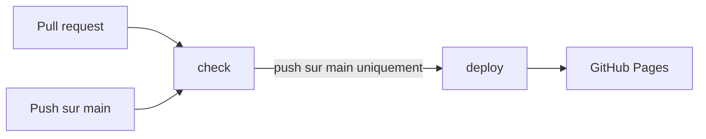
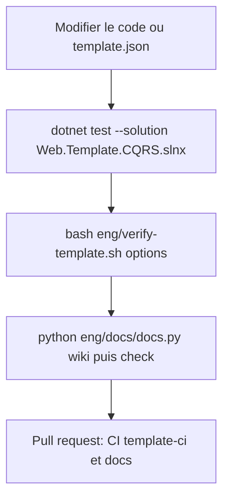

# Scripts et CI

Cette page décrit les scripts du dépôt, les workflows GitHub Actions et les pipelines Azure DevOps, puis ce qu'il faut savoir pour contribuer au template lui-même. Elle ne décrit que ce qui existe dans le dépôt.

Deux familles de fichiers cohabitent :

| Famille | Fichiers | Présents dans un projet généré ? |
|---------|----------|----------------------------------|
| Scripts d'usage | `scripts/get-token.ps1`, `scripts/get-token.sh` | oui, seulement avec `EnableAspire` |
| Outillage du dépôt | `eng/verify-template.sh`, `eng/azure-pipelines/*.yml`, `eng/docs/**`, `.github/workflows/*.yml`, `Directory.Build.props` | non |

## `get-token` : obtenir un jeton pour un persona local

Les deux scripts demandent à Keycloak un jeton d'accès pour un persona du realm local (flux *password*, client `template-cli`) et **n'écrivent que le jeton sur la sortie standard**, ce qui permet de l'utiliser directement dans une variable. Ils ne servent qu'au développement local : ils n'existent que dans les projets avec Aspire, et ne fonctionnent qu'avec le Keycloak de l'AppHost (voir [Keycloak en local](/Identité/Keycloak-en-local.md)).

### Paramètres

| Information | `scripts/get-token.ps1` | `scripts/get-token.sh` | Défaut |
|-------------|-------------------------|------------------------|--------|
| Persona (obligatoire) | `-Persona` | 1er argument | aucun |
| Mot de passe | `-Password` | 2e argument | `Passw0rd!` |
| URL de Keycloak | `-KeycloakUrl` | variable `KEYCLOAK_URL` | `https://localhost:8080` |
| Realm | `-Realm` | variable `KEYCLOAK_REALM` | `template` |
| Client | `-ClientId` | variable `KEYCLOAK_CLIENT_ID` | `template-cli` |

Le persona peut être un nom court ou une adresse : si la valeur ne contient pas `@`, le script ajoute `@local.test` (`admin` devient `admin@local.test`).

**Fichier :** `scripts/get-token.sh`

```bash
persona="${1:?Usage: scripts/get-token.sh <persona> [password]}"
password="${2:-Passw0rd!}"
keycloak_url="${KEYCLOAK_URL:-https://localhost:8080}"
realm="${KEYCLOAK_REALM:-template}"
client_id="${KEYCLOAK_CLIENT_ID:-template-cli}"
```

### Utilisation

**PowerShell**

```powershell
$token = ./scripts/get-token.ps1 -Persona admin
Invoke-RestMethod https://localhost:7246/me -Headers @{ Authorization = "Bearer $token" }
```

**Bash**

```bash
token="$(scripts/get-token.sh admin)"
curl -H "Authorization: Bearer $token" https://localhost:7246/me
```

### Codes de sortie

| Code | Situation |
|------|-----------|
| `0` | le jeton est affiché |
| `1` | Keycloak injoignable, identifiants refusés (le message d'erreur reprend la réponse de Keycloak, par exemple `invalid_grant`), ou réponse sans `access_token` |
| non nul | `get-token.sh` appelé sans persona : Bash affiche le message d'usage `Usage: scripts/get-token.sh <persona> [password]` |

Les messages d'erreur sont écrits sur la sortie d'erreur et commencent par `get-token:`. Le certificat de développement doit être approuvé (`dotnet dev-certs https --trust`), sinon l'appel HTTPS à Keycloak échoue. La version Bash exige `curl` et extrait le jeton avec `sed` ; la version PowerShell n'a pas d'autre dépendance.

## `eng/verify-template.sh` : générer, vérifier, compiler, tester

Le script génère un projet depuis le template avec des options données, vérifie qu'aucun fichier du dépôt n'a fuité, puis compile et teste le projet généré. C'est ce que la CI exécute pour chaque combinaison.

```bash
bash eng/verify-template.sh [AuthorizationModel] [EnableAspire] [EnableRateLimiting] [EnableTests]
```

| Position | Argument | Défaut |
|----------|----------|--------|
| 1 | `AuthorizationModel` (`Authenticated`, `AppRoles`, `Groups`, `AppRolesAndGroups`) | `AppRoles` |
| 2 | `EnableAspire` (`true` ou `false`) | `true` |
| 3 | `EnableRateLimiting` | `true` |
| 4 | `EnableTests` | `true` |

Exemple : `bash eng/verify-template.sh Groups true false true`.

Le script s'exécute avec Bash (Git Bash sous Windows, ou WSL). Ses étapes :

1. Il crée un dossier temporaire, supprimé en fin d'exécution quoi qu'il arrive.
2. Il installe le dépôt comme template (`dotnet new install <racine> --force`) et génère un projet nommé `Ci.Generated`. **Cette installation remplace le template déjà installé sur votre poste** par la version du dépôt.
3. Il contrôle le projet généré (liste ci-dessous) et s'arrête au premier écart avec un message `verify-template: ...`.
4. Il compile (`dotnet build Ci.Generated.slnx`) puis, si `EnableTests` vaut `true`, teste (`dotnet test --solution Ci.Generated.slnx`).
5. Il affiche `verify-template: OK (...)` en cas de succès.

Les contrôles du projet généré :

| Contrôle | Échec si |
|----------|----------|
| absence des fichiers d'outillage | un des éléments exclus est présent (liste ci-dessous) |
| `README.md` | absent, ne mentionne pas le nom du projet, ou contient `dotnet new install` (c'est alors le README du dépôt) |
| `TestResults`, `bin`, `obj` | un de ces dossiers est présent |
| nom source | `Web.Template.CQRS` subsiste dans un fichier `.cs`, `.csproj`, `.slnx` ou `.json` |
| `tests/` | présent alors que `EnableTests` vaut `false` |
| realm Keycloak | `Realms/template-realm.json` absent alors que `EnableAspire` vaut `true` |

**Fichier :** `eng/verify-template.sh`

```bash
for excluded in .idea .superpowers eng docs site Directory.Build.props .github/workflows/template-ci.yml .github/workflows/docs.yml mkdocs.yml README.generated.md .git .vs .cache .pytest_cache build src/Ci.Generated.AppHost/RealmVariants; do
  [ ! -e "$excluded" ] || fail "'$excluded' leaked into the generated project."
done
```

## Les workflows GitHub Actions

Ils se trouvent dans `.github/workflows/`. Aucun n'est copié dans un projet généré.

### `template-ci.yml`

Déclencheurs : `push` sur `main` et toute `pull_request`. Trois jobs indépendants :

| Job | Rôle |
|-----|------|
| `realm-json` | vérifie avec `python3 -m json.tool` que chaque fichier de `Realms/` et `RealmVariants/` est un JSON valide |
| `generate` | matrice de six combinaisons d'options ; chaque entrée exécute `eng/verify-template.sh` |
| `template-repository` | compile et teste les sources du dépôt (`dotnet test --solution Web.Template.CQRS.slnx`) |

**Fichier :** `.github/workflows/template-ci.yml`

```yaml
generate:
  runs-on: ubuntu-latest
  strategy:
    fail-fast: false
    matrix:
      include:
        - { auth: Authenticated, aspire: true, rateLimiting: true, tests: true }
        - { auth: AppRoles, aspire: true, rateLimiting: true, tests: true }
        - { auth: Groups, aspire: true, rateLimiting: false, tests: true }
        - { auth: AppRolesAndGroups, aspire: true, rateLimiting: true, tests: true }
        - { auth: AppRoles, aspire: false, rateLimiting: true, tests: true }
        - { auth: AppRoles, aspire: true, rateLimiting: true, tests: false }
  name: generate (${{ matrix.auth }}, aspire=${{ matrix.aspire }}, rl=${{ matrix.rateLimiting }}, tests=${{ matrix.tests }})
  steps:
    - uses: actions/checkout@v5
    - uses: actions/setup-dotnet@v5
      with:
        global-json-file: global.json
    - name: Generate, build and test
      run: bash eng/verify-template.sh ${{ matrix.auth }} ${{ matrix.aspire }} ${{ matrix.rateLimiting }} ${{ matrix.tests }}

```

Les six combinaisons couvrent les quatre modèles d'autorisation, une génération sans Aspire, une sans tests et une sans limitation de débit.

### `docs.yml`

Déclencheurs : `push` sur `main` et toute `pull_request`. Deux jobs :

| Job | Quand | Étapes |
|-----|-------|--------|
| `check` | toujours | installe Python 3.13 et les dépendances, lance `python -m pytest eng/docs/tests -q`, puis `python eng/docs/docs.py check` |
| `deploy` | seulement sur `push` vers `main`, après `check` | `python eng/docs/docs.py build`, puis publication du dossier `site` sur GitHub Pages |



**Activer GitHub Pages** : dans le dépôt GitHub, ouvrez *Settings*, puis *Pages*, et choisissez *Source* : **GitHub Actions**. Le job `deploy` s'exécute dans l'environnement `github-pages` et publie le site à l'adresse GitHub Pages du dépôt (exposée par l'action `deploy-pages` sous le nom `page_url`). La clé `site_url` de `mkdocs.yml` ne choisit pas cette adresse : elle sert aux liens canoniques et au plan du site, et doit donc correspondre à l'adresse GitHub Pages du dépôt. Tant que cette source n'est pas configurée, le job `deploy` ne peut pas publier le site.

## Les pipelines Azure DevOps

Ils se trouvent dans `eng/azure-pipelines/` et reproduisent les workflows GitHub.

| Fichier | Équivalent GitHub | Contenu |
|---------|-------------------|---------|
| `template-ci.yml` | `template-ci.yml` | jobs `realm_json`, `template_repository` et `generate` (matrice de six combinaisons) ; installe le SDK .NET depuis `global.json` |
| `docs-ci.yml` | job `check` de `docs.yml` | Python 3.13, dépendances, tests de l'outillage, `docs.py check` ; **pas de déploiement** |

Les deux se déclenchent sur `main` (`trigger`) et déclarent un déclencheur `pr`. Ils utilisent un agent `ubuntu-latest`.

### Créer le pipeline à partir d'un YAML existant

1. Dans Azure DevOps, ouvrez *Pipelines*, puis *New pipeline*.
2. Choisissez *Azure Repos Git* (ou GitHub selon l'hébergement) et sélectionnez le dépôt.
3. Choisissez *Existing Azure Pipelines YAML file*.
4. Sélectionnez la branche `main` et le chemin `/eng/azure-pipelines/template-ci.yml`, puis enregistrez.
5. Répétez avec `/eng/azure-pipelines/docs-ci.yml` pour le second pipeline.

### Valider les pull requests Azure Repos

Avec Azure Repos Git, le déclencheur `pr:` du YAML est ignoré : il ne s'applique qu'aux dépôts GitHub et Bitbucket. La validation des pull requests se configure par une **stratégie de branche** :

1. Ouvrez *Repos*, puis *Branches*, et le menu de la branche `main`, puis *Branch policies*.
2. Dans *Build validation*, ajoutez une stratégie, choisissez le pipeline créé ci-dessus, et laissez le déclenchement automatique.
3. Faites de même pour le pipeline de documentation.

Le pipeline `docs-ci.yml` ne publie rien : le wiki de code Azure DevOps suit `main` automatiquement (voir [Contribuer à la doc](/Référence/Contribuer-à-la-doc.md)).

## Développer le template lui-même

Cette section s'adresse à qui modifie le template (et non à qui l'utilise).

### Le dépôt compile la variante la plus complète

Le dépôt est à la fois une solution .NET et un template. Son code contient des directives (`#if (EnableAspire)`...) : pour qu'il compile et que ses tests passent, `Directory.Build.props` définit **tous les symboles** comme constantes de compilation. Le dépôt représente ainsi la variante avec toutes les options activées et les groupes, les rôles et les policies.

**Fichier :** `Directory.Build.props`

```xml
<Project>
  <!-- Template repository only (excluded from generated projects): compiles the most complete variant. -->
  <PropertyGroup>
    <DefineConstants>$(DefineConstants);EnableAspire;EnableRateLimiting;EnableTests;UseAppRoles;UseGroups;UseAuthorizationPolicies</DefineConstants>
  </PropertyGroup>
</Project>
```

Ce fichier n'existe que dans le dépôt (il est exclu de la génération). Dans un projet généré, il n'y a aucune directive : le SDK les a évaluées, et ces symboles n'ont plus d'objet. Pour compiler une autre variante, utilisez `eng/verify-template.sh`, pas `Directory.Build.props`.

### Ce qui est exclu de la génération

La liste exacte est le premier bloc `exclude` de `.template.config/template.json` (voir [Options du template](/Référence/Options-du-template.md)). En résumé :

| Exclu de la génération | Pourquoi |
|------------------------|----------|
| `docs/**`, `mkdocs.yml`, `.github/workflows/docs.yml` | documentation du template et son déploiement |
| `eng/**` | `verify-template.sh`, pipelines Azure DevOps, outillage de documentation |
| `.github/workflows/template-ci.yml` | CI du template |
| `Directory.Build.props` | définitions de symboles propres au dépôt |
| `README.md` (celui du dépôt) | présente le template |
| `.idea/**`, `.vs/**`, `.git/**`, `.cache/**`, `.pytest_cache/**`, `build/**`, `site/**`, `.superpowers/**`, `**/TestResults/**` | environnement et sorties |

À la place, `README.generated.md` est **renommé en `README.md`** : c'est le README du projet généré, rédigé avec des directives pour s'adapter aux options. Les vérifications de `verify-template.sh` ci-dessus (absence des éléments exclus, README du projet et non du template) sont la garantie de ces règles : si vous ajoutez un nouveau dossier réservé au dépôt, ajoutez-le à `exclude` dans `template.json` **et** à la liste de `eng/verify-template.sh`.

### Boucle de travail conseillée



1. Modifiez le code ; testez le dépôt tel quel : `dotnet test --solution Web.Template.CQRS.slnx`.
2. Vérifiez les variantes qui touchent à votre changement : `bash eng/verify-template.sh Groups true false true`.
3. Si le changement modifie un extrait inclus dans la documentation, régénérez et contrôlez : `python eng/docs/docs.py wiki` puis `python eng/docs/docs.py check` (voir [Contribuer à la doc](/Référence/Contribuer-à-la-doc.md)).
4. Ouvrez la pull request : `template-ci` et `docs` s'exécutent.
